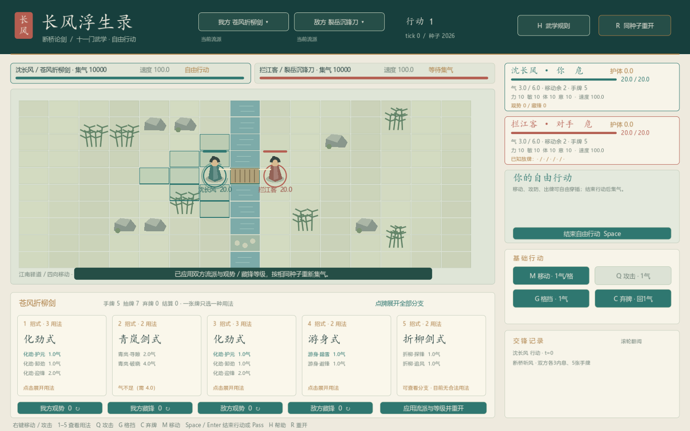

# 长风浮生录 · 游戏开发

本仓库收录《长风浮生录》的可运行原型、技术说明与验证资料。

## 当前 Demo：断桥听风

[打开 Demo 目录](demos/changfeng-battle) · [操作与规则](demos/changfeng-battle/README.md) · [战斗机制与框架详细说明](demos/changfeng-battle/docs/tingfeng-engine.md) · [验证记录](demos/changfeng-battle/reports/validation.md)

已迁入 [十套武学 V3](demos/changfeng-battle/docs/wuxue-v3-integration.md)：双方可独立选择听风五式或十门武学，新增20核心式、41种用法、7条连携及凝势／封气／灼痕。

Godot 4.x 的 2D 武侠战棋原型，采用 **CTB 集气、自由行动、五式多用法卡牌、有限 LIFO 连锁交锋**。玩家和敌人使用相同的资源、牌区、攻击与防御规则；AI 只负责选择合法行动。



### 启动

用 Godot 打开 `demos/changfeng-battle/project.godot` 并运行，或在 Windows 中双击该目录的 `run-demo.cmd`。启动脚本支持通过 `GODOT_BIN` 指定 Godot，也能查找 PATH 中的 `godot` / `godot4`。仓库不包含引擎安装包。

按 Enter 进入战场；点手牌选择招式分支，右键走位或攻击。Space 结束自由行动或交还响应权，R 重开，H 查看完整规则。

### 内容与验证

- 保留 15×10 断桥棋盘、河流与浅滩路径、角色和事件动画。
- 原五式加十门武学共25定义、53种用法；每个测试牌组仍为每人12张独立实例，支持迎锋、闪避、追击、截势和连携。
- 观势／藏锋等级、明牌和危险提示均按观察者权限展示。
- 当前通过805项目录／规则／AI／边界检查、143项真实UI检查；原12场默认对局，以及16组流派对局和2组重复运行均通过，明细见验证记录。

默认仍为听风五式，可在头部选择双方武学并应用重开。当前是每门固定测试配卡，尚未实现自由混搭构筑。旧五阶段存档、旧日志、编辑器缓存与Godot二进制留在原工作区。

## 目录

```text
game-dev/
  demos/changfeng-battle/
    project.godot               Godot 项目入口
    scripts/                    共用规则内核、AI 与界面
    data/                       听风五式定义
    checks/                     可复现的定向检查
    docs/                       架构、参考规格与界面截图
    reports/                    版本验证记录
```

完整游戏企划案保留在本地工作区。本 Demo 当前验证战斗机制；世界探索、养成与长期系统尚未接入。
