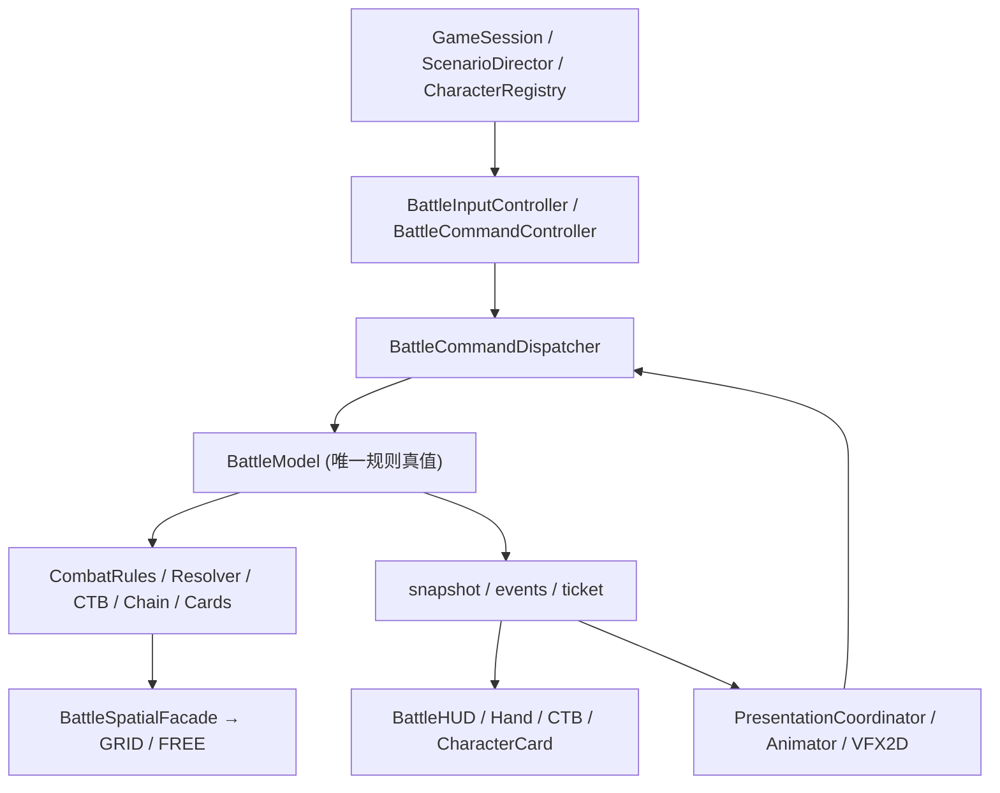

# 《长风浮生录》Demo 当前架构

> 单一正式入口：`opening.tscn` → `battle_hd2d.tscn`；基础版本 `main@8d1486b4`，重构工作在 `refactor/battle-architecture-consolidation`（Draft PR #67）。
> 实现状态以代码与 CI 为准；本文件区分已接入模块与仍在演进的边界。

## 运行结构

## 真值与提交顺序

- `BattleModel.request/validate/submit` 以 `battle_id`、`revision` 与类型检查拒绝过期、非法输入；`CombatResolver` 唯一提交资源与规则效果。
- `BattleCommandController.from_view` 禁止 AI 托管、非玩家、未结束演出时的人工输入；`BattleCommandDispatcher.dispatch` 对枚举动作严格匹配，对 FREE 连续坐标命令交给 `CombatRules` 原子验证。
- UI 的物理手牌列表来自 `snapshot.hand`，不会因合法目标暂时缺失而消失。出招/阶段派生资源、连携、装备武学、交锋 LIFO 与 CTB 仍由原领域模块处理。
- `PresentationCoordinator` 维护待播放 ticket 的唯一消费标记；正常结束和跳过都调用 `acknowledge_animation(ticket)`，不会重复触发伤害。Esc/重试和新战斗重置演出状态。
- AI 通过 `decision_context` 查询权限约束下的候选动作；表现层不能推断敌方隐藏手牌。

## 2D 场景

正式 `battle_hd2d.tscn` 已是 `Node2D` 根与 `Camera2D`；`illustrated_battle_map.gd` 的 CanvasLayer 将插画、格子调试层、脚点演员共享在同一 Node2D 世界；`battle_vfx_2d.gd` 消费语义事件；`hd2d_animation.gd` 播放 6×4 动作图集。相机震动通过绘制世界偏移，鼠标坐标由 `to_battle_point` 校正。表现层只改 Sprite/VFX，不直接改 HP、Qi、CTB 和牌区。

## GRID / FREE 的真实约束

- `GRID`：保留 15×10 正交格、原移动预算与 Manhattan 基本攻击距离。
- `FREE`：连续 `Vector2`、圆形碰撞、真实路径长度、自动接近攻击与自由身法落点。
- `BattleSpatialFacade` 统一回答 `can_land / safe_landing / find_path / path_cost / can_attack / find_attack_approach / forced_move_preview`。当前 `CombatRules` 的基础攻击、FREE 攻击用法与自动接近走 facade；`BattleModel.preview_free_path` 也使用它。部分旧校验仍直接调用 `BattleSpatialService`，属于后续收敛点。
- FREE 底层仍是 `MapBake` 的障碍 mask 与 `AStar2D` 动态可见性图和路径平滑，**不是** `NavigationPolygon` 独立导航网格。重构不修改寻路算法。
- `forced_move_preview` 仅返回几何建议；真实强制位移仍需经 CombatResolver 授权。GRID/FREE 切换失败不能产生资源与 revision 的副作用。

## 保留入口、资产与已知限制

- 玩家入口唯一 `battle_hd2d.tscn`；`battle.tscn` / `party_battle.tscn` 作为历史规则视图保留，不触发删除。
- `hd2d_vfx.gd`、`hd2d_scenery.gd` 是历史兼容实现，不再是正式演出依赖。
- 美术素材既有 Kenney CC0，也有用户上传原画和生成的概念稿；用途/授权分开记录，未确认原创素材的许可证不能宣称 CC0。
- 完整四方向逐帧图集、姿态条、动作型绝招、交锋慢镜头和音效编排不是这轮重构已完成的功能，属于结构稳定后的新增玩法；旧 6×4 图仅提供动作类别与水平镜像。
- 目前仍有 UI 创建/AI 更新时间循环留在 `hd2d_battle.gd` 中；R2–R5 优先提取重要行为边界，后续可以继续迁移纯视图而不改规则。

## 验证

GitHub Actions `Original Wuxia HUD regression` 对 PR 的正式场景、FREE/GRID 切换、旧战斗、武学与剧情执行 Godot 4.7.2 headless 回归。Windows 使用 `checks/verify.ps1 -Stage Refactor` 和 `-Stage All`。当前执行结果见 [路线图](REFACTOR_ROADMAP.md)；实际截图与人工操作不能由规则测试替代。

[历史场景约束](LEGACY_COMPAT.md) · [美术/路径审计](REFACTOR_ASSET_AUDIT.md) · [路线图](REFACTOR_ROADMAP.md)
