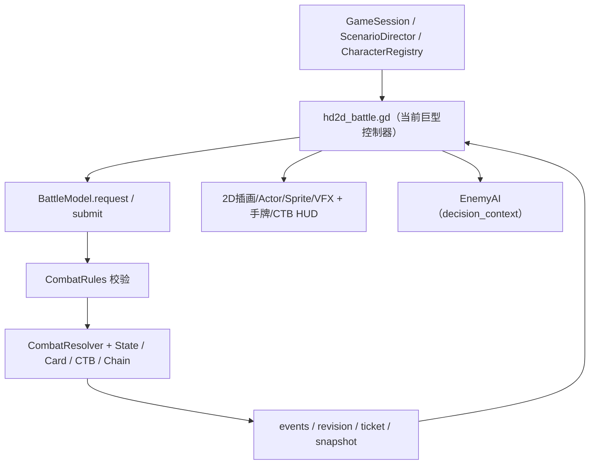

# 《长风浮生录》Demo 技术架构（当前基线）

> 状态：R1 源码架构契约。基线 `main@8d1486b4b27dd06aaae78739ca13740a5169074d`（含 PR #65）。
> 本文区分**现有实现**和**计划重构**，不能把未完成的目标写成已上线能力。

## 1. 唯一正式入口

- Godot 项目：`demos/changfeng-battle/project.godot`，运行入口 `opening.tscn`，Autoload：`GameSession`。
- 唯一正式战斗场景：`battle_hd2d.tscn`。主菜单直达与序章追兵均使用它；前者主要做 1v1 验证，剧情支持多人遭遇。
- `battle.tscn` 和 `party_battle.tscn` 是 **DEPRECATED / 规则或旧视图回归入口**，不可继续扩展为第二套正式战斗 UI，也不可未经迁移直接删除。
- `demo_result.tscn` 是结果页；剧情重试由 `GameSession` 协调返回正式场景。

## 2. 实际数据流

**唯一权威真值：`BattleModel` 与它拥有的 `BattleState`。** 所有 UI、AI、剧情控制器只能提交版本化命令或读取只读投影；画面物理碰撞不得直接扣血、移动牌区或结算卡牌。

## 3. 模块所有权

| 模块 | 当前文件 | 权责 |
| --- | --- | --- |
| 战斗入口与事务 | `battle_model.gd` | `reset/request/validate/submit/acknowledge_animation/legal_actions/snapshot/decision_context` |
| 战斗状态 | `battle_state.gd`、`combatant_state.gd` | 角色位置、队伍、生命/内息、阶段、牌区引用、请求版本、动画票据 |
| 校验与执行 | `combat_rules.gd`、`combat_resolver.gd`、`cost_resolver.gd` | 时机/费用/合法性检查、唯一结果执行、伤害/移动/状态事件 |
| 行动调度与交锋 | `turn_manager.gd`、`reaction_controller.gd`、`combo_resolver.gd` | CTB、同一 ACTION 连携、有限 LIFO 响应 |
| 武学、卡牌与状态 | `card_system.gd`、`school_catalog.gd`、`technique_runtime.gd`、`ability_system.gd`、`status_system.gd` | 定义校验、派生卡/阶段能力、武学切换、状态生命周期 |
| 信息权限与 AI | `visibility_system.gd`、`enemy_ai.gd` | 观察者投影、合法策略，不读取未知对手牌 |
| 空间 | `map_bake.gd`、`battle_spatial_service.gd`、`battle_spatial_waypoint.gd` | GRID/FREE 路径、连续位置/碰撞、预算、距离/LOS、自动接近 |
| 应用/剧情/人物 | `game_session.gd`、`scenario_director.gd`、`character_registry.gd`、`opening_flow.gd` | 会话、剧情路由、遭遇数据、人物绑定 |
| 正式显示 | `hd2d_battle.gd`、`illustrated_battle_map.gd`、`hd2d_animation.gd`、`hd2d_vfx.gd` 等 | 玩家输入、2D地图、演员、动画、特效、HUD，目前耦合较深 |

## 4. 空间模式约束

- **GRID**：保留 15×10 原规则、格子移动与攻击距离、旧测试。
- **FREE**：连续 `Vector2` 脚点、角色圆形碰撞、实际路径长度预算、连续攻击距离/LOS、自动接近、卡牌自由步法。
- 当前 FREE **不是独立 NavigationPolygon 路网**：遇障碍仍依赖 `MapBake` 的15×10遮挡数据和 `AStarGrid2D` 绕障，再进行线段可见性平滑。重构先抽象接口，不偷偷改变地形算法。
- `SET_SPATIAL_MODE` 是权威版本化请求；不消耗行动资源，且拒绝不能安全回格的 FREE→GRID 请求。
- PR #65 已修正角色朝向、拥挤情况下的 FREE 寻路/靠近与第一幕空白背景。重构必须将其作为新回归基线。

## 5. 卡牌、时间和派生的不变量

1. CTB 只负责行动权，`ACTION` 和 `CLASH` 停表；动画时间不得触发额外内息恢复。
2. `Combo` 是同角色本次 ACTION 的主动攻击链；`Chain` 是一次根攻击双方的交替响应，仍有原最大深度与 LIFO 规则。
3. “探锋·试探”产生真正的“追风”衍生牌；“变锋”是额外阶段能力，不能被错误地当成手牌。
4. 手牌显示来自 `snapshot(observer_id).hand`；`legal_actions()` 只控制可用状态，不能用它过滤已抽到但暂时射程不足的攻击牌。
5. 多套武学属于 `learned_schools`；`school_id` 是当前装备的一套。切换受合法时机限制，消耗行动，不能混用旧衍生卡。
6. `submit` 拒绝时不得修改资源、牌区、位置或 revision。已承诺的动作不因演出失败而二次扣费。
7. 每个版本化动画 ticket 只确认一次；跳过/取消演出不得重复结算结果。

## 6. 当前表现层债务（尚未重构）

- `hd2d_battle.gd` 同时承担世界创建、UI、输入、AI 调度、路径跟随、动画票据和状态展示；后续将逐项抽出。
- `battle_hd2d.tscn` 根仍是 `Node3D`；可见战场却由 `illustrated_battle_map.gd` 使用 `CanvasLayer` 与 `Sprite2D` 绘制。`_build_world()` 在创建 2D 地图后直接返回，后续保留不可达的旧 3D 地形构造代码。
- `hd2d_vfx.gd` 同时兼容 2D 和 3D 特效；`hd2d_animation.gd`、`hd2d_battle.gd` 均参与演出时序。应逐步收敛到单一 2D 表现控制器。
- `battle_view.gd`、`party_battle_view.gd` 仍用于历史测试；不要简单删除。
- 最终目标：应用层 / 战斗控制层 / 规则领域层 / 空间层 / 表现与 UI 层。**当前目录结构不是已完成的目标分层。**

## 7. 安全修改原则

- 优先“提取职责而不改行为”；原公开 API、事件名、场景入口和测试保持兼容。
- 首轮不得同时修改伤害公式、费用、武学牌组、CTB、AI 情报权限与 UI 重构。
- 移动 `res://` 文件时先列出所有 `preload` / scene / test 依赖；一次只迁移一小组。
- 每次提交保留可复现 seed、headless 规则检查和真实图形集成检查。
- **架构文档的已验证含义仅为源码核查**，如无 Godot 实机运行，不写“测试已通过”。

相关背景：[PR #62](https://github.com/yup-21/game-dev/pull/62) · [PR #65](https://github.com/yup-21/game-dev/pull/65) · [历史场景状态](battle-entry-status.md) · [迁移计划](REFACTOR_ROADMAP.md)。
