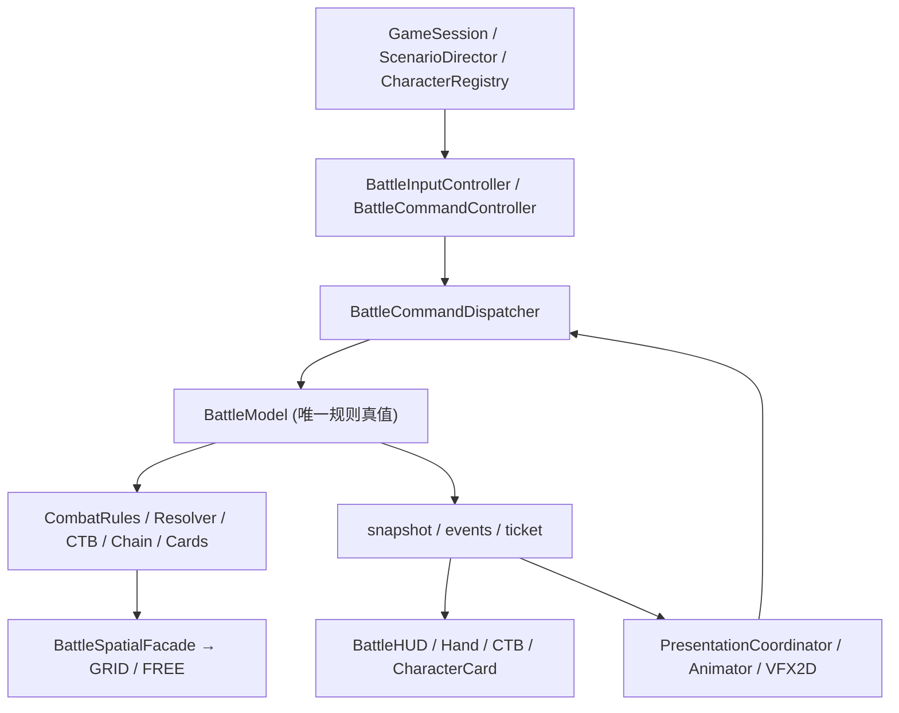
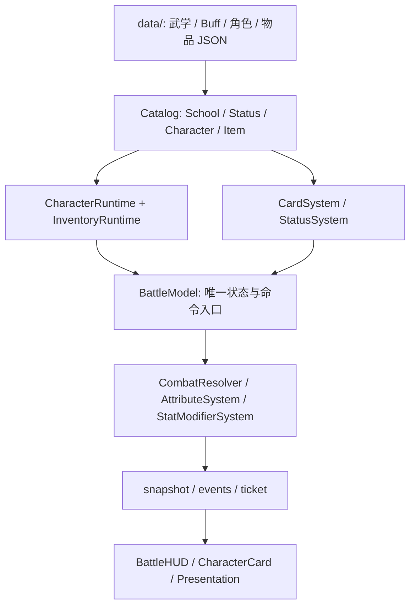

# 《长风浮生录》Demo 当前架构

> 单一正式入口：`opening.tscn` → `battle_hd2d.tscn`；基础版本 `main@8d1486b4`，重构工作在 `refactor/battle-architecture-consolidation`（Draft PR #67）。
> 实现状态以代码与 CI 为准；本文件区分已接入模块与仍在演进的边界。

> **R28 现状（2026-10-31）**：正式内容入口已经切换为 `data/content_manifest.tres` 中的 Godot 原生 Resource；原有复杂目录存于 `data/native/documents/*.tres`。下文 R11–R15 的 JSON 索引图是当时阶段的设计记录，**不是现在的生产配置流程**。新内容制作请看 [原生 Resource 指南](../../../docs/changfeng-native-authoring.md)。

## 运行结构

## 真值与提交顺序

- `BattleModel.request/validate/submit` 以 `battle_id`、`revision` 与类型检查拒绝过期、非法输入；`CombatResolver` 唯一提交资源与规则效果。
- `BattleCommandController.from_view` 禁止 AI 托管、非玩家、未结束演出时的人工输入；`BattleCommandDispatcher.dispatch` 对枚举动作严格匹配，对 FREE 连续坐标命令交给 `CombatRules` 原子验证。
- UI 的物理手牌列表来自 `snapshot.hand`，不会因合法目标暂时缺失而消失。出招/阶段派生资源、连携、装备武学、交锋 LIFO 与 CTB 仍由原领域模块处理。
- `PresentationCoordinator` 维护待播放 ticket 的唯一消费标记；正常结束和跳过都调用 `acknowledge_animation(ticket)`，不会重复触发伤害。Esc/重试和新战斗重置演出状态。
- AI 通过 `decision_context` 查询权限约束下的候选动作；表现层不能推断敌方隐藏手牌。

## 2D 场景

正式 `battle_hd2d.tscn` 已是 `Node2D` 根与 `Camera2D`；`illustrated_battle_map.gd` 的 CanvasLayer 将插画、格子调试层、脚点演员共享在同一 Node2D 世界；`battle_vfx_2d.gd` 消费语义事件；`hd2d_animation.gd` 播放 6×4 动作图集。相机震动通过绘制世界偏移，鼠标坐标由 `to_battle_point` 校正。表现层只改 Sprite/VFX，不直接改 HP、Qi、CTB 和牌区。

## GRID / FREE 的真实约束

- `GRID`：保留 15×10 正交格、原移动预算与 Manhattan 基本攻击距离。
- `FREE`：连续 `Vector2`、圆形碰撞、真实路径长度、自动接近攻击与自由身法落点。
- `BattleSpatialFacade` 统一回答 `can_land / safe_landing / find_path / path_cost / can_attack / find_attack_approach / forced_move_preview`。当前 `CombatRules` 的基础攻击、FREE 攻击用法与自动接近走 facade；`BattleModel.preview_free_path` 也使用它。部分旧校验仍直接调用 `BattleSpatialService`，属于后续收敛点。
- FREE 底层仍是 `MapBake` 的障碍 mask 与 `AStar2D` 动态可见性图和路径平滑，**不是** `NavigationPolygon` 独立导航网格。重构不修改寻路算法。
- `forced_move_preview` 仅返回几何建议；真实强制位移仍需经 CombatResolver 授权。GRID/FREE 切换失败不能产生资源与 revision 的副作用。

## 保留入口、资产与已知限制

- 玩家入口唯一 `battle_hd2d.tscn`；`battle.tscn` / `party_battle.tscn` 作为历史规则视图保留，不触发删除。
- 无任何运行时或测试引用的旧 `hd2d_party_bridge.gd`、`hd2d_vfx.gd`、`hd2d_scenery.gd` 已清理；正式 UI 使用 `hd2d_battle.gd` 与 `battle_vfx_2d.gd`。
- 美术素材既有 Kenney CC0，也有用户上传原画和生成的概念稿；用途/授权分开记录，未确认原创素材的许可证不能宣称 CC0。
- 完整四方向逐帧图集、姿态条、动作型绝招、交锋慢镜头和音效编排不是这轮重构已完成的功能，属于结构稳定后的新增玩法；旧 6×4 图仅提供动作类别与水平镜像。
- 目前仍有 UI 创建/AI 更新时间循环留在 `hd2d_battle.gd` 中；R2–R5 优先提取重要行为边界，后续可以继续迁移纯视图而不改规则。

## 验证

GitHub Actions `Original Wuxia HUD regression` 对 PR 的正式场景、FREE/GRID 切换、旧战斗、武学与剧情执行 Godot 4.7.2 headless 回归。Windows 使用 `checks/verify.ps1 -Stage Refactor` 和 `-Stage All`。当前执行结果见 [路线图](REFACTOR_ROADMAP.md)；实际截图与人工操作不能由规则测试替代。

[历史场景约束](LEGACY_COMPAT.md) · [美术/路径审计](REFACTOR_ASSET_AUDIT.md) · [路线图](REFACTOR_ROADMAP.md)

## R8–R10 组件演进

R8：`BattleWorld2D` 持有插画战场与视觉移动，`BattleHUDView` 持有手牌/状态投影，`BattlePresentationPlayer` 持有 Sprite2D 动画、VFX 和单次 ticket。旧场景接口保持向后兼容。

R9：SPACE 统一通过 `BattleSpatialFacade` 完成 FREE 落点、自动接近复核、强制轴向位移及 GRID 远程 LOS；AI 路径入口与同状态预览缓存也复用 facade。底层 FREE 为 `AStar2D` 可见性图。

R10：新增 `BattleActionTimeline` 和 `data/action_timelines.json`，描述 startup/active/recovery、cancel/reaction/visual-invulnerable 窗口及 cue。**全部属于表现时序元数据**；目前仍由 BattleModel 先结算规则，再由 Presentation 消费语义事件。想实现真正的实时闪避/i-frame 必须扩展权威协议，不能直接让动画驱动修改状态。

## R11–R15 内容扩展架构

重构遵守「**静态定义 → 独立运行时 → 战斗规则结算 → 只读视图**」的单向边界。新增武学、Buff、角色和物品通常只增加 `data/` 内索引及定义文件，不应更改 `BattleModel` 的分支逻辑。

| 扩展域 | 定义与运行时边界 | 对战斗的接入方式 |
| --- | --- | --- |
| 武学与卡牌（R11） | `SchoolCatalog` 读取武学索引及招式/连携定义；`ComboResolver` 按可配置触发次数计算 | `CardSystem` 接管招式牌、状态引用及武学规则，保持原出牌命令校验 |
| 角色（R12） | `CharacterRegistry` 按稳定 `character_id` 查档，兼容独立 `battle_actor_id`；美术通过 `HD2DArtCatalog` 查找 | 创建战斗时构造 `battle_options`，HUD 不再假设角色 ID 必等于演员序号 |
| Buff 与属性（R13） | `StatusCatalog` 独立声明 Buff；`StatModifierSystem` 对基础属性叠加来源确定的 flat/percent_bp 修正 | `StatusSystem` 负责层数、期限、来源同步，`AttributeSystem` 基于 `base_attributes` 重算，防止增益反复滚存 |
| 物品与装备（R14） | `ItemCatalog` 管定义，`InventoryRuntime` 管唯一实例、可堆叠数量及装备槽，`CharacterRuntime` 管角色成长与持有状态 | 角色战斗构筑 `battle_build` 引入装备属性，战斗属性只由权威状态持有 |
| 合同与回归（R15） | 模块化 Godot Actions 验证逐域测试及跨域使用场景 | 与原 HUD/剧情/战斗回归独立运行，避免新内容破坏老存量行为 |

### 对外扩展契约

1. **索引驱动**：新增卡牌、武学、Buff、物品时先登记各自索引；目录扫描或全局硬编码枚举不是正式注册协议。添加角色时使用角色定义和稳定 ID。
2. **身份分离**：`character_id` 是剧情/档案/美术身份，`battle_actor_id` 是单场对战索引，装备实例另有 UID；不能用数组位置互相替代。
3. **属性来源可追溯**：角色基础值、成长、装备、Buff 各自携带来源；移除 Buff 或卸下装备后重新派生属性，不逆向猜测原始数值。
4. **规则单一写入方**：`Catalog` 只给定义、`InventoryRuntime` 只做物品持有操作。消耗品目前仅产出效果意图，**尚未**将 `USE_ITEM` 命令接入 `BattleCommandDispatcher` 和 `CombatResolver`，不能声称实战中可直接饮药。
5. **兼容性门槛**：任一新增内容既要通过模块契约测试，也要保证既有 CTB、连携、FREE/GRID、绘制及旧武学测试不回退。下一阶段若扩展装备随机词条或存档迁移，应另设 schema/version 合同。

扩展步骤与 JSON 示例见 [模块化内容扩展指南](MODULAR_CONTENT_GUIDE.md)，详尽阶段完成情况见 [重构路线图](REFACTOR_ROADMAP.md)。
