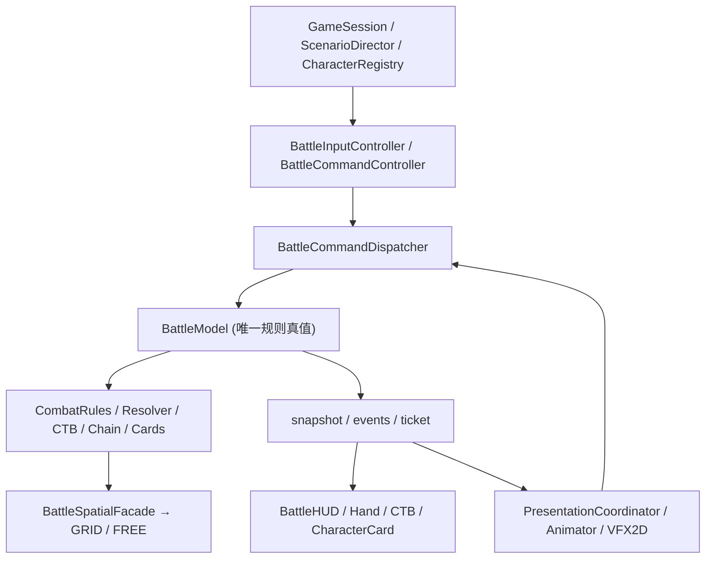
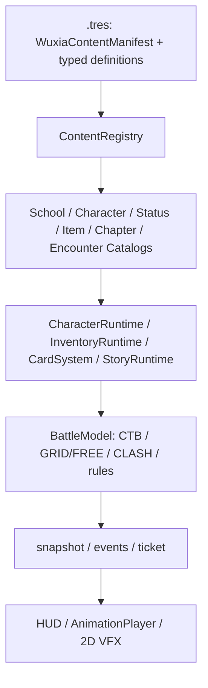

# 《长风浮生录》Demo 当前架构

> 当前正式入口：`opening.tscn` → `battle_hd2d.tscn`；R1–R41 已经经由 PR #67–#70 合入 `main`。
> 实现状态以代码与 CI 为准；本文件区分已接入模块与仍在演进的边界。

> **R41 内容注册基础（2026-11-01）**：所有正式**内容定义**只从 `data/content_manifest.tres` 加载，包含武学、角色、装备、技法、章节、遭遇、GRID/FREE 地图和动作时间轴；表现层可使用原生 `.tscn`，动画可使用 `SpriteFrames.tres`。仓库中的历史 `data/**/*.json`、旧武学 ID 映射 Resource、解析器及旧格式对照测试均已移除。R11–R15 中的 JSON 索引描述仅是历史记录。跨领域编辑权以 [Godot 原生内容开发规范 V2](../../../docs/GODOT_NATIVE_AUTHORING_STANDARD.md) 为准；具体操作参阅 [原生内容制作指南](../../../docs/changfeng-native-authoring.md)。

## 运行结构

## 真值与提交顺序

- `BattleModel.request/validate/submit` 以 `battle_id`、`revision` 与类型检查拒绝过期、非法输入；`CombatResolver` 唯一提交资源与规则效果。
- `BattleCommandController.from_view` 禁止 AI 托管、非玩家、未结束演出时的人工输入；`BattleCommandDispatcher.dispatch` 对枚举动作严格匹配，对 FREE 连续坐标命令交给 `CombatRules` 原子验证。
- UI 的物理手牌列表来自 `snapshot.hand`，不会因合法目标暂时缺失而消失。出招/阶段派生资源、连携、装备武学、交锋 LIFO 与 CTB 仍由原领域模块处理。
- `PresentationCoordinator` 维护待播放 ticket 的唯一消费标记；正常结束和跳过都调用 `acknowledge_animation(ticket)`，不会重复触发伤害。Esc/重试和新战斗重置演出状态。
- AI 通过 `decision_context` 查询权限约束下的候选动作；表现层不能推断敌方隐藏手牌。

## 2D 场景

正式 `battle_hd2d.tscn` 已是 `Node2D` 根与 `Camera2D`；`illustrated_battle_map.gd` 的 CanvasLayer 将插画、格子调试层、脚点演员共享在同一 Node2D 世界；`battle_vfx_2d.gd` 消费语义事件；`hd2d_animation.gd` 播放 6×4 动作图集。相机震动通过绘制世界偏移，鼠标坐标由 `to_battle_point` 校正。表现层只改 Sprite/VFX，不直接改 HP、Qi、CTB 和牌区。

## GRID / FREE 的真实约束

- `GRID`：保留 15×10 正交格、原移动预算与 Manhattan 基本攻击距离。
- `FREE`：连续 `Vector2`、圆形碰撞、真实路径长度、自动接近攻击与自由身法落点。
- `BattleSpatialFacade` 统一回答 `can_land / safe_landing / find_path / path_cost / can_attack / find_attack_approach / forced_move_preview`。当前 `CombatRules` 的基础攻击、FREE 攻击用法与自动接近走 facade；`BattleModel.preview_free_path` 也使用它。部分旧校验仍直接调用 `BattleSpatialService`，属于后续收敛点。
- FREE 底层采用 `MapBake` 的障碍 mask 与单一 `AStar2D` 动态可见性图和路径平滑，**不是** `NavigationPolygon` 独立导航网格；PR57 的第二份 waypoint 算法实现和转发 API 已在 R40 删除。
- `forced_move_preview` 仅返回几何建议；真实强制位移仍需经 CombatResolver 授权。GRID/FREE 切换失败不能产生资源与 revision 的副作用。

## 保留入口、资产与已知限制

- 玩家入口唯一 `battle_hd2d.tscn`；旧双人/多人 View 和场景已删除，规则测试转到正式场景与 `BattleModel`。
- 无任何运行时或测试引用的旧 `hd2d_party_bridge.gd`、`hd2d_vfx.gd`、`hd2d_scenery.gd` 已清理；正式 UI 使用 `hd2d_battle.gd` 与 `battle_vfx_2d.gd`。
- 美术素材既有 Kenney CC0，也有用户上传原画和生成的概念稿；用途/授权分开记录，未确认原创素材的许可证不能宣称 CC0。
- 完整四方向逐帧图集、姿态条、动作型绝招、交锋慢镜头和音效编排不是这轮重构已完成的功能，属于结构稳定后的新增玩法；旧 6×4 图仅提供动作类别与水平镜像。
- 目前仍有 UI 创建/AI 更新时间循环留在 `hd2d_battle.gd` 中；R2–R5 优先提取重要行为边界，后续可以继续迁移纯视图而不改规则。

## 验证

GitHub Actions `Original Wuxia HUD regression` 对 PR 的正式场景、FREE/GRID 切换、旧战斗、武学与剧情执行 Godot 4.7.2 headless 回归。Windows 使用 `checks/verify.ps1 -Stage Refactor` 和 `-Stage All`。当前执行结果见 [路线图](REFACTOR_ROADMAP.md)；实际截图与人工操作不能由规则测试替代。

[历史场景约束](LEGACY_COMPAT.md) · [美术/路径审计](REFACTOR_ASSET_AUDIT.md) · [路线图](REFACTOR_ROADMAP.md)

## R8–R10 组件演进

R8：`BattleWorld2D` 持有插画战场与视觉移动，`BattleHUDView` 持有手牌/状态投影，`BattlePresentationPlayer` 持有 Sprite2D 动画、VFX 和单次 ticket。不再维护旧场景接口；正式战斗命令合同保持不变。

R9：SPACE 统一通过 `BattleSpatialFacade` 完成 FREE 落点、自动接近复核、强制轴向位移及 GRID 远程 LOS；AI 路径入口与同状态预览缓存也复用 facade。底层 FREE 为 `AStar2D` 可见性图。

R10（历史阶段）：引入 `BattleActionTimeline`，现使用 `data/native/action_timelines/r32_default.tres`，描述 startup/active/recovery、cancel/reaction/visual-invulnerable 窗口及 cue。**全部属于表现时序元数据**；目前仍由 BattleModel 先结算规则，再由 Presentation 消费语义事件。想实现真正的实时闪避/i-frame 必须扩展权威协议，不能直接让动画驱动修改状态。

## 当前模块化内容架构

`ContentRegistry` 加载 `res://data/content_manifest.tres` 中显式引用的 `WuxiaContentManifest`，再由各领域 Catalog 校验并生成运行态所需的数据副本。新增内容通过强类型 `.tres` 注册，不做全目录 JSON 扫描，也不在 `BattleModel`、`CombatResolver` 或 HUD 中增加按角色/门派名判断的特殊分支。

| 领域 | 内容类型 | 运行时所有者 |
| --- | --- | --- |
| 角色与初始装备 | `WuxiaCharacterDefinition`、`WuxiaStartingItemDefinition` | `CharacterRegistry` / `CharacterFactory` |
| 武学与招式 | `WuxiaSchoolDefinition`、`WuxiaSkillDefinition`、`WuxiaTechniqueDefinition` | `SchoolCatalog` / `CardSystem` / `TechniqueRuntime` |
| Buff / 词条 | `WuxiaBuffDefinition`、`WuxiaAffixDefinition` | `StatusSystem` / `StatModifierSystem` |
| 装备 / 消耗品 | `WuxiaItemDefinition` | `InventoryRuntime` / `CombatResolver` |
| 剧情、章节、遭遇 | `WuxiaStoryDefinition`、`WuxiaChapterDefinition`、`WuxiaEncounterDefinition` | `OpeningStory` / `ChapterCatalog` / `ScenarioDirector` |
| GRID/FREE 地图 | `WuxiaGridMapDefinition`、`WuxiaMapDefinition` | `MapBake` / `BattleSpatialService` |

扩展约束：`character_id` 与每场 actor ID 分离；`Item UID` 与定义 ID 分离；基础属性、成长、装备和 Buff 来源均独立可追溯；所有战斗状态只由 `BattleModel` 提交。消耗品 `USE_ITEM` 已由权威命令验证和结算，不在视图中扣除物品。

**唯一制作说明**：[Godot 原生内容制作指南](../../../docs/changfeng-native-authoring.md)。历史 R11–R15 设计讨论留在 [重构路线图](REFACTOR_ROADMAP.md)，不再作为当前内容注册协议。
