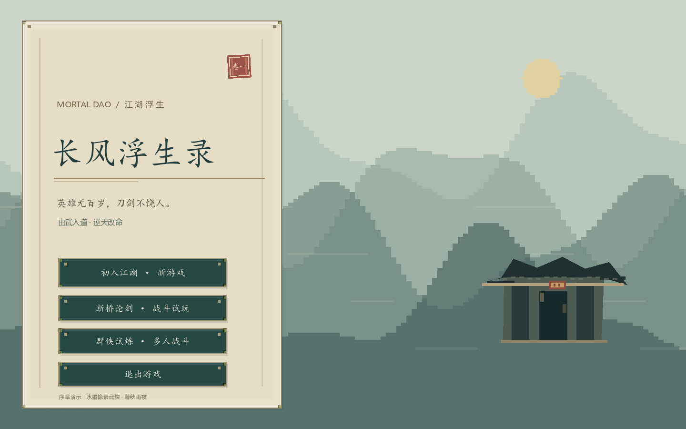
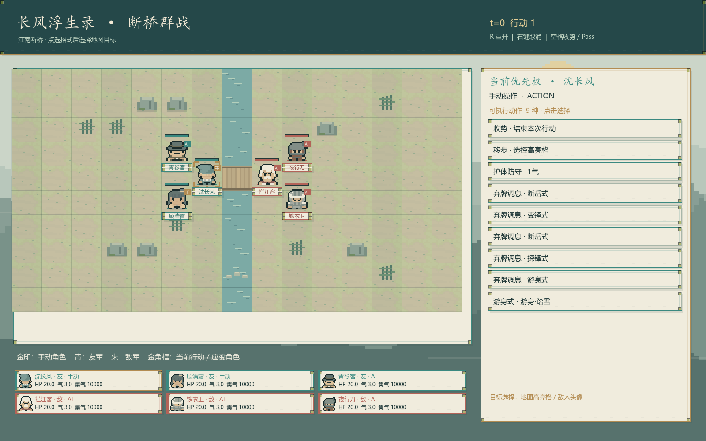

# 免费素材与水墨像素画面

当前版本以水墨像素风武侠为方向：世界与人物使用最近邻像素绘制，界面保留清晰的中文文字、纸色留白、墨青边框和朱红敌我标记。

## 已接入项目

采用 Pixel-boy / AAA 的 [Ninja Adventure](https://pixel-boy.itch.io/ninja-adventure-asset-pack)。作者页面及下载包内 LICENSE 均为 **CC0 1.0**，允许商用、修改和随项目分发，无强制署名。项目仍保留来源与许可。

| 使用位置 | 本地资源 | 原始素材 |
| --- | --- | --- |
| 沈长风 | `assets/ninja_adventure/characters/changfeng.png` | ManGreen |
| 拦江客及老镖头 | `characters/interceptor.png` | Master |
| 顾清霜 | `characters/qingshuang.png` | Princess |
| 青衫客 | `characters/scholar.png` | Noble |
| 铁衣卫、黑衣敌人 | `characters/guard.png`、`characters/assassin.png` | NinjaGray、NinjaDark |
| 对话头像 | `portraits/` | 对应角色 Faceset |
| 地面纹理与边框 | `environment/`、`ui/panel.png` | 作者的 Godot 4 示例项目 |

角色图集为 64×112，每格 16×16：四列表示朝向，七行表示动作。行走使用四帧；原图的攻击只有单姿态，挥剑、剑气、墨点、护御和闪避由表现层随真实战斗事件绘制。人物按角色选择不同图集，运行时映射青、墨、朱色；模型随机数和战斗规则不参与美术采样。

完整包仅用于选材，仓库保存实际使用的精简 PNG。逐文件上游路径、原包 SHA256、文件 SHA256 和修改说明见 [`manifest.json`](../assets/ninja_adventure/manifest.json)，许可原文见 [`LICENSE.txt`](../assets/ninja_adventure/LICENSE.txt)。地面纹理和 UI 来源固定到作者[示例仓库](https://github.com/pixel-boy/NinjaAdventure)提交 `6ac78232d5aedcc85ce5f27d060ea92366f7c24a`。

## 可继续使用的免费资源

| 类型 | 官方资源 | 授权与适配 |
| --- | --- | --- |
| 像素人物、地图、UI、动作 | [Ninja Adventure](https://pixel-boy.itch.io/ninja-adventure-asset-pack) | CC0；本轮已实际接入。原包是东方忍者题材，主角专属汉服与兵器可继续在这些原型上改绘。 |
| 按钮、面板、UI 元件 | [Kenney UI Pack – Adventure](https://kenney.nl/assets/ui-pack-adventure) | CC0；可修改并随项目分发，接入时统一纸色和墨青配色。 |
| 烟尘、火花、剑气贴图 | [Kenney Particle Pack](https://kenney.nl/assets/particle-pack) | CC0；512×512 粒子贴图用于像素风时应降低采样分辨率，避免与角色清晰度脱节。 |
| 武器、招式图标 | [Katana](https://game-icons.net/1x1/delapouite/katana.html)、[Sword brandish](https://game-icons.net/1x1/delapouite/sword-brandish.html) | Delapouite，CC BY 3.0；须附作者、来源、许可链接并注明修改。当前未入库。 |
| 纸面材质 | [ambientCG Paper001](https://ambientcg.com/view?id=Paper001) | [CC0](https://docs.ambientcg.com/license/)；2D 界面只需颜色贴图，无需整套 PBR。当前纸面采用程序绘制。 |
| 3D 人物、动作 | [Quaternius Universal Animation Library](https://quaternius.itch.io/universal-animation-library) | 免费 Standard 下载包中的 License.txt/README 明确为 CC0；其他包逐包核对实际许可。当前项目为 2D，3D 动作需绑定并离线渲染成精灵。 |
| 3D 人物与动作 | [Mixamo](https://www.mixamo.com/)、[Adobe 官方 FAQ](https://helpx.adobe.com/creative-cloud/faq/mixamo-faq.html) | 免费 Adobe ID；可用于商业游戏，原始人物和动作有再分发限制，不能直接放进公开素材目录。当前未使用。 |

CC0 和 CC BY 的素材均可商用；署名义务不同。以上只把已核实的 Ninja Adventure 文件加入项目。

## 画面验证

在 `demos/changfeng-battle` 目录使用本地 Godot 4.7：

```powershell
godot --path . -- --opening-visual-check
godot --path . res://battle.tscn -- --ink-visual-check
godot --path . --script res://checks/ink_pixel_visual_check.gd
godot --path . --script res://checks/demo_result_visual_check.gd
```

表现层集中在 `scripts/ink_pixel_art.gd`，单挑与 3v3 均调用同一组人物、地形、边框和特效接口。移动格、按钮点击范围与规则状态维持原有契约。

首次从源码运行前需要导入 PNG。用 Godot 编辑器打开项目，或在 Windows 使用 `run-demo.cmd`，后者会自动完成导入并检查导入错误。`-CheckOnly` 只检查引擎路径。

## 实机截图




