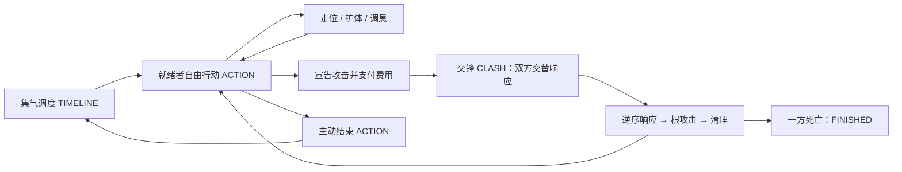
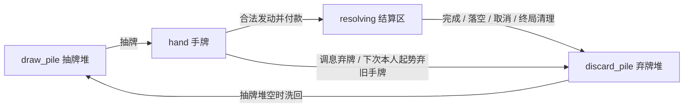
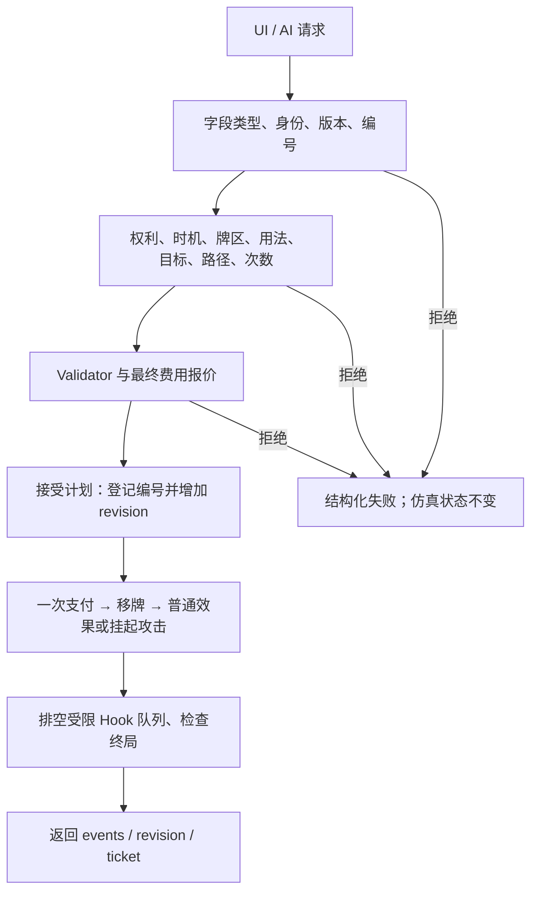

# 《长风浮生录》断桥听风：战斗机制与框架详细说明

本文面向玩法设计、卡牌配置与代码接入，说明当前 Demo 实际怎样运行。历史五式基线为 [`d70181b`](https://github.com/yup-21/game-dev/commit/d70181bab2cf57d5ed548a933ae6c523b666e37c)，本页已同步2026-10-29的十套武学V3接入。增量分析见 [武学V3移植说明](wuxue-v3-integration.md)。

当前玩法是 **CTB 集气决定行动顺序，ACTION 内自由走位出牌，每次攻击建立一场有限连锁交锋**。双方使用相同规则；玩家从 UI 选择，敌人从合法动作中选择。代码中没有第二份专供 AI 使用的伤害或资源系统。

本文描述已实现行为。标为“扩展建议”的内容尚未接入；旧十二势、旧五阶段或完整游戏企划不能替代当前源码作为规则依据。

## 阅读导航

| 内容 | 章节 |
| --- | --- |
| 玩法全貌、角色和模块 | 1–3 |
| 集气、时间、属性和内息 | 4–6 |
| 地图、牌区、卡牌使用方式 | 7–9 |
| 请求管线与攻防连锁 | 10–11 |
| 迎锋、伤害、连携、状态 | 12–15 |
| 情报、Hook、AI 与 UI | 16–19 |
| 算例、验证与扩展边界 | 20–22 |

## 1. 一场战斗由哪些决策组成

一名角色集气就绪后，获得一次完整行动。角色可以在资源允许时按自己的顺序移动、护体、主动出牌或再次攻击。结束行动才交回调度器。

攻击不会直接跳到扣血：它先锁定原目标格，暂停当前 ACTION，交给防守方决定是否应变。双方轮流追加响应或 Pass，关闭窗口后逆序结算，再判断原攻击是否命中。交锋结束后，仍由原 ACTION 的拥有者继续行动。



这是离散决策的战棋机制。真实等待、鼠标操作和动画帧数不会推动战斗时间；不存在按现实秒数持续增长的 ATB 条、实时按键弹反或随机命中骰。

## 2. 当前战场与初始内容

| 项目 | 当前值 |
| --- | --- |
| 角色 | 0：沈长风；1：拦江客 |
| 棋盘 | 15×10，四方向格子 |
| 初始位置 | 沈长风 `(6,4)`；拦江客 `(8,4)` |
| 默认四维 | STR / AGI / CON / MND 各 10 |
| 默认气血 | 20，开局满血 |
| 初始／最大内息 | 3／6，最大值可受属性影响 |
| 初始集气 | 双方均为 10000，已经就绪 |
| 默认先手 | 同集气、同速度时为玩家；可通过 reset 指定 |
| 牌组 | 每人独立 12 张：探锋×3、断岳×2、游身×2、化劲×3、变锋×2 |
| 初始手牌 | 每人 5 张，其余进入各自抽牌堆 |
| 临时状态 | 默认露隙、明牌；V3流派再登记凝势、封气、灼痕；另有统一护体池 |

“镜像牌组”指组成和规则一致。双方各自有牌实例与牌区，使用同一个战斗 RNG 依次洗牌，因此两人的开局手牌不必相同。

## 3. 模块职责与唯一权威状态

入口是 [`battle.tscn`](../battle.tscn) → [`battle_view.gd`](../scripts/battle_view.gd) → [`BattleModel`](../scripts/battle_model.gd)。核心规则对象为 `RefCounted`，不读取 SceneTree。

| 模块 | 实际职责 | 主要输入／输出 |
| --- | --- | --- |
| `BattleModel` | 装配组件、统一提交、版本与编号、防重入、快照、动画票据 | ActionRequest → result/events |
| `BattleState` | 当前角色、棋盘、时间、行动、攻击、牌实例、RNG、审计状态 | 唯一运行时真值 |
| `CombatantState` | 每名角色资源、位置、牌区、额度、状态、行动历史 | 同型敌我状态 |
| `AttributeSystem` | 四维转衍生数值 | 属性 → stats |
| `TurnManager` | 最近事件跳时、就绪选择、自动起势与收势 | 时间／集气 → ACTION |
| `CombatRules` | 纯查询的时机、目标、路径、次数和费用校验 | 状态／请求 → 合法选项或 precommit plan |
| `CostResolver` | 费用报价、内息量化、气血费用、一次支付 | cost → 整数单位费用 |
| `ReactionController` | 响应优先权、Pass、每方与总层数限制 | 根攻击 → ClashContext |
| `CombatResolver` | 原子效果、LIFO、迎锋、空间命中、伤害与终局清理 | 已验证行动 → 状态变化／事件 |
| `CardSystem` | 定义与实例解析、牌区迁移、专用 RNG 洗牌 | UID + usage → 定义／效果 |
| `SchoolCatalog` | 十门目录、定义规范化、配卡与旧引用校验 | V3源数据 → 已验证定义／11项选项 |
| `ComboResolver` | 最近主动攻击匹配、命中条件连携 | 历史／根攻击 → 奖励描述 |
| `StatusSystem` | 状态是否有效、叠层、到期、有限条件增伤 | actor/status/condition → 判定 |
| `VisibilitySystem` | 已知 UID、观势／藏锋／明牌和角色视图 | 权威状态 + observer → 可见投影 |
| `HookRegistry` | 校验／数值修正回调和声明式触发注册 | 拷贝上下文／事件 → 结果或效果组 |
| `EventLog` | 顺序记录，不执行规则 | 语义事件 → 审计记录和显示摘要 |
| `EnemyAI` | 只为收到的合法选项评分 | decision_context → ActionRequest |
| `BattleUI` | 输入、选择、绘制、事件动画与确认 | snapshot/events → 展示和请求 |

### 3.1 状态模型

```text
BattleState
  battle_id, revision, processed_requests
  mode, phase, active_id, global_tick, action_no, round_no
  actors[], terrain, rng, card_instances
  attack, clash, reaction_window
  knowledge[observer_id][card_uid]
  root_action_id, hook_queue, hook_usage, root_effect_count
  event_seq, events, pending_events, logs
  animation_pending, animation_ticket

CombatantState
  id, name, cell, attributes, stats, passives, school_id, school_name
  hp_u/max_hp_u, qi_u/max_qi_u, shield_u/shield_expiry
  gauge, regen_qi_remainder, regen_hp_remainder
  turns_started, normal_moves_used
  basic_attack_used, basic_guard_used, pitch_used
  hand, draw_pile, discard_pile, resolving, hand_generation
  statuses, attack_history, combo_used
```

`hp_u/qi_u/shield_u` 是权威整数；`hp/qi/shield` 是换算后的只读显示属性。运行中对状态的写入归属于控制器装配的规则组件，不能由 UI、AI 或动画直接完成。

`phase` 当前与主 `mode` 对齐；`reaction_window` 只是兼容展示用的 `ATTACK/DEFENSE/NONE`。`round_no` 按全局 ACTION 数每两次加一，是显示编号，不是 CTB 下“双方一定各动一次”的规则依据。个人额度应看 `turns_started`。

旧字段 `BattleState.combo_history/combo_used`、部分扩展槽仍保留；当前有效连携历史和已触发标记位于各角色的 `attack_history/combo_used`。

## 4. CTB 集气与全局时间

实现位置：[`turn_manager.gd`](../scripts/turn_manager.gd)。

### 4.1 只有四个主状态

| 主状态 | 含义 | 是否推动逻辑时间 |
| --- | --- | --- |
| `TIMELINE` | 无人行动时，计算下一就绪或到期事件 | 是 |
| `ACTION` | 一名角色自由操作 | 否 |
| `CLASH` | 原 ACTION 挂起，双方按优先权应变 | 否 |
| `FINISHED` | 战斗结束 | 否 |

`ACTION_START` 和 `ACTION_END` 是自动生命周期与事件，不是需要玩家逐个点击的额外阶段。

### 4.2 就绪判定与跳时

```text
CHARGE_THRESHOLD = 10000
gauge += charge_speed × delta_tick
就绪条件：hp_u > 0 且 gauge >= 10000
```

若已有就绪者，立即选人，不推进时间。多名角色就绪时依次比较：

1. 集气值更大者先。
2. 集气相同，速度更高者先。
3. 开局仍相同，使用 `preferred_first`。
4. 后续仍相同，优先非上次行动者；最后按角色 ID 稳定排序。

无人就绪时，计算各角色的 `ceil((10000-gauge)/speed)`，再与尚未到期的状态、护体剩余 tick 比较，推进到最近事件。系统处理恢复和到期，然后重新判断就绪。

结束 ACTION 时扣除 10000 集气，保留溢出。攻击、卡牌和移动不分别扣集气；当前没有逐招的集气延迟参数。

### 4.3 两种速度的例子

假设双方初始行动都已结束，集气归零，速度分别为 120 和 100：

| 全局时间 | 速度120 | 速度100 | 结果 |
| --- | ---: | ---: | --- |
| t=0 | 0 | 0 | 无人就绪 |
| t=84 | 10080 | 8400 | 高速方先获 ACTION |
| 高速方行动结束 | 80 | 8400 | 仍在 t=84 |
| t=100 | 2000 | 10000 | 另一方获 ACTION |

在同样属性、未触资源上限的前提下，两人在 84 tick 内都自然恢复 2.52 内息。高速方的收益是较早和更多的 ACTION、额度重置与换手机会，不是“每次行动额外发3内息”。

## 5. 四维属性与精度

实现位置：[`attribute_system.gd`](../scripts/attribute_system.gd)。输入属性在初始化时限制于 1–100，未指定项使用 10。

令 `s=STR−10`、`a=AGI−10`、`c=CON−10`、`m=MND−10`；`clamp(x,L,H)` 表示将值限制在上下限之间。

| 衍生项 | 当前公式 | 基准值 |
| --- | --- | ---: |
| 最大气血 | `max(10, 20+c)` | 20 |
| 攻击 | `max(1, 10+s)` | 10 |
| 防御 | `max(1, 10+c)` | 10 |
| 破招 | `10+floor(0.5s+0.25a)` | 10 |
| 接招 | `10+floor(0.5m+0.25a)` | 10 |
| 最大内息 | `clamp(6+floor(m/5),4,10)` | 6 |
| 每100tick自然回气 | `clamp(3+0.03m,2,4)` | 3 |
| 每100tick自然回血 | `clamp(0.2+0.02c,0,0.6)` | 0.2 |
| 卡牌内息费用百分比 | `clamp(100−m,85,110)` | 100% |
| 集气速度 | `clamp(100+2a,75,130)` | 100 |
| 普通移动额度 | `clamp(2+floor(max(0,a)/12),2,3)` | 2 |

因此 AGI20 对应速度120，普通移动额度仍为2；AGI22 才达到3格额度。MND 同时影响内息容量、恢复、接招和卡牌费用，不能只当成费用折扣。

### 5.1 资源单位

```text
1 点气血／内息／护体 = 10000 内部单位
0.1 点 = 1000 单位
0.01 点 = 100 单位
```

时间恢复采用整数余数累积。例如回气率为 `R` 单位／100tick，封气减半采用统一分母200：

```text
factor = 1（封气）或2（正常）
total = R × delta_tick × factor + old_remainder
gain = total 整除 200
new_remainder = total % 200
qi_u = min(max_qi_u, qi_u + gain)
```

这保证同一未封顶时间区间分成数次推进，不会因每次截断而少回气。满资源时按上限截断，未建立可在以后使用的溢出恢复池。

## 6. 费用、基础动作与个人额度

实现位置：[`cost_resolver.gd`](../scripts/cost_resolver.gd)、[`CombatRules.validate`](../scripts/combat_rules.gd)。

### 6.1 卡牌费用

```text
base_u = round(config.qi × 10000)
raw_u = ceil(base_u × qi_cost_percent / 100)
正费用量化 = max(5000, ceil(raw_u / 1000) × 1000)
气血费用 = round(config.hp × 10000)
随后应用 BEFORE_COST Modifier
```

基础气费为0时保持0，不先强制变成0.5。正费用最低0.5气；之后受注册的费用 Modifier 修正。付款要求内息足够，且 `hp_u > hp_cost_u`，因此不能用费用把自己扣到0血。

| 示例 | 属性条件 | 最终基础报价（未加自定义 Modifier） |
| --- | --- | --- |
| 配置1气 | MND10 | 1.0气 |
| 配置1气 | MND20 | 0.9气 |
| 配置2气 | MND30 | 1.7气 |
| 配置0.1气 | MND10 | 0.5气，受正费用下限约束 |
| 配置2气血 | 任意 MND | 2气血，心神折扣不直接乘到HP费用 |

`snapshot.hand[].usages[].quoted_cost` 给出最终单位换算后的 `{qi,hp}`，界面优先显示它；配置 `cost` 仍保留基础值。提交时重新验证并支付接受计划，不信任 UI 显示值。

### 6.2 基础动作例外

基础动作通过同一请求入口和支付器，但当前最终报价使用固定值，不使用心神折扣或 BEFORE_COST Modifier 的最终结果。

| 请求 | 可用时机 | 费用／效果 | 每次本人 ACTION 额度 |
| --- | --- | --- | --- |
| `MOVE` | ACTION | 实际路径每格1气 | 普通移动合计不超过 move_budget |
| `BASIC_ATTACK` | ACTION，目标相邻 | 1气；基础伤害1；进入同一交锋流程 | 1次 |
| `BASIC_GUARD` | ACTION | 1气；护体+1、基础时效100tick | 1次 |
| `PITCH_CARD` | ACTION，拥有所选手牌 | 弃1张，回复1气并按上限截断 | 1次 |
| `PLAY_CARD` | usage 指定时机 | 使用该 usage 的 qi/hp 费用和效果 | 无通用主动攻击张数上限；可声明once_per_action，同定义全部副本共用 |
| `PASS_REACTION` | 当前拥有交锋优先权 | 0费用，交还优先权 | 可多次；两次连续Pass关闭窗口 |
| `END_ACTION` | 本人 ACTION | 0费用，自动收势并交回调度器 | 结束当前行动 |

当前满气时仍允许弃牌，可能没有实际回气收益。身法牌不占普通移动额度；反应闪避也不刷新完整 ACTION 的额度。

## 7. 地图、路径与攻击范围

实现位置：[`battle_state.gd`](../scripts/battle_state.gd)、[`combat_rules.gd`](../scripts/combat_rules.gd)。

- 坐标使用 `Vector2i(x,y)`，范围为 x=0–14、y=0–9；四方向相邻，距离为曼哈顿距离。
- 第7列为河流，`(7,4)` 是桥，`(7,8)` 是浅滩；水、岩石、竹林不可通行。
- 寻路使用 BFS，不能越界、穿障碍或穿过其他存活角色；不能把原地当作有效移动路径。合法动作枚举用一次reachable_paths复用全部落点，保持find_path的方向顺序与结果。
- 普通移动按实际路径长度付费；不能用直线距离替代绕路成本。
- 原五式均为相邻单目标；V3武学支持最小／最大曼哈顿距离，最远4格。LOS限定正交直线并检查中间地形与角色阻挡，没有完整多目标范围攻击系统。
- `exit` 目前只是可通行的地形标记，不构成撤离或自动胜利条件。

攻击宣告时保存 `origin_cell`、`target_cell`、`affected_cells`，初始覆盖只有原目标格。结算时检查目标角色的实际位置是否仍在覆盖内，不根据对手新位置自动重新锁定。当前不额外按攻击者被移动后的新位置重算整套射程。

变锋·追击将原锁定格及四向邻格中的可通行格加入覆盖，目标角色保持不变。它是扩大覆盖，不是自动换目标。

## 8. 卡牌定义、实例与四个牌区

实现位置：[`card_system.gd`](../scripts/card_system.gd)；数据真值为 [`tingfeng_cards.json`](../data/tingfeng_cards.json)。

### 8.1 三种标识不要混用

| 标识 | 例子 | 用途 |
| --- | --- | --- |
| `definition_id` | `tf_probe` | 哪种招式定义，可被多个实例共享 |
| `card_uid` / `uid` | `card:0:0001` | 某一局、某一方的一张具体牌 |
| `usage_id` | `probe` / `follow` | 本次选取该牌的哪种用法 |

请求中 `card_id` 兼容表示 UID，必须与同时传入的 `card_uid` 相同；它不代表 `tf_probe` 这样的定义 ID。推荐新调用直接使用 `card_uid + usage_id`。

定义访问和 UI 卡牌视图返回深拷贝；牌实例的权威字典是 `BattleState.card_instances`。实例的 `modifications` 字段目前只是预留，不能假设写入任意字段就会自动修正费用或效果。

### 8.2 牌区转换



响应牌追加后同样进入结算区，正常情况下在整场交锋清理时入弃牌。被截势取消的牌照样已付款、占响应额度、最终入弃牌，不回手。

抽牌堆空时只洗本方弃牌，不洗手牌或结算区。没有可抽牌时停止抽取。正常 ACTION 起势目标为5张；通用 `draw_cards` 可以额外抽牌，当前没有独立的“手牌上限5张”规则。

每方12个 UID 必须始终各在一个牌区中：

```text
hand + draw_pile + discard_pile + resolving = 12个不同UID
```

### 8.3 本人 ACTION_START

每次本人行动开始重置普通移动／基础攻防／弃牌额度，并清空本人连携历史和已触发标记。首次只保留开局5手牌；后续先弃掉上次剩余手牌，再抽5张。**起势不额外回气，也不按回合无条件清除所有护体。** 护体和状态依全局时间到期。

## 9. 五式、12种用法与配置格式

本节保留默认五式清单。V3另有20核心式、41种用法、7条连携；全目录25定义、53种用法，每局按双方选择加载，详见 [流派清单](wuxue-v3-integration.md)。

以下费用是 MND10、无额外 Modifier 时的基础值。

| 招式／实例数 | usage_id | 时机 | 费用 | 主要效果 |
| --- | --- | --- | ---: | --- |
| 探锋式×3 | `probe` | ACTION | 1气 | 相邻2伤；招路 thrust |
| 探锋式×3 | `follow` | ACTION | 1气 | 相邻2伤；招路 sweep；可接探锋追风连携 |
| 断岳式×2 | `heavy` | ACTION | 3气 | 相邻5伤，破招+2，crushing；空间落空后自己露隙 |
| 断岳式×2 | `expose` | ACTION | 2气 | 相邻3伤，thrust；存活目标命中后明牌；可利用露隙 |
| 游身式×2 | `step` | ACTION | 1气 | 合法路径移动≤2格 |
| 游身式×2 | `evasion` | DEFENSE_REACTION | 1气 | 防守者移动≤1格，最终覆盖外可使根攻击MISS |
| 化劲式×3 | `guard` | ACTION | 1气 | 护体+3，100tick |
| 化劲式×3 | `yield` | DEFENSE_REACTION | 1气 | 当前根攻击减伤3 |
| 化劲式×3 | `intercept` | DEFENSE_REACTION | 2气 | 迎锋三档判定，成功中断并令攻击者露隙 |
| 变锋式×2 | `change` | ATTACK_REACTION | 1气 | 扩展当前根攻击覆盖 |
| 变锋式×2 | `attack_counter` | ATTACK_REACTION | 1气 | 取消一层敌方未结算响应 |
| 变锋式×2 | `defense_counter` | DEFENSE_REACTION | 1气 | 同一通用截势效果，使用权属于防守方 |

同一张牌每次只选一个 usage；没有“先用护元，再把同一 UID 用于卸劲”。`kind` 只是 UI 粗分类，合法时机始终以 usage 和合法动作查询为准。

### 9.1 最小定义样例

下面是完整 `tf_step` 定义的精简示例，当前数据还含说明字段；实际数值以 JSON 为准。

```json
{
  "id": "tf_step",
  "name": "游身式",
  "tags": ["movement", "lightness"],
  "usages": [
    {
      "id": "step",
      "name": "游身·踏雪",
      "timing": "ACTION",
      "cost": {"qi": 1},
      "target": {"kind": "reachable_cell", "max_distance": 2},
      "effects": [{"type": "move", "max_distance": 2}]
    },
    {
      "id": "evasion",
      "name": "游身·避锋",
      "timing": "DEFENSE_REACTION",
      "cost": {"qi": 1},
      "target": {"kind": "reachable_cell", "max_distance": 1},
      "effects": [{"type": "move", "max_distance": 1}]
    }
  ]
}
```

当前目标类型为 `self`、`enemy_actor`、`reachable_cell`、`pending_root_attack`、`opponent_unresolved_response_link`。主动敌目标距离主要读取 `attack_profile.range`、`target.min_distance` 和 `line_of_sight`；文字说明字段不会自动转换成额外规则。

### 9.2 数据声明与代码语义的界限

加载器实际读取 `cards/statuses/combos/deck`。JSON 顶部 `rules/meta` 并非通用解释器：集气阈值、基础动作费用、属性公式和4层上限仍由代码决定。修改 `rules` 中一个数字，不会自动重写调度或结算器。

单次主动攻击当前建立一个根攻击；不要用并列多个 `deal_damage` 当作多段攻击。现有实现扫描主动用法时取最后一个伤害项作为根基础伤害，没有多段宣告／多目标交锋调度。

## 10. ActionRequest：从意图到承诺

实现位置：[`battle_model.gd`](../scripts/battle_model.gd)、[`combat_rules.gd`](../scripts/combat_rules.gd)。

### 10.1 请求字段

| 字段 | 要求 |
| --- | --- |
| `kind` | 字符串，使用第6节列出的命令 |
| `actor_id` | 整数0或1，对应当前行动／响应权拥有者 |
| `battle_id` | 当前局身份；重开后旧身份失效 |
| `expected_revision` / `request_version` | 至少有一个；同时有时都必须等于当前版本 |
| `request_id` / `action_id` | 显式提供时必须是未消费的非空字符串；可不同，二者都会登记防重 |
| `card_uid` / `card_id` | 使用牌或弃牌时的实例UID；同时提供必须相同 |
| `usage_id` | 出牌时明确指定用法，不自动推断 |
| `target_cell` | `Vector2i`，用于移动或身法 |
| `target_id` | 整数，主动攻击目标 |
| `link_id` | 整数，截势所选响应层 |

推荐通过 `model.request()` 构造；它补齐当前身份、版本和编号。合法选项查询不会分配请求编号；直接提交合法选项时，控制器可在接受后补齐缺失编号。`END_PHASE` 仅兼容归一为 `END_ACTION`，不恢复旧五阶段。

### 10.2 当前提交顺序



具体校验包含：字段类型先于 Variant 比较；已有牌必须在自己的手牌；最终请求必须匹配当前枚举出的合法动作；未知 usage、不合法落点和错误响应层不能只靠 UI 隐藏来阻止。

拒绝时不会扣资源、移牌、推进随机数或增加战斗版本。`request()` 自身会分配本地请求编号，不能把该构造器与纯查询混为一谈。

承诺后合法落空不回滚：例如避锋使攻击MISS、后结算位移因占位变化失效、响应被截势取消，都保留已经支付的费用。

### 10.3 可直接接入的调用示例

```gdscript
const Model = preload("res://scripts/battle_model.gd")

func example_submit() -> void:
    var battle = Model.new()
    # 默认开局：玩家在(6,4)，桥格(7,4)可走。
    var request = battle.request("MOVE", 0, {"target_cell": Vector2i(7, 4)})
    var result = battle.submit(request)
    if result.success:
        # 实际UI应播放result.events后确认；此处展示接口。
        battle.acknowledge_animation(result.ticket)

    # 优先从当前合法选项选出具体实例与用法。
    var actions = battle.legal_actions(0)
    for action in actions:
        if action.kind == "PLAY_CARD" and action.get("usage_id", "") == "probe":
            var attack_request = battle.request("PLAY_CARD", 0, action)
            var attack_result = battle.submit(attack_request)
            print(attack_result.success)
            break
```

返回结构为 `success/error_code/message/events/revision/ticket`。常见拒绝码包括 `MALFORMED_REQUEST`、`STALE_BATTLE`、`STALE_REVISION`、`DUPLICATE_ACTION`、`ALIAS_MISMATCH`、`ILLEGAL_ACTION`、`PRESENTATION_PENDING` 和 `INSUFFICIENT_RESOURCE`。资源不足常会先使该动作退出合法列表，因此也可能返回 `ILLEGAL_ACTION`。

## 11. 攻防交锋与有限 LIFO

实现位置：[`reaction_controller.gd`](../scripts/reaction_controller.gd)、[`CombatResolver.resolve_clash`](../scripts/combat_resolver.gd)。

### 11.1 根攻击与响应栈分开保存

```text
attack
  attack_id, attacker_id, defender_id
  card_uid, definition_id, usage_id, route, break_bonus
  origin_cell, target_cell, affected_cells
  base_damage, attack_bonus, defense_reduction
  effects, interrupted, combo, paid

clash
  attack（指向同一根攻击）
  priority_actor_id, consecutive_passes
  counts[actor_id], stack[]

stack entry
  id/link_id, actor_id, uid, definition_id, usage_id, name
  effects, choice, canceled, resolved
```

根攻击不算一层响应。`link_id` 在本局单调增加，下一场交锋不一定重新从1编号。

### 11.2 优先权规则

1. 宣告攻击并付款后，防守方先获得优先权。
2. 当前权利者可用一张合法响应，或 Pass。进攻方读取 `ATTACK_REACTION`，防守方读取 `DEFENSE_REACTION`。
3. 出牌后转给对方，连续Pass计数归零；Pass只转权并将计数加一。
4. 每方最多声明2张响应，总共最多4张。取消不减少声明次数。
5. 连续两次Pass，或第4张响应声明完毕，关闭加入窗口并开始逆序结算。
6. 无牌／无气时仍可手动或由 AI 选择 Pass；当前没有自动跳过所有无牌窗口。
7. 栈结算期间不再插入新响应；响应效果不会另开一场完整交锋。

完整 ACTION 的 `active_id` 在交锋中保持原拥有者；`priority_actor_id` 则在两方之间交替。获得响应权不会重抽手牌、重置移动或增加集气行动。

### 11.3 三层反制例子

假设双方资源和牌都足够：

| 声明顺序 | 行动 | 目标 |
| --- | --- | --- |
| 根攻击 | 探锋·试探，2伤 | 防守方 |
| L1，防守方 | 化劲·卸劲 | 根攻击减伤3 |
| L2，进攻方 | 变锋·截势（攻） | 取消L1 |
| L3，防守方 | 变锋·截势（守） | 取消L2 |
| 随后 | 双方Pass | 关闭窗口 |

结算顺序为 L3 → L2 → L1 → 根攻击：L3取消L2，L2跳过，L1仍减伤3，2伤降至0。四张牌（包括根攻击）均已真实支付并在最后入弃牌。

若进攻方再声明 L4 截势指向L3，立即到4层上限：L4取消L3，L2得以取消L1，根攻击恢复2伤。截势只能指向敌方未结算响应层，不能直接选择根攻击。

## 12. 迎锋、招路与空间应变

### 12.1 迎锋的确定性三档

```text
parry = 防守方接招 + 响应parry_bonus + 对当前招路的route_bonus
breaker = 攻击方破招 + 根攻击break_bonus
margin = parry - breaker

margin >= 2：成功，中断根攻击，攻击者获得露隙
margin <= -2：失败，本响应没有减伤或中断
其余：相持，根攻击减伤1
```

化劲·迎锋当前 `parry_bonus=1`；对 thrust/sweep/crushing 的加成为 `+2/0/−1`。双方基础破招、接招均10时：

| 来招 | 额外破招 | 差值 | 迎锋结果 |
| --- | ---: | ---: | --- |
| 探锋·试探／照胆：thrust | 0 | `10+1+2−10=3` | 成功 |
| 探锋·追风：sweep | 0 | `10+1−10=1` | 相持，减伤1 |
| 断岳·重斩：crushing | 2 | `10+1−1−(10+2)=−2` | 失败 |

中断使用 `ATTACK_INTERRUPTED`，不是空间MISS。二者都不扣目标HP，但只有MISS路径运行 `on_attack_miss`；迎锋成功施加露隙是迎锋自身分支的效果。

### 12.2 闪避与追击

游身·避锋声明时选择合法相邻落点，逆序结算时再检查从当时位置到落点的路径。合法位移执行后，根攻击统一检查最终位置。

- 最终位置在覆盖外：`ATTACK_MISSED`，不吸护体、不扣HP、不执行命中子效果。
- 变锋已扩区且最终位置仍在扩区内：继续命中。
- 位移在结算时已不合法：该位移跳过，费用不退；不保证“出过避锋牌”就一定闪避成功。

UI 朱框表示当前权威覆盖，碧色内框表示当前合法落点。选择提示不能替代结算时的空间判断。

## 13. 伤害流程与语义事件

实现位置：[`CombatResolver.resolve_attack/deal_damage`](../scripts/combat_resolver.gd)。

根攻击先判断中断、再判断空间覆盖，二者都通过后才计算伤害：

```text
属性修正 = clamp(trunc((攻击 - 防御) / 8), -2, 2)
raw = 基础伤害 + attack_bonus + 属性修正 + 有限条件奖励
raw = 有效 BEFORE_DAMAGE Modifier 修正结果
有效减伤 = min(max(0,raw), defense_reduction)
本击伤害 = max(0,raw - defense_reduction)
护体吸收 = min(本击伤害单位, shield_u)
实际扣HP = min(当前hp_u, 本击伤害单位 - 护体吸收)
```

声明连携和命中条件连携会写入 `attack_bonus`；按源码顺序，命中条件连携先于上述 raw 计算处理。`trunc` 向0截断，因此攻防差−7的属性修正为0，不是−1。

| 事件 | 意义 | 可否当作“扣过HP” |
| --- | --- | --- |
| `ATTACK_DECLARED` | 费用已付、目标与覆盖公开 | 否 |
| `ATTACK_INTERRUPTED` | 根攻击被中断 | 否 |
| `ATTACK_MISSED` | 目标离开最终覆盖 | 否 |
| `DAMAGE_REDUCED` | 防御减伤实际抵消了正伤害 | 否，不包含护体吸收 |
| `ATTACK_HIT` | 未中断且目标在覆盖中；伤害可为0 | 否 |
| `DAMAGE` | 展示本击伤害、吸收与HP损失，允许0 | 读取 hp_damage 判断 |
| `HP_DAMAGED` | 实际扣HP大于0 | 是 |
| `ATTACK_FINISHED` | 交锋收尾 | 否 |

例如基础5伤、增强1、减伤3、护体2，最终本击3，吸收2，扣HP1。护体改成3时仍命中、扣HP0，不产生 `HP_DAMAGED`。吸血等未来效果不能只监听 `ATTACK_HIT` 就假定扣过血。

命中后先执行用法中的 `on_attack_hit.effects`，再执行伤害项中的 `on_hit` 子效果；前提是目标未因本击死亡。致死时直接停止这些后续效果，但仍可记录本次根攻击命中结果和清理牌区。

## 14. Combo 与 Chain 的区别

| 机制 | 跨越范围 | 核心问题 |
| --- | --- | --- |
| Combo 连携 | 本人同次 ACTION 的数次主动攻击牌 | 前一招是否为本招提供奖励 |
| Chain 响应链 | 当前一场根攻击的响应栈 | 本击如何被卸劲、闪避、追击或截势改变 |

实现位置：[`combo_resolver.gd`](../scripts/combo_resolver.gd)。

### 14.1 探锋追风

读取本角色最近一条主动攻击牌历史，精确匹配 `(tf_probe,probe) → (tf_probe,follow)`。前招必须已结算且未中断；当前配置没有 `require_hit`，所以前招MISS仍可贡献序列。

声明追风时将+1写入本次根攻击，防守者随后仍可应对。普通移动、护体和反应不写入主动攻击牌历史；基础攻击也不写入，因此不会替换“最近一张主动攻击牌”。

追风进入根攻击结果结算且未中断时，登记本次连携并消耗本 ACTION 额度，即使它自己MISS。若追风被中断，则记录中断历史，但不登记该连携为已触发。若响应层或其 Hook 已导致终局，根攻击不会进入结果结算，也不补写该根攻击历史或连携记录。每次本人 ACTION_START 清历史和额度。

### 14.2 乘隙照胆

目标仍在覆盖中且具有露隙时，在伤害前加2并消耗露隙。随后只要目标存活，照胆命中子效果施加明牌。护体全吸收也属于空间命中，可以触发该连携与明牌。

### 14.3 当前匹配器的范围

声明型连携目前只解释长度为2的精确ID／usage序列；声明时只提取奖励中的 `modify_pending_damage.flat_delta`。命中型连携解释指定攻击定义、usage和目标状态。

两条查询各取配置数组中第一个匹配项，未实现通用 priority 排序或任意长度组合。次数固定为每本人 ACTION 每种连携一次，配置中的 `scope/max_activations_per_action` 不会任意改写这一规则。两条匹配路径独立，不能泛称“所有场景下每次攻击全局最多一个连携”。

## 15. 状态、护体和通用效果

### 15.1 已启用状态

| 状态 | 内部ID | 时效 | 当前语义 |
| --- | --- | --- | --- |
| 露隙 | `opening` | 施加后150全局tick | 照胆命中时利用并消耗 |
| 明牌 | `hand_exposed` | 施加后150全局tick | 覆盖藏锋，暴露当前和新抽手牌 |
| 凝势 | `focus` | 250全局tick，最多2层 | 下一次根攻击宣告时全部消费，每层+1；普攻／攻击牌均可用，MISS不返还 |
| 封气 | `qi_seal` | 150全局tick | 自然回气速度减半，主动gain_qi不受影响 |
| 灼痕 | `scorch` | 350全局tick，最多2层 | 每100tick绕护体扣当前层数伤害，再减一层 |

状态存为 `{expiry,stacks}`，灼痕另带next_tick。`global_tick < expiry` 才有效；重复施加刷新到期时间并按stack_limit封顶。灼痕重加保留原next_tick，周期与到期同刻先扣伤减层、再移除到期状态。状态到期不抹掉仍在手中的已知牌事实。

Timeline将大步时间推进切成状态／周期边界：先自然恢复，再对双方结算到点灼痕，然后统一检查死亡并消费存活情况下的Hook队列。当前实现了灼痕这一标准周期状态，尚无任意周期、驱散标签或“触发N次后到期”的通用配置语言。

护体不是逐层独立的 StatusInstance。角色只有一个护体数值与一个 `shield_expiry`：叠加时增加数值，并取更晚的到期时刻；到期清空整个池。因此后加护体可能延长已有护体的有效期。

### 15.2 当前可执行效果

| type | 功能 | 注意事项 |
| --- | --- | --- |
| `deal_damage` | 根攻击基础伤害或受控派生直接伤害 | 主动卡开一场交锋；派生效果不再开新响应窗 |
| `on_attack_hit/on_attack_miss` | 按根攻击结果执行子效果 | 不是独立攻击 |
| `add_shield` | 增加统一护体池 | `amount`、可选持续tick |
| `move` | 按所选落点合法移动 | 从结算时位置重新检查路径 |
| `gain_qi` | 回气，按上限截断 | 使用整数单位换算 |
| `modify_pending_damage` | 增强或减伤当前根攻击 | 正 flat_delta 加攻击增强；负值转防御减伤 |
| `modify_attack_area` | 原锁定格及四向邻格扩区 | 当前只有这一个固定形状 |
| `cancel_chain_link` | 取消敌方未结算响应 | 不退款、不取消根攻击 |
| `contest_intercept` | 破招／接招与招路三档 | 分支效果仍走统一执行器 |
| `interrupt_root_attack` | 标记当前根攻击中断 | 不开启反击回合 |
| `apply_status/consume_status` | 加入或消费登记状态 | 未知状态不能作为有效配置 |
| `force_move` | 逐格击退／牵引 | 优先较大坐标差轴，平手选x轴；障碍或占位即停 |
| `draw_cards/discard_cards` | 通过公共牌区方法转换 | 不直接复制、生成或重用UID |

### 15.3 有限条件谓词

用法条件目前只解释 `before_first_attack`、`after_active_attack`、`has_status`；前两者实质看主动攻击牌历史是否为空，中断和MISS的已记录历史也会影响条件。

伤害项 `conditional_bonus` 支持：自身护体大于阈值、目标有状态、自身付款后血量比例低于阈值、目标状态层数乘奖励，或满足条件后的固定奖励。比例应写 `0.5` 这种0–1数值。非零奖励时才处理 `consume_on_hit`。

这些是有限字段与代码语义，不执行任意表达式。五式已通过基础配置验收，公共接口的个别字段通过边界用例验证；不能据此将任意组合配置视为已经平衡或全面验证。

## 16. 观势、藏锋、明牌与观察者权限

实现位置：[`visibility_system.gd`](../scripts/visibility_system.gd)。

### 16.1 看得到什么

`snapshot(observer_id)` 返回双方公开气血、内息、护体、属性、位置、状态和牌区数量；完整 `hand` 只属于观察者本人。敌手牌投影为 `observed_hand`：

```json
{
  "unknown_card": {"known": false},
  "known_card": {
    "known": true,
    "uid": "card:1:0013",
    "definition_id": "tf_probe",
    "name": "探锋式"
  }
}
```

未知项不包含 UID 或定义。对手抽牌堆、剩余顺序、全部实例字典不进入 AI 的 decision_context。发动后的根攻击和响应牌已经是公开事实，可以显示名称、用法、目标与招路。

### 16.2 等级与记忆

- 观势0：不主动揭牌；可看到未被藏锋遮蔽的危险提示。
- 观势1：一次有效刷新尝试识别一张未知手牌。
- 观势2：有效刷新识别整手；必须严格高于对方藏锋才生效。
- 藏锋1／2：同级及更低观势不能新识破，危险提示变 `?`；不删除过去已知事实。
- 明牌：覆盖任何级别藏锋，暴露当前及持续期间新抽到的牌；到期后仍持有的已知UID继续被记忆。
- 牌离开手牌时，所有观察者立即忘记其“当前仍在手中”的知识。以后同UID重抽不自动继承旧记忆。

“危”表示对方当前手中有 `threat_level=HIGH` 的牌，不表示敌方准备使用哪一招。藏锋可能显示 `?`，即使当前实际上没有高威胁牌，也不会藉提示变化反向泄露牌情。

### 16.3 首次刷新边界的修复

历史版本用“手牌列表＋目标的turns_started”去重，第一次起势虽未换牌，计数变化仍可能让观势1额外识别一张。该边界已在V3接入时修复。

当前改用hand_generation：仅实际抽到新牌才增加批次；初始抽牌产生批次，首次ACTION_START不抽牌，因此不会再次揭牌。后续换手或额外抽牌产生新批次，允许观势1再识别一张未知牌。

V3回归已验证双方观势1／藏锋0在开局及首次轮转中各只识别一张，重复snapshot不会增加揭牌。明牌仍可合法揭示整手；新抽牌批次与首次空刷新是不同事件。

### 16.4 权限接口的范围

观察者投影是本地业务隔离；调用方必须传正确的 observer_id，当前没有联网认证层。公开种子服务于原型复现，未实现面向联网对抗的服务端随机数保密方案。

## 17. Hook、语义事件与受限效果队列

实现位置：[`hook_registry.gd`](../scripts/hook_registry.gd)、[`CombatResolver.emit/drain_hooks`](../scripts/combat_resolver.gd)。

### 17.1 三类扩展

| 类型 | 注册接口 | 输出 | 当前排序 |
| --- | --- | --- | --- |
| Validator | `register_validator(id,callback)` | `{success,message}` | id稳定排序 |
| Modifier | `register_modifier(id,callback)` | 费用或伤害字段的整数结果 | id稳定排序 |
| Trigger | `register_rule(id,owner,event,effects,priority,min_amount,options)` | 一组声明式效果 | priority → owner → id |

Validator／Modifier 得到深拷贝。Modifier 必须检查 `timing`，当前关键点为 `BEFORE_COST` 和 `BEFORE_DAMAGE`；费用使用内部 `qi_u/hp_u`，伤害使用普通伤害数值。回调应纯查询、可重复调用，不能在查询时扣资源或累计奖励。

无效费用修正不能付款；无效 BEFORE_DAMAGE 修正保留原始伤害计算值。当前不是所有无效 Modifier 都统一生成诊断事件。

Trigger 先匹配事件名、owner与可选最小amount；有 actor_id 的事件只通知该拥有者，没有有效 actor_id 的全局事件则为每个拥有者生成通知副本。`TIME_ADVANCED` 的广播已验证。`HP_DAMAGED.actor_id` 是受伤者，`ATTACK_HIT.actor_id` 是攻击者，注册时不能把两者混用。

### 17.2 排队与执行时机

EventLog 立即存储事件，但不执行规则。Resolver 收集触发组进入 FIFO 队列，在普通行动收尾、每层响应后、根攻击后、时间推进和自动起收势的明确排空点消费。排空期间产生的新事件继续排队，不递归再次进入 drain。

因此“监听 ATTACK_HIT”不意味着能在同一根攻击扣血前改写已经计算的 raw；这类事应使用 BEFORE_DAMAGE Modifier。标准事件顺序与 Trigger 效果实际执行点是两个概念。

一个纯演示的内功规则可这样注册，双方分别登记同样的规则即可：

```gdscript
model.hooks.register_rule(
    "guard_restore_qi", 0, "SHIELD_ADDED",
    [{"type": "gain_qi", "target": "self", "amount": 0.5}],
    100, 0.0, {"once_per_turn": true}
)
```

它表示“本人护体增加后，本人每次完整行动间隔最多回0.5气”，不授予新的 ACTION。`once_per_turn` 绑定该拥有者的 `turns_started`；敌方 ACTION 不刷新本人额度。

### 17.3 幂等与上限

- 默认键为 `root_action_id + owner + hook_id`，同一根行动只触发一次。
- `once_per_turn=true` 优先使用本人行动间隔键。
- 显式关闭 `once_per_root_action` 时，再加入 event_id 区分事件。
- 一次非CLASH提交建立新 root；围绕该攻击的全部响应与Pass继续共用原 root。
- 一组 Trigger 任意效果无效，整组拒绝；同一组的多条有效效果均执行，不会因按Hook去重而漏掉第二条。
- 每根行动最多32条 Hook 派生效果，嵌套迎锋分支也计数，包装命令本身占一条；正常卡牌原有效果不占这个派生预算。
- 重复触发、无效组和超限记录 `HOOK_REJECTED/HOOK_LIMIT_REACHED`；超限中止剩余派生队列，已生效部分不回滚。
- `_busy` 阻止结算中递归 submit；死亡后停止剩余派生。

注册来源是可信GDScript，不从JSON加载任意脚本路径。当前没有卡牌 `custom_hook_ids` 的通用自动挂接器；新增专属行为需明确接入注册位置、作用对象与所需上下文，不能仅在配置里填ID就认为已生效。

## 18. AI、UI 与动画屏障

### 18.1 同规则、不同决策源

```gdscript
var context = model.decision_context(actor_id)
var chosen = enemy_policy.choose_action(context)
if not chosen.is_empty():
    var result = model.submit(chosen)
```

AI 只读观察者投影和自己的 `legal_actions`，返回其中一个选项的副本。它不访问 BattleState，不代替核心扣费，也不能生成列表外的免费动作。

当前是确定性启发式评分：考虑主动伤害、连携、接近路径、必要护体和调息；响应中考虑截势目标、避锋覆盖、迎锋差值、卸劲和追击。它没有完整搜索未来响应树，也不保证最优。

V3评分按规范化effects识别回气、抽牌、凝势、血费风险和远程最小射程；长局达到60 ACTION后降低纯防御使用以推进原型对局。该选择只影响AI策略，玩家的合法防守不受此阈值限制。

策略按“本局＋全局action_no＋观察者”记录24次决策上限；到达后选择 END_ACTION 或 Pass。这是 AI 自身防卡死策略，不是玩家额外行动点上限。相同上下文重复询问返回相同决定。

### 18.2 表现流程

```text
submit 同步完成当前可结算部分
  → 返回 events，设置 animation_pending 并增加 ticket
  → UI 播放移动／伤害／护体／连携表现
  → acknowledge_animation(ticket)
  → 解除输入屏障，继续等待下一个合法决策
```

等待动画时合法动作列表为空，UI不应抢交下一条；错误票据不能解锁。显式带当前票据确认可以隔离旧回调，`ticket=-1` 只保留本地兼容用法，不应用于异步回调。

动画确认不改集气、HP、QI、牌区或当前响应权，也不增加战斗 revision。若在 CLASH，下一位仍由优先权决定；它与动画屏障是两套独立状态。

## 19. 终局、日志与确定性

任何实际伤害使一方HP归零后，状态进入FINISHED并设置winner_id；UI以玩家0为参照输出victory/defeat。同一tick双方周期效果均结算后都归零时为draw、winner_id=-1。对局不以走到exit或行动数自动结束，尚无撤退或多队伍胜负协议。

终局后不再推进时间或接受新行动。清理在当前结算调用返回到安全位置后统一进行：所有 resolving 牌入弃牌，清空挂起 attack/clash、响应权与效果队列，避免正在使用的局部攻击引用被提前清空。

每个详细事件包含 `seq/event_id/root_action_id/tick`；`events` 保存本局详细记录，`pending_events` 用于当前提交返回。显示 `logs` 只保留最近80条摘要，UI再过滤空text，不能当作完整回放源。

固定种子与相同合法决策序列可复现牌序与玩法结果。每局battle_id和操作身份有意保持不同，不能要求这些运维编号逐字相同。当前测试会重跑决策并比较结果；没有通用存档恢复、日志反推状态或回放播放器。

## 20. 两个完整算例

### 20.1 自由行动与探锋追风

为便于说明，设双方同属性，进攻方有足够内息、两张探锋及一张游身，防守方最终均Pass：

1. 普通移动进入相邻位置，按路径付气，占普通移动额度。
2. 打第一张探锋的试探，付1气，根攻击挂起；双方Pass后造成2伤，该牌入弃牌并记录主动攻击历史。
3. 用游身调整站位，付1气，不占普通移动额度，不替换最近主动攻击牌历史。
4. 仍满足相邻距离时，打另一张探锋的追风，付1气，声明时获得+1连携，最终命中造成3伤。
5. 整段仍在同一个 global_tick；继续合法动作或 END_ACTION 后才交回调度器。

没有足够内息、牌已用过、距离不合法或轮到他人响应时，不能照抄这个序列；每一步仍由合法列表决定。

### 20.2 重斩、避锋与变锋

根攻击重斩5伤锁定防守者原格：防守者先声明避锋，进攻者随后声明追击扩区。双方Pass后按LIFO：先扩区，再执行避锋，最后判断重斩。

- 若避锋落在原格的可通行四向邻格，该格已经加入覆盖，本击仍可能命中5伤。
- 没有有效扩区且目标离开覆盖，重斩MISS；攻击方触发自己的露隙。
- 若追击被后续截势取消，最终按未扩大的覆盖判断。
- 所有已声明牌独立付款，MISS或取消不退款；整场交锋结束后恢复原进攻者ACTION。

## 21. 验证范围与复现

当前验收为原265条规则／AI／边界，加V3目录198条、武学342条，共805条；真实UI为原82条＋新增61条，共143条。默认12场对局／重放、16组流派对局及2组重复运行均通过。明细见 [验证记录](../reports/validation.md)；这些结果覆盖已列案例，不代表任意配置组合或数值平衡均已验证。

| 检查入口 | 主要覆盖 |
| --- | --- |
| [`test_tingfeng.gd`](../checks/test_tingfeng.gd) | 五式用法、CTB、牌区、三／四层响应、两Pass、闪避追击、迎锋、连携、情报 |
| [`test_tingfeng_ai.gd`](../checks/test_tingfeng_ai.gd) | 只选合法选项、连携与应变评分、输入只读、决策限额 |
| [`test_tingfeng_edges.gd`](../checks/test_tingfeng_edges.gd) | 畸形字段、拒绝后可继续、HP费用、条件伤害、强制位移、Hook嵌套限流、终局清理、时间事件广播 |
| [`test_tingfeng_playthrough.gd`](../checks/test_tingfeng_playthrough.gd) | 三种子×双先手×重复对局，资源与牌区逐请求检查 |
| [`tingfeng_visual_check.gd`](../checks/tingfeng_visual_check.gd) | 真实键鼠／按钮入口、分支、响应层、落点、折扣费用、重开与结局 |
| [`test_wuxue_catalog.gd`](../checks/test_wuxue_catalog.gd) | 目录／规范化／旧ID／深拷贝／错误配置拒绝 |
| [`test_wuxue_v3.gd`](../checks/test_wuxue_v3.gd) | 41usage、7combo、状态时钟、射程、限次、血费与路径等价 |
| [`test_wuxue_playthrough.gd`](../checks/test_wuxue_playthrough.gd) | 16组流派与两组重复对局，逐请求不变量 |
| [`wuxue_visual_check.gd`](../checks/wuxue_visual_check.gd) | 流派选择、分页、状态、远程和draw真实UI |

```powershell
# 在Demo目录运行，每次选择相关的定向检查。
.\checks\verify.ps1 -Stage Rules
.\checks\verify.ps1 -Stage Policy
.\checks\verify.ps1 -Stage Edges
.\checks\verify.ps1 -Stage Playthrough
.\checks\verify.ps1 -Stage Catalog
.\checks\verify.ps1 -Stage Schools
.\checks\verify.ps1 -Stage SchoolPlaythrough
```

脚本支持 `-GodotPath`、`GODOT_BIN` 与PATH查找，日志写到captures/checks。图形检查命令见 [Demo操作说明](../README.md)；V3用 --wuxue-visual-check，原界面回归用 --tingfeng-visual-check。本次已对受影响的旧定向检查及新增检查分别执行验证。

## 22. 扩展路线与当前限制

| 新需求 | 优先接入点 | 仍需明确的规则与验证 |
| --- | --- | --- |
| 新攻击、护体、身法 | cards[].usages + 公共效果 | 真实时机、费用、目标、落空与牌区 |
| 新内功被动 | 受控 Validator／Modifier／Trigger | 事件所属者、只读上下文、本人行动间隔额度 |
| 击退、牵引、低血量增伤 | force_move / conditional_bonus | 障碍、目标相对关系、付款前后与消费时机 |
| 更复杂状态 | StatusSystem + Timeline | 时间／次数语义、到期事件、叠层、驱散与DOT |
| 虚招 | usage／条件／明确语义事件 | 宣告透露哪些信息、真假判断和对称应对 |
| 陷阱 | 棋盘实体＋移动／时间触发 | owner、放置成本、可见性、触发范围、同根限流 |
| 多段或范围攻击 | 根攻击与效果调度协议 | 响应窗数量、目标顺序、命中与死亡中断 |
| 多角色／队伍 | Actor与目标关系、调度、UI、胜负 | 当前双方固定UI、enemy目标及交锋other逻辑均需扩展 |
| 其他武学与混搭牌组 | Definition／Deck／Combo适配 | 旧阶段转新timing、状态语义、资源平衡与测试 |
| 联网对战／持久回放 | 服务端权威、认证、序列化 | 身份、随机源、事件完整性与兼容版本 |

目前未启用独立架势条、实时帧招、无限响应、门派养成、存档、通用脚本DSL或完整40牌混搭。`equipped_passives/learned_combos/traps` 等槽位不代表这些系统已经运行。

保留旧调用形状也不意味着所有参数均已实现：reset的profile当前统一为tingfeng，流派由options.schools分别选择；query_legal_actions的scope尚未提供其他模式；build_deck按角色流派取固定测试配卡，尚不接受任意混搭。

旧参考文档见 [五式V2原型说明](tingfeng-reference/five-forms-v2.md) 和 [十二势V1.1架构参考](tingfeng-reference/architecture-v11-reference.md)。参考中的12定义／16实例、主动观势藏锋、三类通用生命周期等条目不能直接当作当前可运行能力。
