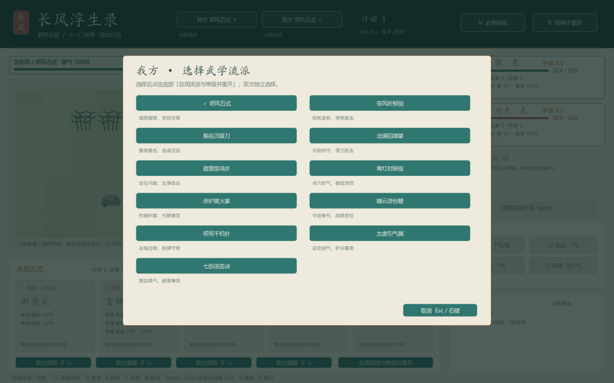
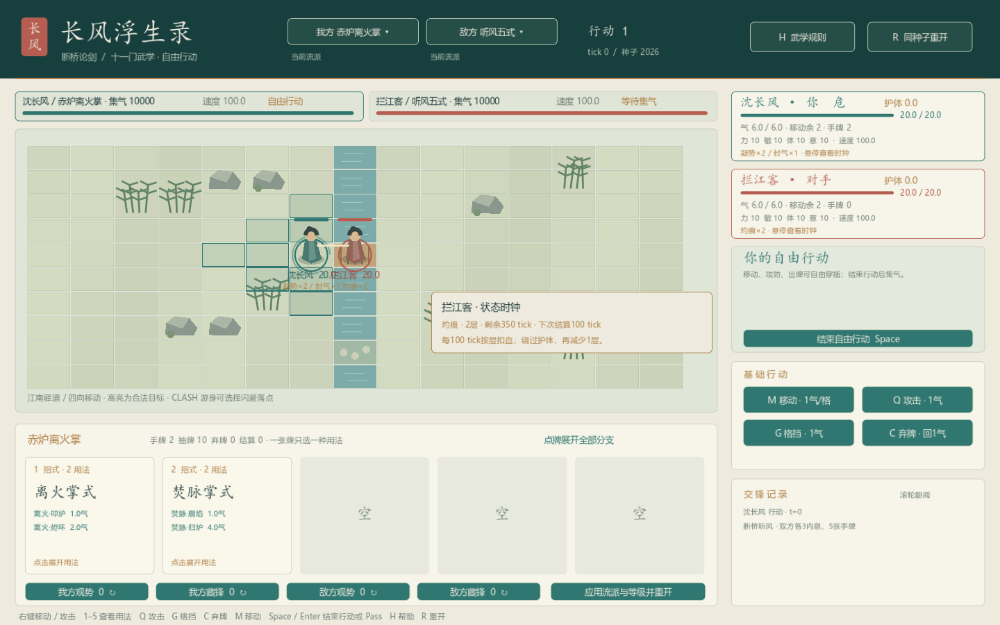

# changfeng_wuxue_v3：兼容性分析与移植结果

核对日期：2026-10-29。目标是当前模块化的断桥听风 Demo，源包是独立的十套武学 V3 原型。

## 1. 结论

**机制兼容，内容与公共能力已经迁入。** 当前仍使用同一个 BattleState、BattleModel、ActionRequest、费用与效果管线。15×10断桥棋盘、四维属性、CTB、自由ACTION和有限LIFO均保留；原型的7×5地图和单体 TingfengEngine 没有成为第二份运行时状态。

V3原包未经过Godot实际运行验收；本机编译其main.gd确认存在 `Engine` 别名与内置类重名，不能原样启动。两个Python静态检查通过，只说明数据和引用可读。此次验收依据的是迁入后的目标工程实际测试。

| 能力 | 与原框架的关系 | 实际处理 |
| --- | --- | --- |
| CTB、自由行动、四层LIFO | 一致 | 沿用当前调度／响应协议 |
| 费用、HP费用、命中子效果 | 已有公共接口 | 沿用并验证燃血后的条件计算 |
| 20核心式、41用法、7连携 | 格式大体相同 | 目录校验与内存规范化后加载 |
| 条件增伤 | 原包为三个独立effect类型 | 转现有有限 `conditional_bonus` |
| 强制位移 | 名称一致、字段不同 | 字段映射，保留当前逐格检查 |
| 远程攻击 | 原框架已有范围，但LOS语义不同 | 补正交直线、角色挡线和最小射程 |
| 每ACTION一次 | 原框架有额度槽，尚未接该声明 | 按定义＋usage计数，多个副本共用额度 |
| 凝势／封气／灼痕 | 原框架缺少该状态语义 | 加入统一StatusSystem与Timeline |
| 流派选择 | 原默认固定五式 | 双方独立选择，共11个选项 |
| 旧40卡ID | 不能当作当前UID | 仅提供非战斗定义引用适配 |

## 2. 实际可玩内容

默认仍可选听风五式。新增十门，每门两张核心式、每个核心式有多个usage：

| id | 流派 | 核心式 | 玩法侧重 |
| --- | --- | --- | --- |
| wind_sword | 苍风折柳剑 | wind_flow / wind_final | 低耗连斩、寻隙与终式 |
| saber | 裂岳沉锋刀 | saber_charge / saber_river | 凝势、重击、击退 |
| tide | 沧澜回潮掌 | tide_guard / tide_return | 护体、卸劲、迎锋与盾后增伤 |
| step | 踏雪惊鸿步 | step_shadow / step_swallow | 主动位移、闪避、步法护体 |
| finger | 青灯封脉指 | finger_seal / finger_finish | 封气、利用状态并消费 |
| ember | 赤炉离火掌 | ember_fire / ember_burst | 灼痕叠层与引燃 |
| whip | 缠云游丝鞭 | whip_coil / whip_cut | 中距牵引、露隙、控位 |
| needle | 听雨千机针 | needle_rain / needle_hidden | 2–4格直线、抽牌护体 |
| taixu | 太虚引气篇 | taixu_breath / taixu_guard | 运功回气、抽牌、蓄势 |
| blood | 七伤逆血诀 | blood_burn / blood_finish | 真实气血费用、换气与低血爆发 |

每门测试牌组12张：tf_probe×1、tf_step×2、tf_guard×2、tf_change×1，加本门两个核心式各3张。双方可以同门、异门，或一方继续使用听风五式。

全目录含原5式＋新增20式，共25定义、53种usage；单局只装双方所选流派的核心式，默认五式仍为5定义／12usage。镜像指同样的组成和规则，不保证洗牌后手牌相同。

7条专属连携为风回柳转、沉锋断岳、青灯叩关、炉火归元、牵丝断线、雨尽千丝、伤门焚脉；仍由当前ComboResolver读取已完成的主动攻击牌历史。普通攻击不被写成一张新武学牌去意外打断序列。

## 3. 状态与时间语义

| 状态 | 时效／叠层 | 统一结算 |
| --- | --- | --- |
| 凝势focus | 250tick，最多2层 | 下一次根攻击宣告时全部消费，每层+1；普攻／主动攻击牌均可消耗，MISS或中断不返还 |
| 封气qi_seal | 150tick，1层 | 期间自然回气减半，主动gain_qi不变；本人起势不额外扣气 |
| 灼痕scorch | 350tick，最多2层 | 每100tick绕护体扣当前层数HP，然后减1层；0层移除 |

封气按时间区间的起点判断，到期点是该区间的终点时，整段仍受封气影响。自然回气用200为分母累计整数余数，封印与未封印区间都不丢精度；满资源时不囤积溢出恢复量。

灼痕保存独立next_tick，刷新叠层延长expiry但不推迟原周期。Timeline即使一次收到较大的delta也会按周期／到期点切分，避免原包单次大步漏烧、周期漂移。周期与到期同刻时先周期后清除。

同一时刻先给双方结算自然恢复和周期伤害，再统一判断死亡，允许 `outcome="draw"`。灼痕产生SCORCH_TICK与带damage_kind=status的HP_DAMAGED，不伪造ATTACK_HIT，也不消费凝势。

原包里击退只检查终点的实现未照搬：当前仍逐格检查地形和占位，途中遇阻停止，后续独立效果照常处理。

## 4. 数据与代码接入

原始 `school_forms.json` 和 `legacy_id_map.json` 原样保存在data目录，SHA256见 [数据校验记录](wuxue-v3-reference/source-hashes.txt)。`SchoolCatalog` 完整校验数量、引用、费用、时机、目标、效果与映射，再返回深拷贝。

| 原包字段 | 当前内存规范化 |
| --- | --- |
| damage_if_status | 根deal_damage.conditional_bonus：状态层数×奖励，按需消费 |
| damage_if_shield | if_self_shield_gt + bonus |
| damage_if_low_hp.threshold_percent | if_self_hp_pct_lt_after_cost，百分数转0–1比值 |
| force_move.distance / away / toward | max_distance / away_from_attacker / towards_attacker |
| target=opponent | target=enemy，相对效果源确定对手 |
| target.max_distance | 同步到attack_profile.range |

这些武学复用公共效果，没有添加41个专属Hook。未知流派与坏目录通过load_error拒绝，控制器进入可诊断的终局，避免半装载对局或断言崩溃。

```gdscript
model.reset(2026, 0, "tingfeng", {
    "schools": {0: "wind_sword", 1: "saber"},
    "passives": {0: {"insight": 1}, 1: {"conceal": 0}}
})
```

`snapshot.school_catalog` 给UI 11项目录，`actors[].school_id/school_name` 公开。实际出牌仍提交 `card_uid+usage_id`，不把流派ID或旧卡ID当作UID。

`LegacySkillAdapter.resolve_legacy("wind_01")` 返回新definition_id/card_id和usage_id引用；step_01保留按old_usage选择evasion的分支。它不转换正在结算的攻击、手牌UID或旧存档中的运行时状态。

## 5. UI与AI

头部“我方／敌方”按钮打开11项流派菜单；选择后点击底部“应用流派与等级并重开”。双方观势／藏锋仍独立可调。手牌超过5张时分页显示，键盘1–5作用于当前页。

界面增加血费、每行动限次、正交射程、条件伤害说明，以及凝势／封气／灼痕层数与时钟提示；灼痕伤害有独立飘字，支持平局结局。

AI按规范化usage和公共效果评分，支持抽牌、回气、凝势、燃血风险和远程最小距离，仍仅选择合法选项。长局达到60 ACTION后，策略减少纯防御和护体，避免同门原型无限拖延；该阈值只影响AI评分，玩家合法动作不变。

## 6. 同时修正与性能

- 一级观势不再用turns_started做刷新标记，改用真实新抽牌产生的hand_generation；首次起势不重抽，也不再次揭牌。
- 移动选项在每次合法查询中只做一次全局BFS并复用路径；方向顺序和最短路径结果与原find_path保持一致，没有改动地形或移动规则。
- 原16配对串行验证曾超过180秒；改为批量路径后同一组验证约10.4秒，结果和重放trace保持一致。该数字是本机定向检查耗时，不代表其他机器的性能承诺。

## 7. 实际验收

| 定向检查 | 结果 |
| --- | --- |
| 原五式规则／AI／边界 | 105＋15＋145项通过 |
| V3目录、引用、映射、坏配置拒绝 | 198项通过 |
| V3全部41usage、7combo、状态、血费、范围、限次、路径等价 | 342项通过 |
| 新流派选择／分支／远程／分页／状态／平局真实UI | 61项通过 |
| 原UI回归 | 82项通过 |
| 原默认对局与重复验证 | 12场通过，玩法结果保持一致 |
| 流派对局 | 16组全部终局，2783次请求无合法性／守恒错误；其中2组再次运行，逐请求重放一致 |

目录、规则、AI、边界共805项，真实UI共143项。武学检查约2.6秒、流派对局约10.4秒；图形检查在本机NVIDIA OpenGL执行并自动退出，无运行ERROR。

```powershell
.\checks\verify.ps1 -Stage Catalog
.\checks\verify.ps1 -Stage Schools
.\checks\verify.ps1 -Stage SchoolPlaythrough
```

新增图形检查：显式运行 `res://battle.tscn` 并传入参数 `--wuxue-visual-check`。日志仍写captures及captures/checks，生成数据不加入Git。





## 8. 原包取舍与剩余边界

移植保留V3本身的简化：雁回掠锋是近身一击，未恢复“先移后攻”；雪尽无踪并入1格常规避锋；海门不动的完全无伤回气特例未恢复。它们不是目录映射后自动获得的旧40牌全部行为。

当前支持每门测试牌组，未实现任意门派混搭构筑、旧存档热迁移、门派培养、多角色队伍、斜线弹道或数值平衡验证。16组对局能结束不等于流派胜率平衡；太虚同门在当前策略下仍可能较长，本次样本93 ACTION。

完整接口见 [V3接入约定](../V3_CONTRACT.md)，总体内核见 [战斗框架详细说明](tingfeng-engine.md)，源包参考材料见 [V3原始说明](wuxue-v3-reference/README.md)。
