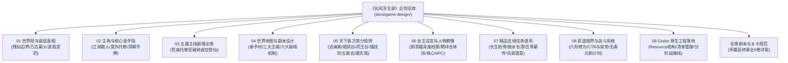

# 《长风浮生录：以武入道》游戏企划总纲（导航入口）

> **项目定位**：水墨高武玄幻 · 战棋卡牌与即时交锋 RPG  
> **核心立意**：凡人以武抗仙 · 万古薪火相传 · 破除残仙囚笼 · 破碎虚空登仙  
> **技术基石**：Godot 4.x 原生强类型 Resource 驱动（`content_manifest.tres`）

> **当前剧情版本：V2。** 序幕“江湖散人偶遇残镖”已经替换“宿命传承”；寿元暗伤／天命死线不再作为玩家系统，残卷初醒只揭示敌方当前手牌。第一幕已补[平江府六任务剧情链](game-design/chapters/act-1-pingjiang-v2.md)，但未实装 Godot 任务；各幕长对白仍待重写，请参照[主线 V2 同步清单](game-design/mainline-v2-consistency-audit.md)。

---

## 模块化企划专题库导航

本企划案已按模块全面拆解至 [`docs/game-design/`](game-design/README.md) 专题目录，请按需点击下方链接查阅各系统专项规约：

### 1. 系统与世界观专题（01–09）

| 编号 | 专题文档 | 主要内容提要 |
| :---: | :--- | :--- |
| **01** | [**01 · 世界观与底层真相**](game-design/01-worldview-and-lore.md) | 渊冥残仙万古布局、绝天地通三目的、历代先贤叩天、《逆仙图录》起源、名门宿老群像 |
| **02** | [**02 · 主角与核心金手指**](game-design/02-protagonist-and-cheat.md) | 沈长风江湖散人、两战建立严的信任、残卷首次洞察手牌与后续悬念 |
| **03** | [**03 · 五幕主线剧情全景**](game-design/03-main-storyline.md) | 序章暮秋残镖 → 第一幕江南药引 → 第二幕昆仑药劫 → 第三幕神都泣血 → 第四幕叩击绝天 → 终章极境入道 |
| **04** | [**04 · 世界地图与副本设计**](game-design/04-world-map-and-dungeons.md) | 新手村烟水渡、三大主城（姑苏/洛京/昆仑古集）、六大特色副本机制（GRID/FREE双模） |
| **05** | [**05 · 天下各方势力矩阵**](game-design/05-factions-and-sects.md) | 沧澜阁、烟岚剑谷、百草药王谷、玄天镇抚司、天人五衰会、无极通天观六大势力全貌 |
| **06** | [**06 · 女主设定与人物群像**](game-design/06-characters-and-heroine.md) | 顾清霜独立调查药案及功法风险、群像人物关系与各自目标 |
| **07** | [**07 · 精品支线任务谱系**](game-design/07-sidequests-system.md) | 【长生枯骨】、【弱水长清】、【百草薪传】、【重铠之泪】、【先贤遗意】五大深度支线 |
| **08** | [**08 · 武道境界与战斗系统**](game-design/08-cultivation-and-combat.md) | 六阶武道修为梯队、原生洞察、CTB推条与架势破势；不引入寿元死线 |
| **同步审查** | [**主线 V2 一致性与逐幕改写清单**](game-design/mainline-v2-consistency-audit.md) | 明确已落实设定、逐幕剧本待修改处与剧情制作优先顺序 |
| **第一幕 V2** | [**平江烟雨 · 六任务剧情链**](game-design/chapters/act-1-pingjiang-v2.md) | 家书、假药、草药欠款、货运账、严守诚疑踪和韩啸后续补查 |
| **09** | [**09 · Godot 原生工程落地**](game-design/09-godot-engineering.md) | 严格遵循 Godot 4.x 强类型 `.tres` 资源结构，绑定 `content_manifest.tres` 清单及演进路线 |
| **宏大志A** | [**天下九州地理大志 · 场景全景谱系**](game-design/world-gazetteer-and-regions.md) | 涵盖大乾九州（江南/东海/南岭/江汉/中原/昆仑/北荒）20+ 城镇山川秘境生态与风貌 |
| **宏大志B** | [**天下群英录 · 50+ 人物深度档案集**](game-design/grand-character-encyclopedia.md) | 50余位各派掌门、权臣宦官、市井草莽、魔头宿老、战死先贤的性格身世台词全景 |

---

### 2. 全景剧情与关卡剧本分卷（序幕–终章）

| 篇章 | 章节文档直达 | 核心剧情高潮与关卡Boss |
| :---: | :--- | :--- |
| **序幕** | [**序幕 V2 · 暮秋荒庙 · 雨夜逃亡**](game-design/chapters/act-0-prologue-v2.md) | 带家书途经破庙，救治重伤严守诚、两波追兵、断桥托付无名残卷，最后战斗初次洞察手牌。 |
| **第一幕** | [**第一幕 V2 · 平江烟雨 · 水市药案**](game-design/chapters/act-1-pingjiang-v2.md) | 完成家书与谋生，查水市假药、采药人工钱和跨区货运；顾清霜与岚尘因各自调查合作；[旧版 V1 台词归档](game-design/chapters/act-1-jiangnan.md)。 |
| **第二幕** | [**第二幕 · 名门暗流 · 昆仑药劫**](game-design/chapters/act-2-kunlun.md) | 争夺甲子赤龙果；古卷【观天真眼】破毒害；枯木剑圣舍身斩魔；长风破入通玄宗师。 |
| **第三幕** | [**第三幕 · 神都泣血 · 帝京鼎炉**](game-design/chapters/act-3-shendu.md) | 严烈救妹反戈；攻破观星台万灵血池；斩杀妖化崇明帝，崩碎国师陈玄道肉身法躯。 |
| **第四幕** | [**第四幕 · 叩击绝天 · 先贤共鸣**](game-design/chapters/act-4-frozen-gate.md) | 极北绝天大阵；顾清霜得弱水女圣灌顶破除早夭血煞；十二万古先贤归一，长风达半步天人极境。 |
| **终章** | [**终章 · 极境入道 · 剑斩残仙 · 破碎虚空**](game-design/chapters/act-5-finale.md) | 凡人以武入道成就陆地真仙；剑斩幕后真凶渊冥残仙；一剑劈碎锁灵大阵；昆仑立碑传道，破碎虚空飞升。 |

---

*总纲与序幕 V2、第一幕 V2 任务链已更新。第一幕至终章长篇对白尚在迁移；平江任务仍为企划文档，不能据此宣称全套剧情已与当前 `demos/changfeng-battle/` 100% 一致。*
