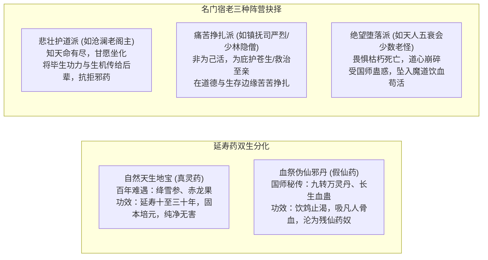

# 01 · 世界观与底层真相：残仙囚界与万古薪火

> **关联索引**：[企划总库](README.md) · [主线全景](03-main-storyline.md) · [势力矩阵](05-factions-and-sects.md)

---

## 一、宏观背景：绝天地通与仙凡之变

万载之前，天地灵气浩荡，九天之上仙宫林立，凡界修道通玄者皆可御空登仙。然而不知从何纪元起，仙路断绝，九重天门封闭，世称“绝天地通”。

自此，此方世界规则残缺，生灵寿命被无形天道斩断枷锁，凡俗之人寿不过百；即便是参透阴阳、内力深厚至移山填海的绝世武道大宗师，肉身寿元亦止步于 **两百岁天堑（天命大限）**。任你生前横压一世，限期一至，天人五衰，枯骨黄土。

---

## 二、幕后黑手：上界败寇“渊冥残仙”

* **败逃下界**：万年前，上界发生惊天动地的仙神浩劫，数尊古老仙人在争夺至尊道果中惨败。其中一尊身负重创、法躯崩裂的仙尊撕裂虚空，携残缺神魂潜逃到这方凡俗下界苟延残喘，世称**“渊冥残仙”**。
* **封天锁地的三大目的**：
  1. **遮掩天机**：布下覆盖整界的“锁灵绝天大阵”，彻底切断凡界与上界的空间坐标连接，避免上界仇家搜寻追杀。
  2. **扼杀威胁**：抽干天地灵脉，压制下界武者寿元上限至**两百岁天堑**，阻绝任何后人触及仙道，防止下界诞生能够威胁其存在的巅峰生灵。
  3. **寄生吮血**：残仙伤势过重，仙魂无时无刻不在溃散，必须定期吞噬下界磅礴的气血生机与高手神念来压制伤势、维持苟活。

---

## 三、历代前贤的泣血抗争与《逆仙图录》

* **前贤叩天**：自古至今，凡界每隔数百上千年，总有绝艳惊才的天纵奇才——剑圣、拳皇、神医、奇门道尊，修至“半步天人”境界，察觉到了悬在人世头顶的这双无形巨眼。
* **悲壮落幕**：他们曾结伴破空，试图斩碎苍穹天阵。然而凡俗武学虽通玄，面对掌握了仙界高维法则与仙道本源的残仙，依然如飞蛾扑火，一代代大能血洒天穹，抱恨而终。
* **万古结晶《逆仙图录》**：
  * 在覆灭前夕，最后的十二位半步天人先贤在绝峰血祭残躯，将凡界历代武圣破关、推演、战死前窥见的仙道破绽，融铸为一卷承载人间武道终极希望的圣物——**《逆仙图录》（即主角手中的兽皮古卷）**。
  * 残仙察觉后悍然出手，天罚降世，古卷被击得**四分五裂**，大部分神髓化作飞灰，唯有一片承载着核心推演中枢的兽皮古卷残篇，被护界隐修脉死命带走，隐匿人间。

---

## 四、延寿奇珍与名门宿老的真实群像

为了避免武林名宿沦为千篇一律的脸谱化恶人，世界观确立了严谨的人性与物产分化：

### 1. 灵药的真实面貌：天地造化 vs 伪仙毒饵
* **真正的人间灵药（地宝）**：如百年“绛雪九叶参”、极阳“甲子赤龙果”。它们吸收山川灵气数百年而成，药力温和醇正，确实能延寿一二十载、修复暗伤、强健根骨。它们是世间极为珍贵的自然奇珍，是武林正道争相探寻的正统宝物。
* **伪仙的收割之毒（血丹）**：国师暗中向朝廷与濒死老怪推销的“九转长生仙方”，声称能打破两百岁大限直达五百岁。其实质是用活人血气炼制的“夺灵血煞”，虽能短期激发回光返照，却会在经脉种下残仙的“噬灵血引”，让人最终化为行尸走肉。

### 2. 名门宿老的立体众生相
* **沧澜老阁主（一代宗师的从容与悲壮）**：
  寿数仅剩一年，白发苍苍。面对国师奉上的“延寿神丹”，他一眼识破其中蕴含的冤魂血腥，毅然拂袖打翻丹炉：“老夫持剑八十载，求的是俯仰无愧！若靠吸食黎民血肉苟活，即便活上一万年，不过是一头穿衣的恶鬼！”临终前，他将浑身沧澜纯阳劲尽数化入灵泉，为顾清霜等后辈洗髓筑基。
* **各派名宿的艰难守护**：
  许多老祖即便面对天命大限，依然盘坐山门舍身洞中，不踏江湖一步，只为在山门遭遇灭顶之灾时，能拼着燃尽最后一口生机，出关替后世弟子斩杀强敌。这种沉甸甸的宗门责任与向死而生的气魄，构成了真实而有厚度的人间江湖。

