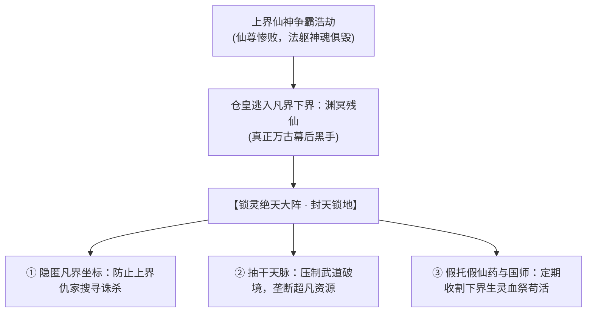
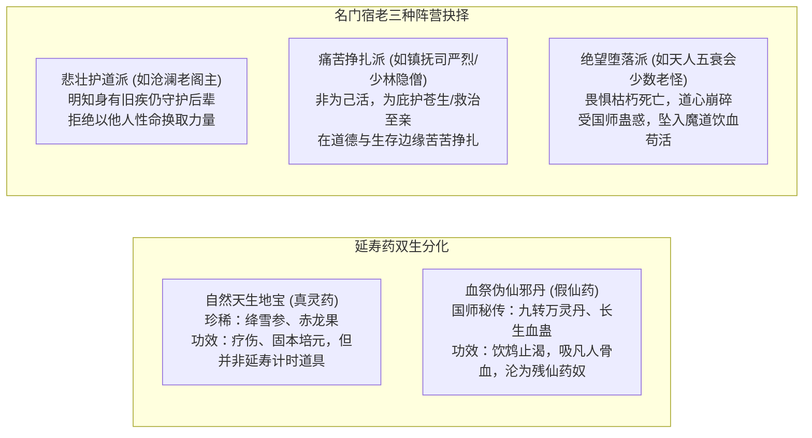

# 01 · 世界观与底层真相：残仙囚界与万古薪火

> **关联索引**：[企划总库](README.md) · [主线全景](03-main-storyline.md) · [势力矩阵](05-factions-and-sects.md)

> **信息分层**：本页记录作者侧可能成立的远期世界真相，并非开场旁白或 NPC 已知事实。序幕至江南初期一律只称“残卷”；完整名称、来源、是否关联上古封界须由玩家在中后期逐步查证。主角与残卷相遇是偶然，不能倒推成残仙或守卷组织早已安排好的接头。

---

## 一、宏观背景：绝天地通与仙凡之变

万载之前，天地灵气浩荡，九天之上仙宫林立，凡界修道通玄者皆可御空登仙。然而不知从何纪元起，仙路断绝，九重天门封闭，世称“绝天地通”。

自此，天地灵机与破境之路逐渐衰败。普通人会经历疾病和衰老，高阶武者也难以无限突破，但**不设武者统一的两百岁死亡界限**。寿命不与境界、角色数值或主线经过的年份直接绑定，凡俗江湖的冲突仍发生在人能经历的数月到数年之内。

---

## 二、幕后黑手：上界败寇“渊冥残仙”

* **败逃下界**：万年前，上界发生惊天动地的仙神浩劫，数尊古老仙人在争夺至尊道果中惨败。其中一尊身负重创、法躯崩裂的仙尊撕裂虚空，携残缺神魂潜逃到这方凡俗下界苟延残喘，世称**“渊冥残仙”**。
* **封天锁地的三大目的**：
  1. **遮掩天机**：布下覆盖整界的“锁灵绝天大阵”，彻底切断凡界与上界的空间坐标连接，避免上界仇家搜寻追杀。
  2. **扼杀威胁**：抽干天地灵脉，扭曲武道进阶与修行资源的分配，使突破极境异常艰难，防止下界诞生能够威胁自身的强者。它不是给每个人设定固定死期的世界计时器。
  3. **寄生吮血**：残仙伤势过重，仙魂无时无刻不在溃散，必须定期吞噬下界磅礴的气血生机与高手神念来压制伤势、维持苟活。

---

## 三、历代前贤的泣血抗争与残卷来源（作者侧机密）

* **前贤叩天**：自古至今，凡界每隔数百上千年，总有绝艳惊才的天纵奇才——剑圣、拳皇、神医、奇门道尊，修至“半步天人”境界，察觉到了悬在人世头顶的这双无形巨眼。
* **悲壮落幕**：他们曾结伴破空，试图斩碎苍穹天阵。然而凡俗武学虽通玄，面对掌握了仙界高维法则与仙道本源的残仙，依然如飞蛾扑火，一代代大能血洒天穹，抱恨而终。
* **残卷传说与待验证的真相**：
  * 后世零散材料记载，先贤曾以武道心得、观敌之术和破境尝试留下某种可读的载体；作者侧暂可沿用《逆仙图录》作为远期真相的工作名称，**不等于主角一开始获得的残卷已被证实属于它**。
  * 卷是否曾被击碎、片数为何、谁保存到严守诚手中，都须留出中期调查与证据链。不能直接设成严守诚与主角家师早就相识、卷上有验证血脉的铭印。

---

## 四、延寿奇珍与名门宿老的真实群像

为了避免武林名宿沦为千篇一律的脸谱化恶人，世界观确立了严谨的人性与物产分化：

### 1. 灵药的真实面貌：天地造化 vs 伪仙毒饵
* **真正的人间灵药（地宝）**：如珍稀的“绛雪九叶参”、极阳“甲子赤龙果”。药力温和，可治疗特殊药毒、经脉旧损与危重病症，但效果因人而异；不存在统一“服下增加二十年寿命”的系统规则。
* **伪仙的收割之毒（血丹）**：国师暗中向朝廷与濒死豪强兜售的“九转长生仙方”，吹嘘能医治百病、突破境界。实为以活人血气炼制的“夺灵血煞”，虽然短暂激发身体，却埋下依赖、异化和服从残仙的血引。

### 2. 名门宿老的立体众生相
* **沧澜老阁主（一代宗师的从容与悲壮）**：
  白发苍苍，积年伤病难愈。面对国师奉上的“延寿神丹”，他一眼识破其中蕴含的冤魂血腥，毅然拂袖打翻丹炉：“老夫持剑八十载，求的是俯仰无愧！若靠吸食黎民血肉苟活，即便活上一万年，不过是一头穿衣的恶鬼！”未来若安排他为护众人牺牲，应由当场抉择与战况推动，而非预设寿命倒计时。
* **各派名宿的艰难守护**：
  许多老祖即便面对天命大限，依然盘坐山门舍身洞中，不踏江湖一步，只为在山门遭遇灭顶之灾时，能拼着燃尽最后一口生机，出关替后世弟子斩杀强敌。这种沉甸甸的宗门责任与向死而生的气魄，构成了真实而有厚度的人间江湖。

