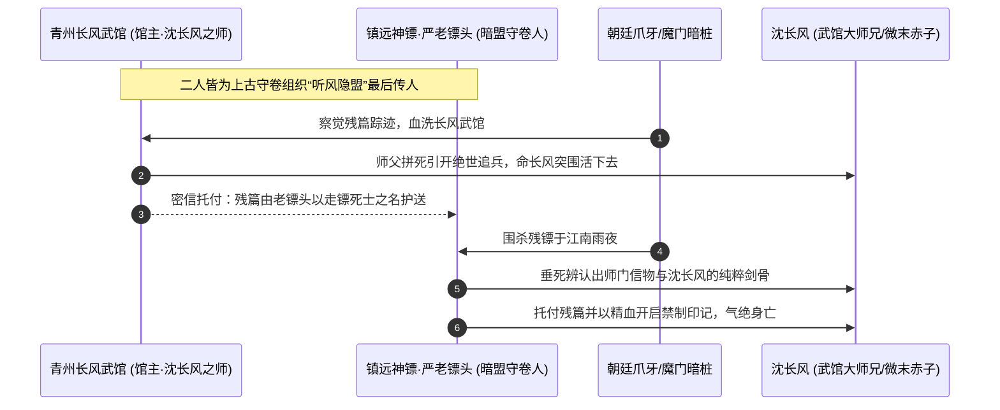

# 02 · 主角与核心金手指：沈长风与《逆仙图录》

> **关联索引**：[企划总库](README.md) · [世界观与底层真相](01-worldview-and-lore.md) · [武道境界体系](08-cultivation-and-combat.md)

---

## 一、为什么是老镖头？为什么会给主角？（传承因果闭环）



### 1. 武馆并非寻常小道馆
沈长风的师父名震一方却大隐于市，实为“听风隐盟”（历代先贤守卷后人）的一员。长风武馆被焚，并非偶然流寇，而是朝廷国师（残仙在人间的代言人）顺藤摸瓜杀人灭口。

### 2. 师父舍身诱敌
师父预感大劫，将残卷缝入古老死镖镖车暗格，由生死之交“镇远老镖头”乔装押运，师父自己则携伪卷引开追兵主力，壮烈战死。

### 3. 雨夜托孤的合理性
老镖头身负数十道致命伤，在江南荒庙油尽灯枯。巧遇在此避雨的沈长风，认出了沈长风佩剑上师门独有的“听风铭印”，以及沈长风身上与师父如出一辙的纯正武者骨气。老镖头知晓自己绝无幸理，临终前以心头最后一口精血抹去外层封印，将残卷郑重托付！

---

## 二、主角的独特性：为何独他能“以武入道”？

1. **赤子剑心 · 无垢武骨**：
   世人修武多求荣华富贵或贪图长生，心境充满欲念杂质；沈长风历经师门尽毁、微末苟活，心如磐石，只求“见众生、证武道、讨公道”，神魂澄澈，契合古卷无念自通的要求。
2. **凡人纯阳体魄的奇妙契合**：
   历代先贤为突破天堑，往往贪纳天地驳杂之气，反被残仙的大阵同化；沈长风生于微末，武功一招一式皆从最基础的站桩、拔剑、搬运凡胎气血练起，肉身底子纯粹至极，反倒成了承载“先贤纯粹武道法则”的最佳容器。

---

## 三、古卷“推演神能”的常态化玩法与剧情贯穿

古卷绝非结局才有用的话柄，而是主角从**第 1 天起就能依赖并成长的核心金手指系统**：

```text
【逆仙古卷 · 三重觉醒能力】

1. 一阶能力：【演武明镜】（前期常驻玩法）
   - 招式推演与质变：自动记录战斗中见识过的敌方招式，推演其破绽与最佳解法。
   - 玩法体现：在战斗中，主角每成功用【化劲】或【探锋】抵挡敌方攻击，古卷积蓄演武进度，将基础招升级为派生神技（如把「折柳剑」优化出不可被反制的「折柳·无痕」）。

2. 二阶能力：【观天真眼】（中前期破解“藏锋/迷雾”）
   - 气机洞察：看破敌方体内真气运转流向、寿元亏空虚弱期与暗中准备的伏手。
   - 玩法体现：全面强化游戏中的“观势 (Insight)”系统，强制显示敌方手牌、破除敌方潜行隐匿，精准显示敌方架势断裂点（Break Point）。

3. 三阶能力：【先贤神念复苏】（中后期逆天破境）
   - 薪火传承：随着沈长风探索上古遗迹、击败被残仙操控的傀儡，古卷会逐一激活上古十二位武圣的“战意烙印”（如刀圣的斩天之志、医仙的逆命生机）。
   - 玩法体现：每激活一位先贤印记，主角获得专属的【意境领域（Domain）】，真气上限翻倍，解锁扭转战局的“先贤共鸣绝技”。
```

---

## 四、主角属性与战斗机制配置

* **基础属性分布**（`WuxiaCharacterDefinition`）：
  * 初始：`STR: 12, AGI: 12, CON: 10, MND: 10`
  * 随着古卷推演与历练成长，四维均衡且成长上限极高，后期完全超越普通人二百年极限。
* **招式风格**：
  * **前期**：以苍风折柳剑法、探锋式为主，讲究以快打慢、见招拆招。
  * **中期**：古卷激活变招，具备即时派生连携（`grant_card`）与破绽露隙追加伤害。
  * **后期**：以武入道，身化清风长虹，施展超凡武道法则招式【破碎虚空】。

