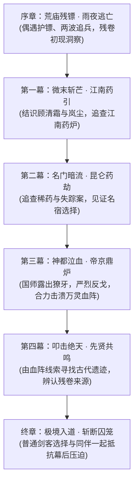

# 03 · 五幕主线剧情全景：从微末到破碎虚空

> **关联索引**：[企划总库](README.md) · [世界观与底层真相](01-worldview-and-lore.md) · [现行序幕详案](chapters/act-0-prologue-v2.md) · [第一幕 V2 任务链](chapters/act-1-pingjiang-v2.md) · [第一幕 V1 旧对白](chapters/act-1-jiangnan.md)

> **V2 总纲（剧情方向已修正，逐幕对白尚待改写）**：主角是因送信途经荒庙的江湖散人，偶然救人获得残卷；主线应由小人物的具体利益与主动选择向外延伸，不能暗示每次事件都被大人物安排。故事以数月到两年左右的连续旅程为宜，不靠跨越百年的寿元倒计时制造紧迫感。完整残卷书名及上古真相，只有作者侧内部资料能预知。

---

## 主线结构演进脉络

---

## 序章：荒庙残镖 · 雨夜逃亡（详见 `chapters/act-0-prologue-v2.md`）
* **场景**：沈长风是送家书往平江府的普通江湖散人，因雨在破庙歇脚，探索官道时意外目睹劫镖余波。
* **剧情转折**：玩家可救或不救重伤严守诚；选择救人后在破庙疗伤，先后击退两名、三名追镖探子。严在断桥因主角的实际义举而托付**无名残卷**，自己留下拖延搜山队，生死未知。
* **高光体验**：主角独自潜入溪谷，对上一名落单哨探时意外激活残卷，首次获得**洞察敌方手牌**能力，逃向烟水渡和平江府。韩啸只是执行截镖、灭口的现场头目，此时既没见过主角，也不知道关键物品或残卷的存在。

---

## 第一幕：微末斩芒 · 平江药案（详见 `chapters/act-1-pingjiang-v2.md`）
* **剧情舞台**：先落在已制作的平江府南门、十字路、水市、沈家旧宅及近郊，再逐渐进入更大的江南药材网络；地图分区与剧情节奏要对应，而非第一幕直接跳过平江。
* **私事先行**：沈长风寻找周阿禾并送达乡邻周婶的普通家书，赚取路费与落脚之所，隐藏无名残卷。寻找严守诚下落是并行且可暂缓的私人疑问，而非被密令强迫追查“师门血仇”。周婶、周阿禾为任务链拟定 NPC，尚未转成原生资源。
* **友人相交**：
  * 顾清霜独立调查有人冒用沧澜阁采购名义的货单与失踪搬运工。两人因平江府水市假药样本合作，查验票据后才互信，不以主角的神秘身世或万能推演换取友谊。
  * 岚尘追查被拖欠的药苗货款、采药人的处境，初期以识药、熟悉山路与市井关系发挥作用，不是被迫等待主角营救的道具人。
* **破局**：从假药包纸、采购印记、草药批次、失踪搬运工证词与账房双簿找出外地货源节点。玩家在本幕**尚不能据此断定存在血炉、国师或残仙**；鬼市大决战视后续场景可玩性决定是否留在第一幕末。
* **韩啸线**：劫镖后先向上级汇报并交出查获货物；上级核对时发现缺少关键物品，才命韩啸补查。韩啸起初连物品是什么都不知道，听到缺失消息才怀疑严守诚或第三方带走了某物。即便开始调查，他也不能凭序幕夜雨中的模糊目击查出主角姓名。可在本幕逐步提供上级交差记录、重新盘问幸存者或货物流向等证据，不预定他与黑市的交易一定成立。
* **地图身份**：PJ-04 保留稳定名“沈家旧宅”及既有资产，但**不是沈长风的祖宅**；普通江湖散人的故乡与平江旧院不预设命定关联。

---

## 第二幕：名门暗流 · 昆仑药劫
* **剧情舞台**：沿第一幕真实取得的货运批次和供药线索前往外地，再到雪山绝壁、凌云剑宗、药王谷圣地；不要仅因地图解锁突然跳至昆仑。
* **核心冲突**：难得一见的“甲子赤龙果”及其他能解药毒的珍稀灵材，被势力争夺和哄抬；有人在交易环节混入邪药，危及急需救治的病者。争夺是**眼下利益冲突**，不是人人正好迎来百年寿限。
* **反转与升华**：查明被动过手的药材、可疑制药工艺和利益关系后，沈长风、顾清霜等人共同破解局面。是否让残卷获得更强的观察药毒或伪装能力，必须有独立的学习过程和限制；不能第一眼就自动看透全场。名宿可为救众人而付出战斗代价，避免“燃尽三年命元”的数值说法。

---

## 第三幕：神都泣血 · 帝京鼎炉
* **剧情舞台**：第二幕的交易与验药实证把人祸线索引至皇城紫禁、太清观星台、地下暗河大阵；地方上的掺假商贩不必预先知道此事。
* **危机顶峰**：随着假药和失踪人口证据汇聚，发现朝廷有人利用灾祸、征发和假医药生意收割百姓，试图在神都启动覆盖全城的“万灵归源大阵”。皇帝害怕失权与衰老，可以受国师迷惑，但不需要一条可量化的“寿元见底”任务计时器；此时仍不宜把所有阴谋直接解释给玩家。
* **豪杰聚义与宿敌反戈**：
  * 沈长风与沧澜阁、药王谷、烟岚谷联手潜入神都。
  * 镇抚司都统**严烈**发现病重的妹妹竟也被列为祭品，终于彻底看清国师的恶魔本质，愤而反戈，以重铠之躯横刀劈碎观星楼地基机关！
* **破阵**：主角和多方同伴按前几幕收集的证据寻找并破坏阵眼，避免最终仅靠残卷“自动指路”。国师败退后留下指向极北的实证，故事才可从朝堂追索升级到更久远的真相。

---

## 第四幕：叩击绝天 · 先贤共鸣
* **剧情舞台**：北极绝天雪域、万古天门废墟、上古封界大阵中心。
* **万古悲歌**：依循血阵残迹、古文与各派收藏的碎片找到远古遗址，逐步证实残卷与先贤武学记录有关；**完整卷名是否在此揭示**，以证据线和后续企划确认，不把开局的猜想写成绝对真相。
* **传承大成**：古代武者留下的是可被学习、争论、质疑的心法和失败记录，不是验证主角“纯粹武心”的单人继承考验。成长由同伴和主角自己的选择促成，具体终极能力待设计。

---

## 终章：极境入道 · 剑斩残仙 · 破碎虚空（方向待复核）
* **终极对决**：冰封地渊轰然破碎，盘踞在凡界万年的幕后真凶——**“渊冥残仙”**法相降世！残仙残魂庞大如遮天巨影，周围环绕着高维仙界规则黑洞，轻蔑嘲弄凡人如蜉蝣草芥。
* **以武入道 · 陆地真仙**：
  * 残仙施展上界仙术企图抽干天地灵气，同伴们以护体罡气结成大阵拼死抵挡。
  * 沈长风闭目凝神，长风折柳剑归于鞘中。他不求天、不拜仙、不吞外药，以凡人之躯点燃精气神三宝，体内凡俗武学在这一刻轰然升华为无上武道法则——**以武入道，肉身为仙，登临人间唯一的“陆地神仙”境界！**
* **一剑开天**：
  * 沈长风拔剑出鞘，这一剑蕴含了人间千万武者的不屈战意，直接跨越了仙凡维度的天堑！
  * 一剑斩灭渊冥残仙的神魂核心，彻底破灭了残仙万年寄生苟活的恶梦；余威化作贯穿天地的冲霄剑虹，顺势将笼罩凡界万年的“锁灵绝天大阵”**一剑斩爆**！
* **传道立碑**：
  * 天地封锁解除，修行资源的垄断被打破、被寄生的百姓得以挣脱抽取；不以“所有人的寿元上限自动解锁”为唯一胜利目标。
  * 沈长风于昆仑绝顶立下万丈“长风道碑”，刻下《以武入道真经》九卷，将古卷中的先贤推演之法与正道武学毫无保留地公诸天下，告诫人间：“人人皆可习武，人人皆可自强，长生不假外物，大道行于脚下。”
* **破碎虚空**（保留为远期可选结局，而非第一幕即确定的命运）：
  * 苍穹之上，天门大开，真正的无垠星汉祥云涌动，天地迎真仙。
  * 众友仰望，青衫飘摇。沈长风回首向顾清霜、岚尘、严烈等人相视一笑，抱拳一揖，身化清风长虹，破碎虚空，飘摇登仙而去！

