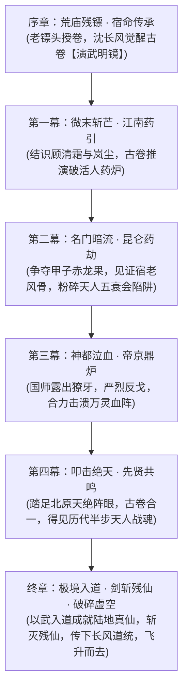

# 03 · 五幕主线剧情全景：从微末到破碎虚空

> **关联索引**：[企划总库](README.md) · [世界观与底层真相](01-worldview-and-lore.md) · [序幕详案](chapters/act-0-prologue.md) · [第一幕详案](chapters/act-1-jiangnan.md)

---

## 主线结构演进脉络

---

## 序章：荒庙残镖 · 宿命传承（详见 `chapters/act-0-prologue.md`）
* **场景**：江南道暮秋荒庙，电闪雷鸣。
* **剧情转折**：沈长风逃亡至此，救下严老镖头。老镖头认出师门信物，揭露长风武馆被灭的惊天隐秘，吐血以心火抹去兽皮古卷禁制，将古卷按入沈长风掌心，溘然长逝。
* **高光体验**：追兵杀入庙内，沈长风危急关头触发古卷初阶能力【演武明镜】，眼中世界瞬间凝滞，敌人的出招轨迹、破绽帧与架势弱点如清溪般流淌在心底。沈长风以不可思议的精妙变招斩杀追兵首领，踏出复仇与寻道的第一步！

---

## 第一幕：微末斩芒 · 江南药引（详见 `chapters/act-1-jiangnan.md`）
* **剧情舞台**：水乡姑苏、烟岚山谷、地下鬼市。
* **友人相交**：
  * 偶遇微服追查师门悬案的冷面女侠**顾清霜**。沈长风以古卷推演补全了她掌法中滞涩的转折，二人结为莫逆。
  * 在烟岚谷救下被魔门围攻的采药奇才**岚尘**，得知近来江湖多处纯正灵药产地被朝廷玄衣卫强行霸占摧毁。
* **破局**：三人潜入鬼市，击破正暗中抽取少年侠士精血的“假灵芝血炉”。沈长风在激战中靠古卷解析出敌方掌毒破绽，一剑封喉，名动江南。

---

## 第二幕：名门暗流 · 昆仑药劫
* **剧情舞台**：雪山绝壁、凌云剑宗、药王谷圣地。
* **核心冲突**：昆仑极顶百年奇珍“甲子赤龙果”成熟。正道宿老齐聚，魔门天人五衰会亦倾巢而动。
* **反转与升华**：国师暗中派出奸细，企图在灵果中注入血煞，挑起正道自相残杀。沈长风凭借古卷【观天真眼】当场识破剧毒伪装，挽救了数位差点误服受控的正道掌门。正魔混战中，凌云剑宗老祖燃尽残躯击退魔门巨擘，临终前抚摸沈长风剑脊：“天地有缺，路在人行……小友，莫要像老夫这般困死于寿元！”沈长风深受触动，心境彻底蜕变，剑意与古卷产生强共鸣，突破至**宗师通玄境**！

---

## 第三幕：神都泣血 · 帝京鼎炉
* **剧情舞台**：皇城紫禁、太清观星台、地下暗河大阵。
* **危机顶峰**：大乾皇帝寿元将尽陷入疯狂，听信国师蛊惑，以庆典为名诱骗百万百姓与万名江湖武者入神都，启动覆盖全城的“万灵归源大阵”，企图汇聚人间生机供奉给幕后的“渊冥残仙”，换取仙人施舍的一滴长生仙血！
* **豪杰聚义与宿敌反戈**：
  * 沈长风与沧澜阁、药王谷、烟岚谷联手潜入神都。
  * 镇抚司都统**严烈**发现病重的妹妹竟也被列为祭品，终于彻底看清国师的恶魔本质，愤而反戈，以重铠之躯横刀劈碎观星楼地基机关！
* **破阵**：沈长风斩杀发狂的妖化皇帝，在古卷指引下一剑斩断阵眼枢纽，拯救神都苍生。国师肉身溃灭，残魂惨嚎着逃向极北禁地。

---

## 第四幕：叩击绝天 · 先贤共鸣
* **剧情舞台**：北极绝天雪域、万古天门废墟、上古封界大阵中心。
* **万古悲歌**：沈长风一行跨过万里雪原，踏入万年前的大阵核心。在此处，兽皮古卷与残破的阵盘严丝合缝地融合，刹那间，大阵冰层中映照出万古以来一位位战死于此的先贤英灵：持刀劈天的霸王、断剑不折的女圣、以身堵阵的医皇……
* **传承大成**：先贤英魂并未消散，他们的执念与战意尽数汇入沈长风的识海：“万年了……人间终于有人携纯粹武心走到此处！”沈长风尽纳万古武圣精华，将体内真气完全蜕变为天地大道神罡，参透武道极境，踏入前所未有的**“半步天人·极境巅峰”**！

---

## 终章：极境入道 · 剑斩残仙 · 破碎虚空
* **终极对决**：冰封地渊轰然破碎，盘踞在凡界万年的幕后真凶——**“渊冥残仙”**法相降世！残仙残魂庞大如遮天巨影，周围环绕着高维仙界规则黑洞，轻蔑嘲弄凡人如蜉蝣草芥。
* **以武入道 · 陆地真仙**：
  * 残仙施展上界仙术企图抽干天地灵气，同伴们以护体罡气结成大阵拼死抵挡。
  * 沈长风闭目凝神，长风折柳剑归于鞘中。他不求天、不拜仙、不吞外药，以凡人之躯点燃精气神三宝，体内凡俗武学在这一刻轰然升华为无上武道法则——**以武入道，肉身为仙，登临人间唯一的“陆地神仙”境界！**
* **一剑开天**：
  * 沈长风拔剑出鞘，这一剑蕴含了人间千万武者的不屈战意，直接跨越了仙凡维度的天堑！
  * 一剑斩灭渊冥残仙的神魂核心，彻底破灭了残仙万年寄生苟活的恶梦；余威化作贯穿天地的冲霄剑虹，顺势将笼罩凡界万年的“锁灵绝天大阵”**一剑斩爆**！
* **传道立碑**：
  * 天地封锁解除，上界纯净灵机浩浩荡荡垂落人间，凡人寿元枷锁破碎，武道前路再无断绝之忧。
  * 沈长风于昆仑绝顶立下万丈“长风道碑”，刻下《以武入道真经》九卷，将古卷中的先贤推演之法与正道武学毫无保留地公诸天下，告诫人间：“人人皆可习武，人人皆可自强，长生不假外物，大道行于脚下。”
* **破碎虚空**：
  * 苍穹之上，天门大开，真正的无垠星汉祥云涌动，天地迎真仙。
  * 众友仰望，青衫飘摇。沈长风回首向顾清霜、岚尘、严烈等人相视一笑，抱拳一揖，身化清风长虹，破碎虚空，飘摇登仙而去！

