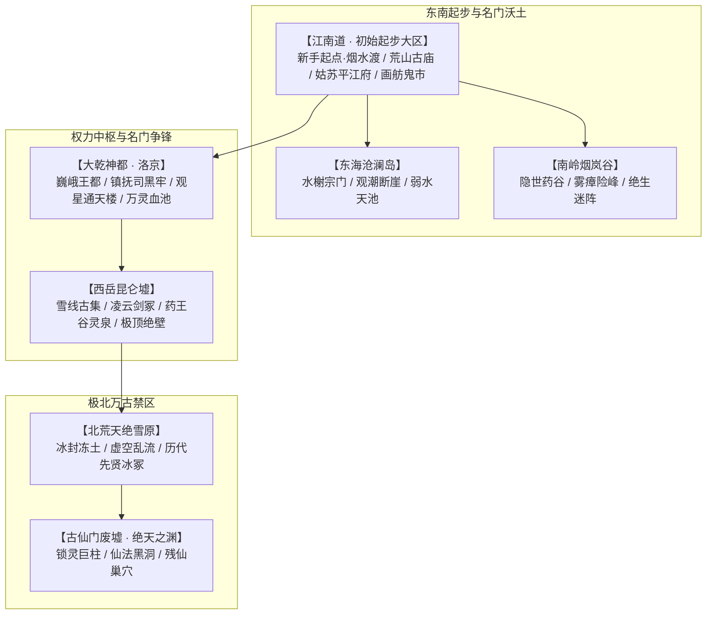
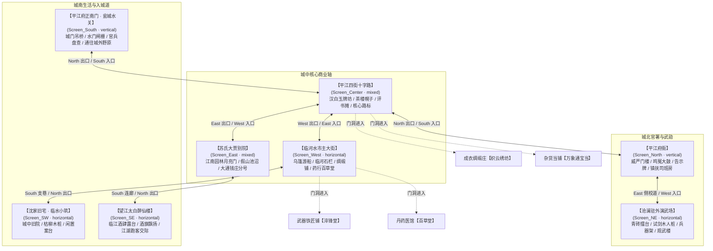

# 04 · 世界地图与副本设计：大乾九州与极北绝地

> **关联索引**：[企划总库](README.md) · [主线全景](03-main-storyline.md) · [地理大志](world-gazetteer-and-regions.md) · [序幕详案](chapters/act-0-prologue.md) · [第一幕详案](chapters/act-1-jiangnan.md) · [场景生产标准](../../art-production/standards/TOWN_MAP_SCALE_PRODUCTION.md)

---

## 一、宏观地理全景与场景制作统一规范

### 1.1 宏观地理演进谱系
本作世界由大乾九州腹地、世外宗门秘境以及极北万古禁区构成。地图采用**“宏观区域探索 + 箱庭微缩城镇 + 战棋/自由空间副本（GRID/FREE双模）”**的结构。开局起点确立为**江南道**，包含城外新手村、荒山古庙及核心水都平江府。



### 1.2 场景底层尺度统一契约
为保证 2.5D 横版武侠在 HD-2D 风格下的空间一致性，全游戏城镇与野外单屏场景严格遵从项目统一标准（唯一数据源 `demos/changfeng-battle/scripts/combat_scale.gd`）：

| 属性维度 | 项目统一标准 | 游戏内视觉感受（1600×1000 视口） |
| :--- | :--- | :--- |
| **世界标尺** | **$1\text{ u} = 80\text{ px}$** | 单屏逻辑视口宽 $20\text{ u}$，高 $12.5\text{ u}$ |
| **标准角色高** | **$2.5\text{ u} = 200\text{ px}$** | 约占屏幕高度 20%，无论 Y 轴前后走位均等高（不透视缩放） |
| **脚下碰撞半径** | **$0.3\text{ u} = 24\text{ px}$** | 仅判定足底重心，衣摆与武器不计入物理阻挡 |
| **门洞通行规格** | 净高 $256\sim 304\text{ px}$，净宽 $120\sim 180\text{ px}$ | 比主角略高，确保进出自然、构图锚点明确 |
| **路面可走纵深** | 横向主街 $280\sim 400\text{ px}$，南北纵廊宽 $240\sim 400\text{ px}$ | 预留走位与避让空间，无冗余空旷大面积空地 |
| **图层同画布** | Background（远景）、Ground（地面）、Foreground（遮挡）、Weather（天气） | 四层使用同一 $1600\times 1000$ 原点，真实 Alpha 剔除 |

---

## 二、初始新手大区：江南道 · 烟水渡与城外野原

### 2.1 区域定位与叙事闭环
承接主角沈长风**带家书赴平江府、因雨借宿破庙**的日常行程；残卷是在后续路旁劫镖事件中偶然获得的，并非主角开局就怀揣神物下山。地图包含破庙、山道、断桥、渡口与通往主城的临江荒径。

### 2.2 新手村与野外大地图拓扑图

```mermaid
graph TD
    subgraph 初始避难与起始点
        HS_TEMPLE["【荒山古庙 · 佛殿残墟】\n(Screen_Wild_Temple · horizontal)\n倒塌泥塑佛像 / 穿堂风断梁 / 严老镖头托孤破庙\n[开局序幕剧情 · 15×10 GRID 教学战]"]
        HS_FOREST["【荒山枯木林 · 泥泞小径】\n(Screen_Wild_Forest · vertical)\n枯藤老树 / 乱石岗 / 碎骨与伏击强盗\n[FREE 身法初试 · 避障身位教学]"]
    end

    subgraph 江畔小聚落（新手村·烟水渡）
        VILLAGE["【烟水渡小渔村 · 几户人家】\n(Screen_Village_Center · horizontal)\n歪斜茅草窝棚(3-4户) / 晒鱼网架 / 老船夫破缆木桩\n[初识村民 / 借宿休整 / 了解江湖传闻]"]
        TAVERN["【江畔茅檐野酒店 · 听风肆】\n(Screen_Village_Tavern · mixed)\n茅草搭盖凉棚 / 劣质黄酒坛 / 跑腿脚夫 / 避雨蓑衣\n[购买粗粮劣酒 / 恢复体力 / 探听失踪案]"]
        MARKET["【村口草台小集市 · 渡口摆摊】\n(Screen_Village_Market · horizontal)\n土布遮阳棚 / 鱼获摊 / 老郎中行脚药担 / 磨刀石客\n[基础补给 / 磨砺粗铁剑 / 贩卖野兽皮毛]"]
        FERRY["【断桥烟水渡口 · 登船石阶】\n(Screen_Village_Ferry · vertical)\n半截汉白玉残桥 / 泊岸破旧乌篷船 / 摆渡老张\n[水路连通主城水关 / 触发支线剧情]"]
    end

    subgraph 通往主城野外荒径
        REED_WILD["【芦苇荡荒原 · 临江古道】\n(Screen_Wild_Road · horizontal)\n半人高荒草芦苇 / 倾覆翻倒镖车 / 泥潭水泊\n[朝廷暗探设卡 / 初识女主顾清霜画舫过江]"]
        CITY_GATE["【平江府正南门 · 瓮城吊桥】\n(连接江南主城平江府南入口)"]
    end

    %% 拓扑路径连结
    HS_TEMPLE <-->|"South 出口 (下山逃生)"| HS_FOREST
    HS_FOREST <-->|"East 出口 (转入江畔)"| VILLAGE
    VILLAGE <-->|"North 沿坡石阶"| TAVERN
    VILLAGE <-->|"East 村道"| MARKET
    MARKET <-->|"South 石滩小路"| FERRY
    MARKET <-->|"East 官道延伸"| REED_WILD
    REED_WILD <-->|"North 临江驿道"| CITY_GATE
    FERRY -.->|"摆渡船专线 (避开陆路盘查)"| CITY_GATE
```

### 2.3 新手村与野外各单屏场景细分规格

| 场景编号与名称 | 视觉主轴 | 地标立面与核心交互目标（3~5个） | 可行走区域与出入口定位 | 玩法机制与音效氛围 |
| :--- | :--- | :--- | :--- | :--- |
| **Screen_Wild_Temple<br>荒山古庙 · 佛殿残墟** | `horizontal`<br>横向破庙 | 1. 半塌泥塑大佛与断裂佛手<br>2. 正殿中央篝火（休息、包扎伤者）<br>3. 严老镖头临时疗伤处（此时还未托卷）<br>4. 倒塌神台下暗道（后续探索入口候选） | 殿内地砖平整区（$Y: 600\sim 920\text{ px}$）；<br>南侧庙门通枯木林山道。 | 正式序幕在官道遇严、回庙疗伤后才迎第一波探子；夜雨狂风吹动破幡声、雷声。 |
| **Screen_Wild_Forest<br>荒山枯木林** | `vertical`<br>南北山道 | 1. 悬崖枯藤老树（可借力跳跃）<br>2. 乱石岗与伏击山贼两名<br>3. 悬崖低处发光采药点【七星止血叶】<br>4. 劈裂的路标石碑 | 贯穿中央的泥泞碎石山径（宽 300px，贯穿全屏）；<br>北接破庙，东出下山通渔村。 | FREE 身法连续移动教学、碎石跳跃避障；鸦鸣啼叫与山风呼啸。 |
| **Screen_Village_Center<br>烟水渡小渔村** | `horizontal`<br>江畔聚落 | 1. 歪斜茅草屋 3 间（老船夫石阿公家可借宿）<br>2. 临江系缆石桩与青石阶码头<br>3. 织网妇人阿秀（指引前往村口集市）<br>4. 晾晒的大张鱼网架（前景遮挡层） | 压实贝壳黑土路面（$Y: 650\sim 920\text{ px}$）；<br>西通枯木林，北上野店，东去集市。 | 安全据点；江水拍岸声、细碎雨声、柴犬轻吠。 |
| **Screen_Village_Tavern<br>茅檐野酒店【听风肆】**| `mixed`<br>沿坡小院 | 1. 竹竿“酒”字草帘布幌与茅草凉棚<br>2. 跑腿脚夫歇脚木桌（可听闻商路流言）<br>3. 掌柜老汪灶台与黄酒坛（售卖土烧、干粮）<br>4. 挂在篱笆上的蓑衣斗笠（可拾取初级防雨具） | 缓坡平整压土路面（纵横交汇廊道）；<br>南下石阶回渔村中心。 | 可休息避雨、购干粮；不绑定主角寿元暗伤治疗功能。 |
| **Screen_Village_Market<br>村口草台小集市** | `horizontal`<br>横向集市 | 1. 游方行脚郎中摊（出售止血草/收草药）<br>2. 杂货老赵货担（火折子/麻绳/飞刀）<br>3. 倒坐磨刀客（提供粗铁剑打磨修理服务）<br>4. 猎户张大牛（传授野兽足迹辨识） | 铺垫青石条的平整土路（$Y: 640\sim 900\text{ px}$）；<br>西接渔村，南抵渡口，东通官道。 | 初级商贸与补给枢纽；小贩吆喝叫卖、铁器打磨哧哧声。 |
| **Screen_Village_Ferry<br>断桥烟水渡口** | `vertical`<br>入水石阶 | 1. 汉白玉断桥残墩（调查可得古代拓印）<br>2. 泊岸破旧乌篷船<br>3. 摆渡老张（核心渡口接引 NPC）<br>4. 江边被冲上岸的浮木箱（开启得散碎银两） | 纵向延伸至江面的湿滑石阶（$Y: 400\sim 850\text{ px}$）；<br>北接村口集市，乘船直达主城水关。 | 渡船水路交通点；波涛声、船桨欸乃摇橹声。 |
| **Screen_Wild_Road<br>芦苇荡临江古道** | `horizontal`<br>荒原野道 | 1. 倾覆翻倒的残破镖车残骸<br>2. 半人高茂密芦苇荡（可潜行隐蔽身形）<br>3. 朝廷镇抚司设卡暗哨两名<br>4. 远眺江面顾清霜素白画舫过江剧情点 | 泥潭与车辙交错的江边古道（$Y: 680\sim 940\text{ px}$）；<br>西接集市，北入平江府南门。 | 泥泞减速地形（移动消耗加倍）；江风吹拂芦苇沙沙声。 |

---

## 三、江南核心主城：姑苏平江府

### 3.1 城市定位与风貌
大乾东南第一大都会，水陆双棋盘布局。表面粉墙黛瓦、高檐飞翘、十里珠帘，暗地里为假灵药与活人血丹交易中枢。城内由 8 个单屏功能街区与 4 处独立室内专精店铺构成。

### 3.2 主城街区拓扑结构规划图



### 3.3 主城核心街区场所细分规格

| 场景编号与名称 | 视觉主轴 | 地标立面与核心交互目标（3~5个） | 可行走区域与出入口定位 | 氛围与声效设计 |
| :--- | :--- | :--- | :--- | :--- |
| **Screen_Center<br>平江十字路口** | `mixed`<br>十字交汇 | 1. 汉白玉“永安平江”高大石牌坊<br>2. 百晓生说书茶棚（打听秘闻与传闻）<br>3. 官府六扇门悬赏飞签告示牌<br>4. 挑担切糕游商（刷新随机奇珍） | 纵横交叉路廊（横宽 350px，竖宽 300px）；<br>东通商家，西接主街，南抵正门，北达府衙。 | 市井喧嚣，评书醒木脆响，人流如织。 |
| **Screen_West<br>临河水市主大街** | `horizontal`<br>横向主街 | 1. 临河白石护栏与拴船石埠（乘画舫交互）<br>2. 武器店“淬锋堂”门首立地铁砧<br>3. 药房“百草堂”百子柜与晾药簸箕<br>4. 糖画泥人老艺人摊位 | 底部横向石板路面（$Y: 620\sim 940\text{ px}$）；<br>西通城西暗渠鬼市，东回十字路，南进旧宅小巷。 | 柳条拂岸，打铁叮当回响，浓郁中药草香。 |
| **Screen_North<br>平江府衙正街** | `vertical`<br>南北纵向 | 1. 府衙朱红门柱、石狮与登闻大鼓<br>2. 玄天镇抚司封条暗哨屋舍<br>3. 带刀巡捕头领（盘查/出示路引）<br>4. 威武木栅栏与行刑示众木台 | 中间青石甬道宽 320px（贯穿 $Y: 150\sim 980\text{ px}$）；<br>南接十字路口，东侧小门通演武场。 | 威严萧杀，差役铜靴踏地声，晨暮鸣钟擂鼓。 |
| **Screen_NE<br>沧澜驻外演武场** | `horizontal`<br>开阔校场 | 1. 汉白玉比武方擂台（长 600px，高 40px）<br>2. 机关练功木人桩（招式实操木偶）<br>3. 十八般兵刃架（更换兵器模具）<br>4. 沧澜阁值守教席（传授进阶身法招式） | 开阔平整夯土台面（纵深 450px）；<br>西侧出口接府衙后街，南设观武雕栏。 | 剑鸣破空，拳掌风声，呼喝操演之声。 |
| **Screen_SW<br>沈家旧宅（城中旧院）** | `horizontal`<br>私密小院 | 1. 斑驳青砖瓦房主屋（可经房主同意租住／安全休息）<br>2. 庭院青石磨盘与练功木桩<br>3. 普通闲置案台（邻里杂物交互）<br>4. 枯柳树下旧物（纯地方生活支线候选，不预藏命定传承） | 庭院青苔砖石地面（$Y: 650\sim 920\text{ px}$）；<br>北面出拱门通主街，东面临水设小木栈道。 | 孤寂清冷，落叶萧瑟，檐头雨滴击石声。 |
| **Screen_East<br>苏氏大贾别院** | `mixed`<br>园林阔院 | 1. 雕花飞檐门楼与鎏金大匾<br>2. 大通钱庄兑换柜台（金银票兑换/借贷）<br>3. 苏府门房老仆（接取商队护送奇遇）<br>4. 停放运送药材的大号镖车（调查失踪药引线索） | 纵向铺砖道结合花岗岩台阶；<br>西出接十字路口，南出通往醉仙楼后庭水榭。 | 算盘脆响，丝竹隐约，家丁低声议论药价暴涨。 |
| **Screen_SE<br>望江醉仙楼** | `horizontal`<br>多层楼阁 | 1. 挑出临水的三层画梁酒楼外坪<br>2. “太白遗风”朱红酒旗与酒坛堆垛<br>3. 醉汉江湖客（请酒套取地下鬼市情报）<br>4. 跑堂店小二（购买酒肆熟食/客房打坐） | 临水回廊木质栈板（$Y: 600\sim 950\text{ px}$）；<br>北接商家大院，南侧栈桥可眺望护城河水。 | 猜拳划拳欢笑，评弹琵琶声，江风吹旗猎猎。 |
| **Screen_South<br>平江瓮城正南门** | `vertical`<br>巍峨城门 | 1. 青砖重垒十丈城门洞与护城铁闸<br>2. 护城河宽阔吊桥与石砌桥墩<br>3. 巡江营水师守城兵丁（出入盘查）<br>4. 告示牌：通缉盗匪海捕文书 | 中轴护城石桥与城门通廊（宽 360px）；<br>北进平江十字路口，南出直抵城外芦苇荡。 | 号角长鸣，铁索起落绞盘声，江风激荡。 |

---

### 3.4 核心商业专精店铺系统规划（独立室内单屏箱庭）

主城店铺不采用简单弹出式二级菜单，而是以**1600×1000 独立室内实体箱庭**呈现，提供沉浸式交互：

```
┌─────────────────────────────【淬锋堂 · 兵刃铁铺】─────────────────────────────┐
│ 空间尺寸: 1600x1000 (室内单屏)               主轴: horizontal                │
│ [左区: 锻造加工区]          [中区: 武器陈列展柜]          [右区: 试剑与交易]  │
│  - 巨型耐火砖熔炉 (暗红火光) - 百兵架: 钢剑/朴刀/长枪/软鞭  - 铁木试刀巨桩    │
│  - 沉重陨铁铁砧 (打铁火星)   - 玻璃罩名器: 青锋霜刃(展示)  - 掌柜古铁匠(柜台)│
│  - 淬火冷水水槽 (白气升腾)   - 墙面挂各品阶箭矢短弩        - 收购残铁、锻造升阶│
│  可走地面: Y=680~920px (压实土面，散落细碎铁屑)         门洞坐标: X=800, 退出主街 │
└───────────────────────────────────────────────────────────────────────────────┘

┌─────────────────────────────【百草堂 · 丹药医馆】─────────────────────────────┐
│ 空间尺寸: 1600x1000 (室内单屏)               主轴: horizontal                │
│ [左区: 坐堂问诊区]          [中区: 药柜收发台]            [右区: 煎药研磨房]  │
│  - 老大夫张济世诊台          - 顶天立地黑漆百子药柜        - 红泥小火炉(药香)  │
│  - 针灸纯铜立人像(穴位经络)  - 抓药小厮小青(交易主NPC)     - 捣药石臼与风箱    │
│  - 供应: 金创散/生肌膏/回春丹- 悬挂当季干草草药(艾草/三七) - 可治疗[重伤/暗伤]│
│  可走地面: Y=650~900px (洁净水磨石砖)                   门洞坐标: X=1200, 退出主街│
└───────────────────────────────────────────────────────────────────────────────┘

┌─────────────────────────────【织云绣坊 · 绸缎成衣】────────────────────────────┐
│ 空间尺寸: 1600x1000 (室内单屏)               主轴: mixed                     │
│ [左区: 绫罗布匹卷陈]        [中区: 试衣镜与量体]          [右区: 防具与轻甲]  │
│  - 五彩苏绣丝绸布垛          - 落地雕花青铜大铜镜          - 夜行衣/游侠长袍   │
│  - 古典挑花织布木机          - 老板娘金三娘(外装染色/试穿) - 护腕/行者绑腿/斗笠│
│  - 供应防寒/防雨功能便服     - 挂置展示成衣素白暗竹锦袍    - 基础防具属性升级  │
│  可走地面: Y=640~910px (光滑平铺红木地板)               门洞坐标: X=800, 退出十字路│
└───────────────────────────────────────────────────────────────────────────────┘

┌─────────────────────────────【万象通宝当 · 杂货当铺】───────────────────────────┐
│ 空间尺寸: 1600x1000 (室内单屏)               主轴: horizontal                │
│ [左区: 抵押封箱堆垛]        [中区: 高筑红木柜台]          [右区: 奇物消耗品铺]│
│  - 铁皮大木箱(封条封蜡)      - 离地五尺高柜(栏杆遮挡)      - 火折子/雄黄粉/飞刀│
│  - 蒙尘古董花瓶与旧画轴      - 掌柜刘半城(手持西洋铜镜)    - 麻绳/解毒香囊/干粮│
│  - 可典当击杀掉落杂物换碎银  - 极品绝当死当暗格(刷新奇遇)  - 出售大地图探险工具│
│  可走地面: Y=670~930px (青灰方砖铺地)                   门洞坐标: X=600, 退出十字路│
└───────────────────────────────────────────────────────────────────────────────┘
```

---

## 四、中后期核心主城与开放枢纽

除初始江南道外，九州中枢与西北雪海承载后续重大危机与主线推进：

### 4.1 大乾神都 · 洛京（中后期权力与危机中枢）
* **风貌特征**：城墙高百丈，黑石森严，八街九陌。气度恢弘却处处弥漫着沉闷肃杀之气，天空中终年笼罩着淡淡的暗红薄霭。
* **关键功能区**：
  * **朱雀御街与长生坊**：权贵云集，满城皆在谈论国师的“延寿仙法”，城内老者被强行迁入“安康坊”实则作为药引血库。
  * **玄天镇抚司大营**：重甲精锐驻扎地，地牢深处关押着不肯合作的正道宗师与抗税义士。
  * **太清观星台**：高耸入云，国师布置万灵归源血阵的核心阵眼，重兵与道术傀儡把守。

### 4.2 昆仑古集 · 飞雪天城（后期雪山前哨）
* **风貌特征**：坐落在海拔万仞的雪线冰瀑旁，由巨木与冰岩搭砌而成，狂风呼啸。正魔名宿、塞外蛮族、隐世散修在此对峙交易。
* **核心功能**：挑战极险秘境前的唯一补给点，产出高阶抗寒丹药与淬火灵矿。

---

## 五、核心特色副本与秘境设计

| 副本名称 | 所属区域 | 核心机制 / 环境效果 | 守关 Boss 与掉落机缘 | 空间玩法模式 |
| :--- | :--- | :--- | :--- | :---: |
| **鬼市血窟 · 活人药炉** | 姑苏平江地下 | **【血煞迷雾】**：每回合积累微量毒素；必须快速寻找排风阀 | 鬼市药客 · 盲骨叟；掉落《洗髓散方》与古卷演武碎片 | GRID 战棋 + 狭窄障碍 |
| **烟岚绝壁 · 奇门迷径** | 南岭烟岚谷 | **【五行瘴障】**：视野削减（观势范围 -1），随机出现幻象 | 迷谷护宝异兽 · 赤鳞玄蟒；产出百年极品草木灵株 | FREE 连续身法，跳跃落点 |
| **少室洗心台 · 伏魔洞** | 中原圣地 | **【禅定心压】**：真气消耗翻倍，考验单纯外家拳脚与架势耐力 | 破戒血僧（天人五衰会）；掉落佛门护体残卷 | GRID 严整大殿，讲究背刺卡位 |
| **凌云绝顶 · 剑冢天坪** | 昆仑绝壁 | **【极地罡风】**：偶发全场顺风推移，身法不稳者坠崖受高额伤害 | 剑宗癫狂老剑圣；领悟《凌云拔剑术》，获得赤龙果 | FREE 悬崖边缘战，走位避风 |
| **神都禁宫 · 万灵血池** | 洛京地底 | **【血阵引魂】**：每隔若干行动条抽取场上角色生命充入主阵 | 国师化身与妖化羽林军；彻底瓦解神都浩劫 | 双模切换，多阶段破坏阵旗 |
| **绝天之渊 · 万古仙门** | 极北禁区 | **【虚空裂隙】**：高维法则碾压，凡俗武学伤害减半，唯入道招式破防 | **最终 Boss：渊冥残仙**；破碎虚空终局战役 | 连续超大空间，虚空跳跃浮台 |

---

## 六、Godot 原生资产定义与工程对接契约

所有街区、野外场景及店铺室内均生成对应的 Godot 原生强类型 Resource，并挂载于剧情章节或战斗地图中：

```
art-production/
├── in-use/scenes/                       # 正式运行时场景贴图
│   ├── town_crossroads/                 # 平江十字路口
│   │   ├── background.png               # 1600x1000 远景
│   │   ├── ground.png                   # 1600x1000 地面
│   │   ├── foreground.png               # 1600x1000 前景遮挡
│   │   └── weather.png                  # 1600x1000 天气烟雨
│   ├── town_main_street/                # 临河水市主大街
│   ├── town_blacksmith/                 # 淬锋堂铁铺
│   ├── town_herb_hall/                  # 百草堂医馆
│   ├── wild_temple/                     # 荒山破庙
│   └── wild_village_ferry/              # 烟水渡口
└── standards/
    └── TOWN_MAP_SCALE_PRODUCTION.md     # 统一世界标尺参考
```

### 标准 `WuxiaSceneArtProfile` 资源范例（.tres）
```ini
[gd_resource type="Resource" script_class="WuxiaSceneArtProfile" load_steps=6 format=3]

[ext_resource type="Script" path="res://scripts/wuxia_scene_art_profile.gd" id="1_profile"]
[ext_resource type="Texture2D" path="res://art-production/in-use/scenes/town_crossroads/background.png" id="2_bg"]
[ext_resource type="Texture2D" path="res://art-production/in-use/scenes/town_crossroads/ground.png" id="3_gnd"]
[ext_resource type="Texture2D" path="res://art-production/in-use/scenes/town_crossroads/foreground.png" id="4_fg"]
[ext_resource type="Texture2D" path="res://art-production/in-use/scenes/town_crossroads/weather.png" id="5_wt"]

[resource]
script = ExtResource("1_profile")
scene_id = "scene_town_crossroads"
display_name = "姑苏平江府 · 四街十字路"
reference_size = Vector2(1600, 1000)
pixels_per_unit = 80.0
background_texture = ExtResource("2_bg")
ground_texture = ExtResource("3_gnd")
foreground_texture = ExtResource("4_fg")
weather_texture = ExtResource("5_wt")
walkable_polygon = PackedVector2Array(
    Vector2(0, 620), Vector2(1600, 620),
    Vector2(1600, 940), Vector2(0, 940)
)
```
