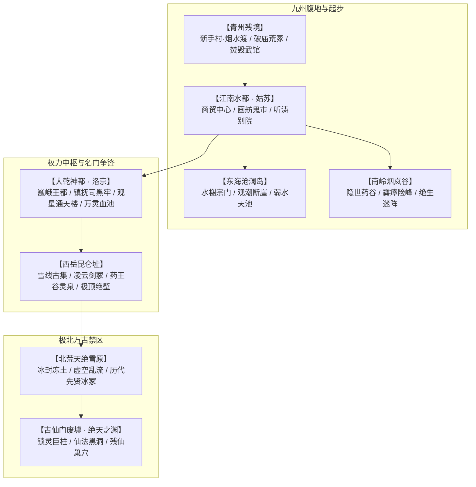

# 04 · 世界地图与副本设计：大乾九州与极北绝地

> **关联索引**：[企划总库](README.md) · [主线全景](03-main-storyline.md) · [第一幕详案](chapters/act-1-jiangnan.md)

---

## 一、宏观地理全景

本作世界由大乾九州腹地、世外宗门秘境以及极北万古禁区构成。地图采用**“宏观区域探索 + 箱庭微缩城镇 + 战棋/自由空间副本（GRID/FREE双模）”**的结构。

---

## 二、新手起点：青州残境 · 烟水渡

* **地理风貌**：暮秋雨夜，江风刺骨。残破的芦苇荡、被大火烧成断壁残垣的长风武馆废址、荒废的江边野庙。
* **新手村定位**：承接主角沈长风的人生至暗时刻。
  * **核心据点【烟水渡小渔村】**：几户靠江谋生的渔民与老船夫，提供基础补给与避雨草棚。
  * **主线场景【荒山古庙】**：即现有 Demo 的开局核心舞台，严老镖头受重伤托孤托卷之地。
  * **初阶副本【长风武馆灰烬地窟】**：潜行回被焚毁的师门地窖，避开朝廷搜捕队，取回师尊留下的生前佩剑与第一批疗伤散。
* **空间机制映射**：主要使用 15×10 正交网格（GRID），熟悉移动距离、探锋试探、化劲防守等基础招式。

---

## 三、核心主城与开放枢纽

### 1. 江南水都 · 姑苏（前中期核心中枢）
* **风貌特征**：粉墙黛瓦，水巷纵横，舟楫相望。表面风雅清秀、琴声悠扬，暗地里却是走私假灵药与活人血丹的地下交易中心。
* **关键功能区**：
  * **平江府客栈**：各路游侠与药商汇聚之地，听取江湖传闻、接取揭榜委托。
  * **千金药行**：朝廷特许的药材商行，高价收购名贵老药，实际为国师搜刮药引。
  * **城西水道 · 地下鬼市**：午夜方开，贩卖黑市古籍、残破神兵、违禁灵草。
  * **沧澜外院**：顾清霜在姑苏的临时落脚处，提供全队休整与古卷演武合成。

### 2. 大乾神都 · 洛京（中后期权力与危机中枢）
* **风貌特征**：城墙高百丈，黑石森严，八街九陌。气度恢弘却处处弥漫着沉闷肃杀之气，天空中终年笼罩着淡淡的暗红薄霭。
* **关键功能区**：
  * **朱雀御街与长生坊**：权贵云集，满城皆在谈论国师的“延寿仙法”，城内老者被强行迁入“安康坊”实则作为药引血库。
  * **玄天镇抚司大营**：重甲精锐驻扎地，地牢深处关押着不肯合作的正道宗师与抗税义士。
  * **太清观星台**：高耸入云，国师布置万灵归源血阵的核心阵眼，重兵与道术傀儡把守。

### 3. 昆仑古集 · 飞雪天城（后期雪山前哨）
* **风貌特征**：坐落在海拔万仞的雪线冰瀑旁，由巨木与冰岩搭砌而成，狂风呼啸。正魔名宿、塞外蛮族、隐世散修在此对峙交易。
* **核心功能**：挑战极险秘境前的唯一补给点，产出高阶抗寒丹药与淬火灵矿。

---

## 四、核心特色副本与秘境设计

| 副本名称 | 所属区域 | 核心机制 / 环境效果 | 守关 Boss 与掉落机缘 | 空间玩法模式 |
| :--- | :--- | :--- | :--- | :---: |
| **鬼市血窟 · 活人药炉** | 姑苏地下 | **【血煞迷雾】**：每回合积累微量毒素；必须快速寻找排风阀 | 鬼市药客 · 盲骨叟；掉落《洗髓散方》与古卷演武碎片 | GRID 战棋 + 狭窄障碍 |
| **烟岚绝壁 · 奇门迷径** | 南岭烟岚谷 | **【五行瘴障】**：视野削减（观势范围 -1），随机出现幻象 | 迷谷护宝异兽 · 赤鳞玄蟒；产出百年极品草木灵株 | FREE 连续身法，跳跃落点 |
| **少室洗心台 · 伏魔洞** | 中原圣地 | **【禅定心压】**：真气消耗翻倍，考验单纯外家拳脚与架势耐力 | 破戒血僧（天人五衰会）；掉落佛门护体残卷 | GRID 严整大殿，讲究背刺卡位 |
| **凌云绝顶 · 剑冢天坪** | 昆仑绝壁 | **【极地罡风】**：偶发全场顺风推移，身法不稳者坠崖受高额伤害 | 剑宗癫狂老剑圣；领悟《凌云拔剑术》，获得赤龙果 | FREE 悬崖边缘战，走位避风 |
| **神都禁宫 · 万灵血池** | 洛京地底 | **【血阵引魂】**：每隔若干行动条抽取场上角色生命充入主阵 | 国师化身与妖化羽林军；彻底瓦解神都浩劫 | 双模切换，多阶段破坏阵旗 |
| **绝天之渊 · 万古仙门** | 极北禁区 | **【虚空裂隙】**：高维法则碾压，凡俗武学伤害减半，唯入道招式破防 | **最终 Boss：渊冥残仙**；破碎虚空终局战役 | 连续超大空间，虚空跳跃浮台 |

