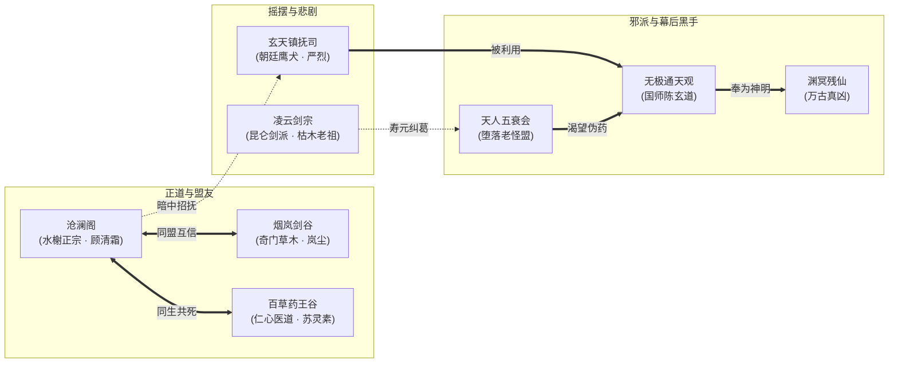

# 05 · 天下各方势力矩阵与核心流派

> **关联索引**：[企划总库](README.md) · [世界观与底层真相](01-worldview-and-lore.md) · [人物与女主设定](06-characters-and-heroine.md)

---

## 一、势力关系网一览

---

## 二、六大核心势力深度档案

### 1. 沧澜阁（东海水榭 · 名门正宗）
* **势力范围**：东海百里沧澜群岛、江南平江外院。
* **宗门理念**：“顺天应水，护生止戈”。坚决反对以人炼药与掠夺寿元，守护苍生平衡。
* **武学体系**：**【沧澜回潮掌】**、**【太虚柔云剑】**。
  * **机制特色**：高格挡、化劲反冲（LIFO 栈顶截势）、架势自愈。招式具有“叠浪”特性，防守成功次数越多，反击爆发伤害越惊人。
* **对立/友善**：与长风武馆遗脉世交，与药王谷深度结盟；与玄天镇抚司水火不容。
* **核心人物**：
  * **老阁主·沧溟真人**（寿尽坦然赴死的泰斗）。
  * **顾清霜**（阁主关门首徒，下一任掌舵人）。

---

### 2. 烟岚剑谷（南岭隐修 · 奇门草木）
* **势力范围**：南岭十万大山，山谷被万年云雾笼罩，世人难寻其踪。
* **宗门理念**：“辨药识天，不问王权”。与草木为友，世代守护上古传下的灵药幼苗。
* **武学体系**：**【烟岚迷踪步】**、**【青芦瞬影剑】**。
  * **机制特色**：高闪避、隐匿藏锋（Conceal）、利用迷烟致盲敌人并打乱 CTB 推条时序。
* **对立/友善**：中立善良，与任何破坏灵脉药源的势力为敌。
* **核心人物**：**岚尘**（身手敏捷的药谷行者，主角挚友）。

---

### 3. 百草药王谷（世外医圣 · 凡界药脉）
* **势力范围**：秦岭翠微峰深谷，谷内遍布灵泉与百草灵圃。
* **宗门理念**：“悬壶活人，医武归一”。天下医者的圣地，痛心疾首于人间假延寿药之毒。
* **武学体系**：**【素问金针决】**、**【太素神针】**。
  * **机制特色**：中远程控制穴位、净化负面异常、驱散药毒、大幅降低己方架势压力。
* **核心人物**：**苏灵素**（当代小药仙，孙真人之关门弟子，心思纯澈）。

---

### 4. 玄天镇抚司（朝廷鹰犬 · 铁血军武）
* **势力范围**：直辖于大乾皇室，在九州各府均设有黑铁分舵，控制天下关隘。
* **组织理念**：“奉旨行事，雷霆无情”。为皇室夺取天下续命之资，违者诛灭九族。
* **武学体系**：**【裂岳沉锋刀】**、**【破煞千机弩】**。
  * **机制特色**：强行削减架势条（Posture Damage）、破霸体击飞、远程压制，战斗风格厚重霸道。
* **核心人物**：**严烈**（左统领，面冷心善的悲情硬汉）。

---

### 5. 天人五衰会（残烛魔盟 · 极端求生）
* **组织本质**：由数十位寿命仅剩三五年、濒临大限的各派叛徒、魔道巨擘组成的地下黑盟。
* **组织理念**：“天不与寿，我自夺命”。为了多活片刻，不惜杀徒弑子、吸食活人精血。
* **武学体系**：**【燃血蚀精大法】**、**【化骨夺元指】**。
  * **机制特色**：低生命值时触发“燃寿狂暴”（速度+50%、攻击吸血），但承受易伤且架势条极脆。

---

### 6. 无极通天观（隐仙司 · 伪仙爪牙）
* **组织本质**：大乾国师陈玄道所建，实际全员皆为“渊冥残仙”所圈养的灵血看守人。
* **武学体系**：**【太上虚灵道术】**、**【九幽摄魂阵】**。
  * **机制特色**：仙凡杂交术法，具有远程大范围轰炸、召唤仙怨阴魂、构筑免疫屏障等超自然异能。

