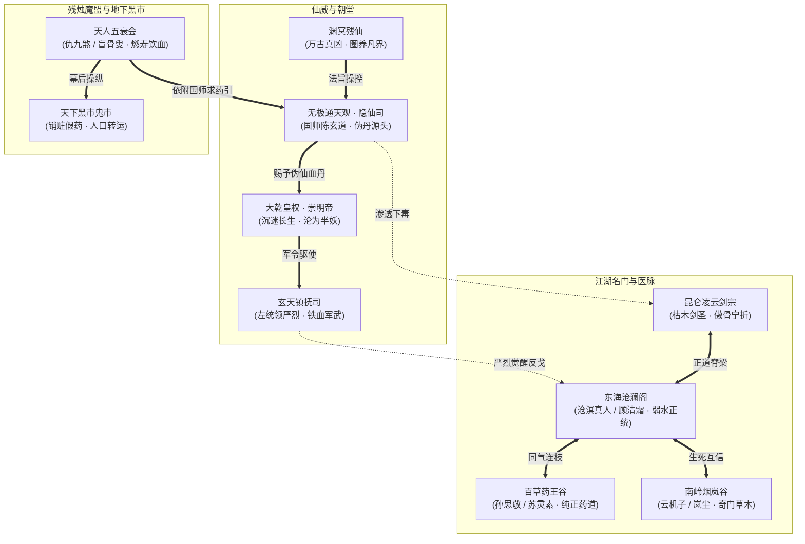

# 05 · 天下各方势力矩阵、宗派秘传与声望体系

> **关联索引**：[企划总库](README.md) · [世界观与底层真相](01-worldview-and-lore.md) · [人物与女主设定](06-characters-and-heroine.md) · [全景人物录](grand-character-encyclopedia.md) · [地理风物总志](world-gazetteer-and-regions.md)

---

## 一、天下大势：正道、朝廷、魔盟与高维伪仙矩阵

在锁灵绝天的潜在大背景下，人间各方势力围绕**修行资源分配、真实药材、假药血丹、地盘与庇护关系**形成复杂的利益与信仰博弈。**不采用统一的两百岁寿元天堑或玩家剩余寿命系统**，也不预设各大派从序幕开始就认得沈长风或残卷。



---

## 二、六大核心势力深度档案与武学秘传

### 1. 沧澜阁（东海水榭 · 碧海青天）
* **宗门驻地**：东海百里沧澜群岛、平江府听涛别苑。
* **宗门风骨**：“弱水三千，海纳百川；以柔克刚，护生止戈。”
  * 沧澜阁世代隐于东海，自上古弱水武圣立派以来，门规森严，严禁门人贪恋世俗皇权，更严禁服食任何以生灵气血炼制的外药。
  * 门中长辈寿限达至两百岁时，皆在“听潮崖”平静坐化，将毕生真元反哺护岛灵脉，被江湖尊为风骨之最。
* **宗门内部分歧**：
  * **守道派**（以沧溟老阁主、顾清霜为首）：主张固守正道，出海巡查，肃清假药与暗桩。
  * **激进派**（大长老沧渊）：眼见门中宿老相继大限坐化，对朝廷送来的延寿血丹产生动摇，成为第三幕前夕的潜在隐患。
* **武学流派与卡牌机制**：
  * **基础武学**：【沧澜回潮劲】（防御时自动累加“回潮”层数，每层提升 5% 格挡率与 3% 架势回复速度）。
  * **进阶招式**：【碧波三叠浪】（三段水行连击，前两段叠势，第三段若命中架势耗尽目标造成双倍破势崩解）。
  * **镇派绝学**：【弱水瀚海域】（展开直径 10 米的水行领域，领域内所有友军受到伤害降低 30%，敌人每秒损失 5 点集气值）。
* **声望崇敬特权**：
  * 可在沧澜水榭购买极品水行宝剑【寒玉漱泉】与秘传心法【太虚化劲诀】。

---

### 2. 百草药王谷（世外桃源 · 仁心医圣）
* **宗门驻地**：秦岭翠微峰深谷“神农悬壶境”。
* **宗门风骨**：“生而为医，敬畏苍生；活人千万，不取一寸邪念。”
  * 药王谷为天下正统医家祖庭，保存着上古《神农百草图》最完整的摹本。
  * 面对大乾皇室推广的“延寿血灵散”，药王谷第七代谷主孙思敬闭门封谷，严禁门人参与，并派遣精通金针与辨药的年轻弟子入世救治中毒百姓。
* **武学体系与医道结合**：
  * **【太素金针术】**：既可御针破穴制敌，亦可封脉止血渡厄。
  * **【青囊回春气】**：强大的群体净化与持续回血功法，能彻底驱散“尸香”、“蛊毒”与“血煞”。
  * **【逆天度命指】**：强行燃烧自身 10% 气血，瞬间复活一名阵亡队友并恢复其 50% 架势值。
* **声望崇敬特权**：
  * 解锁移动炼药台的高级配方（如【九转玉髓丹】、【纯阳固本散】），并可由苏灵素亲自为其量身调配永久增幅属性的灵汤。

---

### 3. 昆仑凌云剑宗（极西雪岳 · 天下剑宗）
* **宗门驻地**：昆仑极顶凌云峰、万剑冢、摘星台。
* **宗门风骨**：“宁折不弯，唯剑作碑；身死道消，傲骨凌云。”
  * 凌云剑宗门风凌厉高洁，门中剑客一人一剑，行走天下荡寇除魔。宗门老祖枯木剑圣年届 190 岁，依旧手握生锈残铁独守剑冢，是天下剑客的精神图腾。
* **武学流派与卡牌机制**：
  * **【凌云断空剑】**：极度强悍的单体剑罡打击，具备“无视目标 35% 外甲”的破甲特性。
  * **【万剑朝宗诀】**：引动剑冢万刃鸣响，全屏范围御剑飞袭，造成大范围破势。
* **声望崇敬特权**：
  * 获得进入万剑冢参悟古老断剑的资格，习得被动天赋【剑心明澈】（暴击率永久 +10%）。

---

### 4. 南岭烟岚谷（苍茫十万山 · 奇门隐修）
* **宗门驻地**：南岭迷雾瘴气沼泽深处“古木悬空寨”。
* **宗门风骨**：“借天地之势，藏万物之形；不拜帝王，不欺孤寡。”
  * 烟岚谷弟子行事低调古怪，擅长机关、草木药理、毒瘴利用与奇门遁甲。
  * 曾因拒绝为玄天镇抚司交出百年“紫罗幽兰”而遭到大军围剿，损失惨重，幸存行者岚尘流落江湖，对朝廷鹰犬怀有刻骨仇恨。
* **武学体系**：
  * **【烟岚乱影步】**：在战场制造 3 处雾气分身，自身进入绝对潜行（Conceal），攻击时必定造成背刺真实伤害。
  * **【奇门百草雷】**：投掷毒雾弹与麻痹雷，强行打乱敌方行动条次序。
* **声望崇敬特权**：
  * 解锁【机关暗袋】扩容道具，全队战术消耗品携带上限由 3 提升至 6。

---

### 5. 玄天镇抚司（大乾朝廷 · 铁血重铠）
* **组织驻地**：神都内城黑铁统领衙门、九州各府镇抚使司。
* **组织风骨与扭曲**：“奉天承运，刑狱肃杀；以杀止杀，王法如炉。”
  * 原本是大乾立国时维护律法秩序的精锐禁卫，但在老皇帝沉迷长生、国师陈玄道把持朝政后，逐渐蜕化为朝廷抓捕“药引”与清剿异己的暴力工具。
  * 下层将士与基层统领（如严烈）内心深感撕裂与痛苦，多次暗中违抗灭门绝户的密令。
* **武学流派**：
  * **【裂岳沉锋刀】**：极致的重量与爆发力，招式附带巨额“震荡”效果，强行击退目标并削减架势。
  * **【破煞重甲功】**：减免受到的外伤 40%，但自身身法下降。
* **声望崇敬特权**：
  * 严烈加入队伍后，可在镇抚司故旧手中获取皇室密藏的百炼玄铁与神臂机弩图纸。

---

### 6. 天人五衰会（残烛魔盟 · 极端求生）
* **组织驻地**：地底幽都鬼市、北荒血窟、九幽地穴。
* **组织风骨**：“长生不择手段，逆天宁堕修罗。”
  * 没有任何道德底线的反人类邪恶黑盟。全员皆为不甘寿终的宗师级堕落败类，为了换取活人精血丹无恶不作。
* **武学体系**：
  * **【燃血化骨爪】**：攻击造成巨额流血，并吸取造成伤害的 30% 转化为自身生命。
  * **【幽冥尸爆术】**：引爆阵亡手下的尸体，对周围造成剧毒与气血侵蚀。

---

## 三、阵营声望系统规则与全地图互动矩阵

### 1. 声望等级与增益门槛

| 声望等级 | 声望点数区间 | 阵营NPC互动表现 | 解锁特权 |
| :--- | :--- | :--- | :--- |
| **生死死敌** | -1000 ~ -500 | 见面直接拔刀围攻，城镇悬赏追杀 | 击杀掉落专属罪恶血牌 |
| **冷漠戒备** | -499 ~ 0 | 拒绝交易，对话冷嘲热讽 | 仅提供最基础住宿与干粮 |
| **友善信赖** | 1 ~ 1500 | 热情接待，提供区域情报指引 | 开放阵营独特药材与普通武学秘籍购买 |
| **莫逆之交** | 1501 ~ 3500 | 主动赠送补给，遇袭时卫兵出兵协助 | 解锁势力专属精品支线与特殊剧情分支 |
| **宗门至尊** | 3501 ~ 5000 | 全体门人躬身参拜，掌门平辈论交 | 传授门派镇派绝学卡牌、开放镇派藏宝阁 |

### 2. 动态声望抉择矩阵

玩家在主支线剧情中的每一个道德抉择，都会引发蝴蝶效应般的声望波动：

```text
[抉择示范：平江茶寮救药农女童]
- 选项 A：拔剑斩杀镇抚司暗探
  -> 沧澜阁声望 +200, 药王谷声望 +300, 玄天镇抚司声望 -500 (引发沿街通缉)
- 选项 B：出示古卷暗记暗中威慑，破财消灾
  -> 消耗 50 两白银，各方声望平稳，解锁暗探【铁鹰】的贿赂交易线
- 选项 C：尾随暗探至黑牢连锅端
  -> 开启天牢潜入战，提前结识严烈，大幅提升后续反戈剧情的成功率
```
