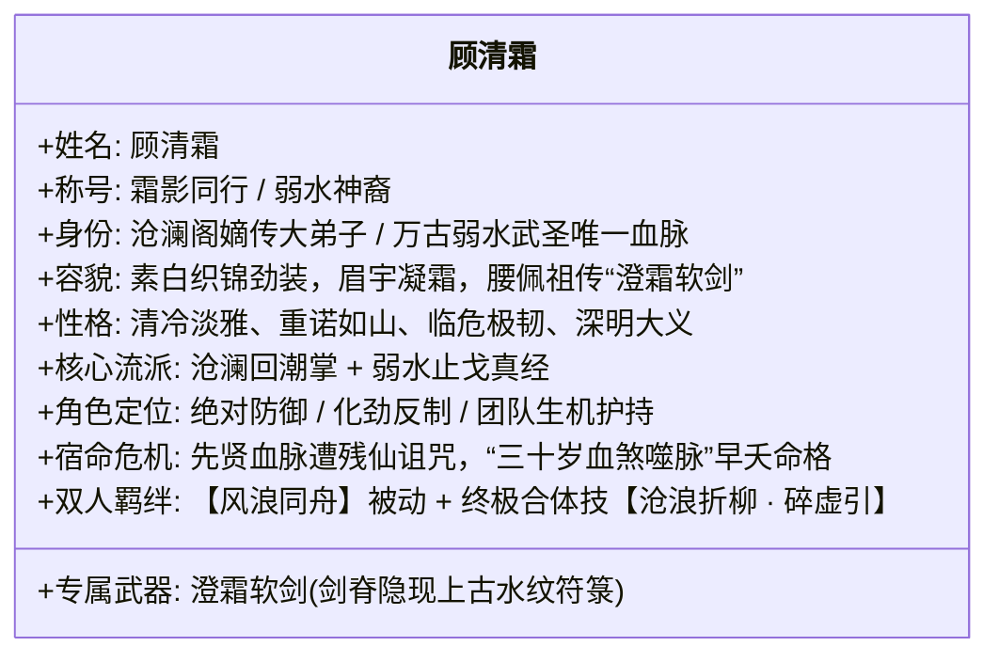
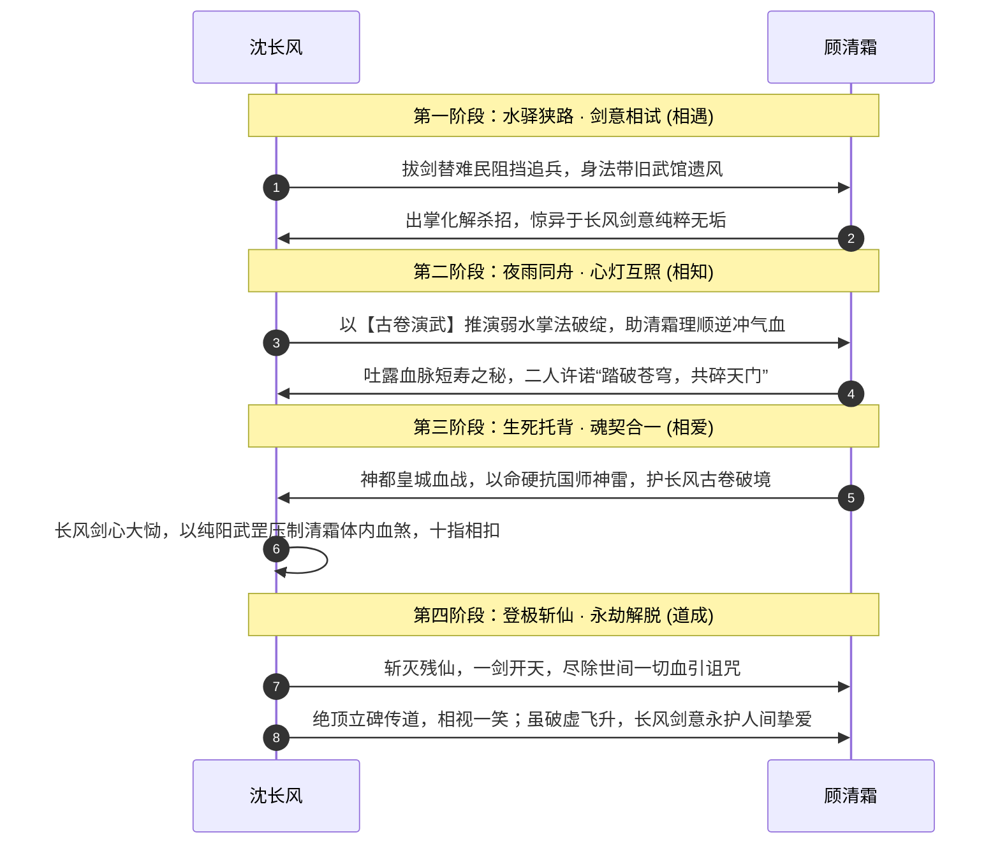

# 06 · 人物群像与女主设定：顾清霜与天下群英档案

> **关联索引**：[企划总库](README.md) · [势力矩阵](05-factions-and-sects.md) · [精品支线](07-sidequests-system.md) · [50+全景人物大典](grand-character-encyclopedia.md)

---

## 一、女主深度设定：顾清霜（霜影同行 · 沧澜水圣传人）

顾清霜绝非传统依附主角的花瓶女伴，而是**拥有独立理想、背负万古先贤血脉、与主角在道心和战术上深度互补的第一女主与生死道侣**。

### 1.1 角色背景与宿命纠葛
* **名门骄子与早夭诅咒**：
  顾清霜为万年前斩天先贤之一“弱水武圣”的嫡系末裔。弱水先贤当年在绝天大阵前拼死重创残仙右臂，残仙因而对其后人降下恶毒的**“血煞天绝引”**——凡具有弱水血脉者，武道进展极快，但体内会随真气增长积蓄阴煞，**寿不过三十，筋脉尽冻而亡**。清霜之母便是年满三十时在清霜眼前化作冰屑散去。
* **追寻正道的执念**：
  师门长辈曾试图寻找延寿灵药救她，清霜见识过延寿药背后的血腥后决然拒绝：“若我的命需要踩着凡人生魂苟延，我宁在三十岁持剑战死！”她下山游历，一是探查血丹祸乱，二是寻找祖上先贤遗留的真正破劫之法。

### 1.2 形象与性格细节
* **容貌风姿**：
  身材高挑修长，墨发以素银簪束起，一袭素白暗纹长袍内衬青蓝软鳞劲装。眉眼清丽如霜雪初霁，平日清冷如秋水初冻，唯在与长风默契破敌或谈及剑道时，才会展露出如雪融化般极具感染力的微暖笑意。
* **以守为攻的仁慈**：
  剑术与掌法专精“卸力、点穴、止戈”，哪怕面对敌手，若非穷凶极恶之徒，往往点到为止、击碎兵刃而不取性命。

### 1.3 与沈长风的关系演进轨迹

### 1.4 战术协同机制与双人合体奥义
* **专属羁绊技能【风浪同舟】（被动）**：
  当沈长风与顾清霜在战场上处于相邻 1 格（GRID）或 3 米半径（FREE）内时，两人架势恢复速度翻倍，沈长风每次攻击命中，为顾清霜回复 1 点真气；顾清霜每次成功化劲，为沈长风的手牌提供【追风】连携标记。
* **双人共鸣绝技【沧浪折柳 · 碎虚引】（终极合招）**：
  需两人皆满真气时施展。顾清霜身化万重柔水天幕定住全场敌方 CTB 推动，沈长风踏水纵剑斩出九重风雷，无视一切防御直接造成毁灭性破势。

---

## 二、天下群英谱系精选档案（全貌见 grand-character-encyclopedia.md）

| 姓名 | 阵营与身份 | 性格与心理矛盾 | 结局归宿 | 战斗标签与核心招式 |
| :--- | :--- | :--- | :--- | :--- |
| **沈长风** | 主角 · 长风武馆遗孤 | 坚韧赤子、嗜苦茶、怀大义 | 斩仙开天，立碑传道，破碎虚空飞升 | 苍风折柳剑、古卷演武推演破防 |
| **顾清霜** | 女主 · 沧澜阁嫡传大弟子 | 清冷克制、重情重诺、畏早夭之痛 | 破除万古早夭血煞，掌管人间道统守护 | 沧澜回潮掌、弱水止戈、极强化劲护盾 |
| **凌长空** | 沈长风之师（长空剑） | 嘴硬心软、嗜旱烟、视徒如己出 | 青州大火当夜斩敌四十七人，力竭按剑殉道 | 苍风剑法极境，剧情追忆之师魂指引 |
| **陆青儿** | 武馆小师妹 | 娇憨灵动、轻功卓绝、长风的牵挂 | 逃入枯井后失散，神都血祭前夕被长风救出 | 飞燕身法，神都主线关键情感线索 |
| **严守诚** | 镇远老镖头 / 听风守卷人 | 忠义无双、恪守密盟重诺三十载 | 荒庙中心头血烧融封印，托付古卷含笑气绝 | 破阵刀法，序幕剧情灵魂引导人 |
| **岚尘** | 烟岚谷行者 / 奇门草木向导 | 油腔滑调、重情重义、心怀门派灭门痛 | 夺回师门神药谱，被推举为天下药王盟主 | 烟岚迷踪步、草木毒障致盲推条 |
| **苏灵素** | 百草药王谷传人 / 小药仙 | 纯善天真、悲天悯人、视治病为天职 | 继承药王衣钵，在人间巡回义诊，功德无量 | 太素金针渡厄、解除药毒、气血回春 |
| **严烈** | 玄天镇抚司右统领（后反戈） | 铁血沉毅、面恶心善、为救病妹身陷泥潭 | 反出皇城，劈碎观星楼地基，开宗传授破阵重刀 | 裂岳斩马刀、黑铁重甲、强压架势条 |
| **严柔** | 严烈胞妹 / 天生纯阴体质 | 知书达理、柔弱聪慧、曾试图自尽求解脱 | 经长风古卷真眼锁定、灵素金针逼出心头血蛊获救 | 纯阴灵体，促成严烈弃暗投明核心枢纽 |
| **沧溟真人** | 沧澜阁老阁主（180岁大宗师） | 豁达爱悔棋、看淡生死、宁死不当药奴 | 拂袖将假仙丹倒进大海，从容坐化，功散东海 | 纯阳化劲极境，剧情杀名宿风骨标杆 |
| **连如玉** | 沧澜阁大师兄 / 连家独子 | 傲骨天骄、暗恋清霜、嘴硬心软 | 神都之战为掩护长风破阵率众断后负伤，终生敬佩长风 | 柔云细剑，攻守兼备的正统名门剑法 |
| **阮小汐** | 沧澜阁机灵小师妹 | 活泼爱开玩笑、擅制药膏与航海 | 平定浩劫后协助清霜重振沧澜阁 | 沧澜轻功、后勤包扎与气氛开心果 |
| **枯木剑圣** | 昆仑凌云剑宗老祖（190岁） | 独臂孤傲、视剑如命、绝壁守徒 | 昆仑药劫燃尽三年命元，万剑护徒战死成冰雕 | 凌云御剑绝境，万丈剑罡全场轰炸 |
| **仇九煞** | 天人五衰会魔擘（195岁枯魔） | 曾遭名门背叛、极度恐惧死亡而入魔 | 昆仑争药陷入疯癫，被沈长风以通玄剑意彻底诛灭 | 燃寿血遁、化血夺元爪、濒死吸血狂暴 |
| **崇明老帝** | 大乾当朝天子（78岁晚年药狂） | 昔日雄主，暮年惜命，昏聩残暴 | 吞噬数百活人血丹异变为半妖药狂，皇城巅被诛 | 蛟龙皇威全场压制、血池重生回血 |
| **陈玄道** | 大乾国师 / 隐仙司之主 | 俊美外表、阴毒仙奴、掌控神都血阵 | 神都战败肉身崩碎，残魂逃至北荒被残仙捏死 | 太上雷法道符、三层仙光屏障、空间遁移 |
| **渊冥残仙** | 万古真凶 / 上界争霸败退仙尊 | 视凡如蚁、残暴病态、吸噬凡界生机苟活 | 极北绝渊被沈长风以武入道一剑贯穿仙魂，灰飞烟灭 | 三阶段终极神战，高维法则黑洞，全屏死咒 |
