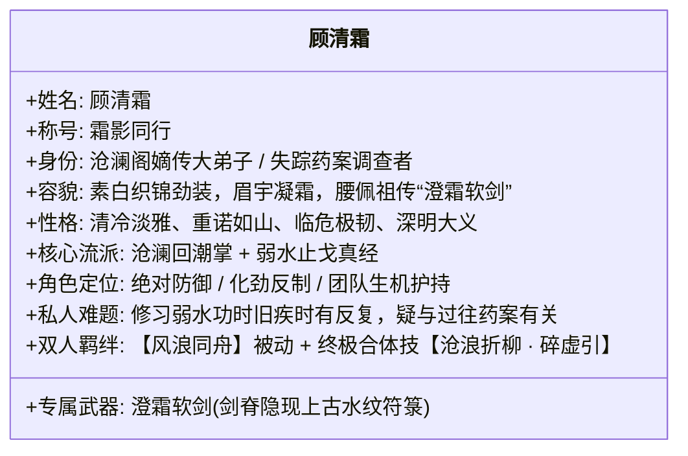
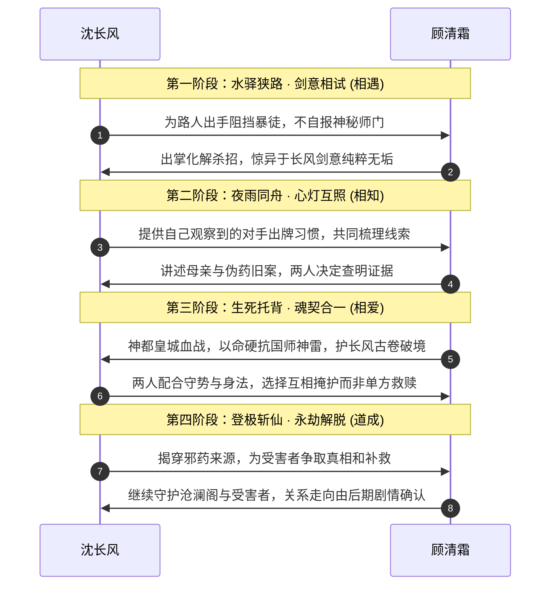

# 06 · 人物群像与女主设定：顾清霜与天下群英档案

> **关联索引**：[企划总库](README.md) · [势力矩阵](05-factions-and-sects.md) · [精品支线](07-sidequests-system.md) · [50+全景人物大典](grand-character-encyclopedia.md)

> **版本边界**：已确认不能再用主角或同伴的固定寿元倒计时推动可玩主线。下文将顾清霜原“三十岁血煞死劫”暂换为“功法风险＋药案”，**病根、母亲经历与血脉关系是候选改法，仍待用户确认**；她独立查案、保有自主目标的原则不依赖最终选哪一种病根。

---

## 一、女主深度设定：顾清霜（霜影同行 · 沧澜水圣传人）

顾清霜拥有自己的查案目标、师门关系和判断能力，与主角在道心和战术上互补。两人的关系应由共同经历发展，不能一开始就因宿命血统或疗救短寿而绑定。

### 1.1 角色背景与个人动机
* **师门弟子与旧案**：顾清霜是沧澜阁嫡传弟子，擅长以守代攻。她在调查与黑市药材、失踪人口有关的线索，怀疑其中有人冒用师门采购名义。她的母亲曾因来路不明的药物而病逝，成为她谨慎查证伪药的私人动力。
* **功法风险而非死期**：修习弱水功法时偶有寒气逆冲，可以用治疗、训练和战斗节奏呈现，但不设固定“三十岁死亡”“剩余寿命”或按游戏年份递减的规则；她也不需等沈长风凭天命解救。
* **与主角相遇**：两人在平江府不同任务线交汇。顾先以主角所见、所为判断他是否值得合作；调查中保持独立目的与行动权。

### 1.2 形象与性格细节
* **容貌风姿**：
  身材高挑修长，墨发以素银簪束起，一袭素白暗纹长袍内衬青蓝软鳞劲装。眉眼清丽如霜雪初霁，平日清冷如秋水初冻，唯在与长风默契破敌或谈及剑道时，才会展露出如雪融化般极具感染力的微暖笑意。
* **以守为攻的仁慈**：
  剑术与掌法专精“卸力、点穴、止戈”，哪怕面对敌手，若非穷凶极恶之徒，往往点到为止、击碎兵刃而不取性命。

### 1.3 与沈长风的关系演进轨迹

### 1.4 战术协同机制与双人合体奥义
* **专属羁绊技能【风浪同舟】（被动）**：
  当沈长风与顾清霜在战场上处于相邻 1 格（GRID）或 3 米半径（FREE）内时，两人架势恢复速度翻倍，沈长风每次攻击命中，为顾清霜回复 1 点真气；顾清霜每次成功化劲，为沈长风的手牌提供【追风】连携标记。
* **双人共鸣绝技【沧浪折柳 · 碎虚引】（终极合招）**：
  需两人皆满真气时施展。顾清霜身化万重柔水天幕定住全场敌方 CTB 推动，沈长风踏水纵剑斩出九重风雷，无视一切防御直接造成毁灭性破势。

---

## 二、天下群英谱系精选档案（全貌见 grand-character-encyclopedia.md）

| 姓名 | 阵营与身份 | 性格与心理矛盾 | 结局归宿 | 战斗标签与核心招式 |
| :--- | :--- | :--- | :--- | :--- |
| **沈长风** | 主角 · 江湖散人 | 谨慎重诺、心怀恻隐 | 开局赴平江府送家书；终局未定 | 基础风剑、残卷初醒后洞察敌方手牌 |
| **顾清霜** | 沧澜阁嫡传大弟子 / 药案调查者 | 清冷克制、重情重诺、坚守证据 | 查清师门药案；中后期归宿待定 | 沧澜回潮掌、弱水止戈、极强化劲护盾 |
| **凌长空** | 历史候选角色（与主角关系待重订） | 原“灭门师尊”设定废弃 | 不再默认在序幕前为守卷牺牲 | 苍风剑术历史来源待定 |
| **陆青儿** | 候选江湖友人（与主角关系待重订） | 旧“小师妹寻亲”设定未审定 | 不再默认是主角的失散亲人 | 飞燕身法，可用于独立支线 |
| **严守诚** | 负伤的走镖老者 | 察人重义、懂镖行规矩、对陌生人谨慎 | 断桥留守牵制追兵，**生死未知** | 经验丰富但伤重不能独抗敌人 |
| **韩啸** | 追镖队现场执行头目 | 冷厉而务实，服从命令却信息有限 | 劫镖当夜只知截镖灭口；事后才因上级告知失物而追查 | 重刀刀法，非序幕 Boss |
| **岚尘** | 烟岚谷行者 / 奇门草木向导 | 油腔滑调、重情重义、心怀门派灭门痛 | 夺回师门神药谱，被推举为天下药王盟主 | 烟岚迷踪步、草木毒障致盲推条 |
| **苏灵素** | 百草药王谷传人 / 小药仙 | 纯善天真、悲天悯人、视治病为天职 | 继承药王衣钵，在人间巡回义诊，功德无量 | 太素金针渡厄、解除药毒、气血回春 |
| **严烈** | 玄天镇抚司右统领（后反戈） | 铁血沉毅、面恶心善、为救病妹身陷泥潭 | 反出皇城，劈碎观星楼地基，开宗传授破阵重刀 | 裂岳斩马刀、黑铁重甲、强压架势条 |
| **严柔** | 严烈胞妹 / 天生纯阴体质 | 知书达理、柔弱聪慧、曾试图自尽求解脱 | 经长风古卷真眼锁定、灵素金针逼出心头血蛊获救 | 纯阴灵体，促成严烈弃暗投明核心枢纽 |
| **沧溟真人** | 沧澜阁老阁主 | 豁达爱悔棋、拒以旁人性命换丹 | 是否牺牲取决于后续战局，而非固定寿元 | 纯阳化劲极境，宗门责任担当 |
| **连如玉** | 沧澜阁大师兄 / 连家独子 | 傲骨天骄、暗恋清霜、嘴硬心软 | 神都之战为掩护长风破阵率众断后负伤，终生敬佩长风 | 柔云细剑，攻守兼备的正统名门剑法 |
| **阮小汐** | 沧澜阁机灵小师妹 | 活泼爱开玩笑、擅制药膏与航海 | 平定浩劫后协助清霜重振沧澜阁 | 沧澜轻功、后勤包扎与气氛开心果 |
| **枯木剑圣** | 昆仑凌云剑宗老祖 | 独臂孤傲、视剑如命、绝壁守徒 | 昆仑药劫可为护徒牺牲；不使用三年命元计量 | 凌云御剑绝境，万丈剑罡全场轰炸 |
| **仇九煞** | 天人五衰会魔擘 | 曾遭名门背叛、依赖邪丹强求力量 | 昆仑争药线的敌人，其药毒反噬是弱点 | 化血夺元爪、邪丹暴走、濒死吸血狂暴 |
| **崇明老帝** | 大乾当朝天子（78岁晚年药狂） | 昔日雄主，暮年惜命，昏聩残暴 | 吞噬数百活人血丹异变为半妖药狂，皇城巅被诛 | 蛟龙皇威全场压制、血池重生回血 |
| **陈玄道** | 大乾国师 / 隐仙司之主 | 俊美外表、阴毒仙奴、掌控神都血阵 | 神都战败肉身崩碎，残魂逃至北荒被残仙捏死 | 太上雷法道符、三层仙光屏障、空间遁移 |
| **渊冥残仙** | 万古真凶 / 上界争霸败退仙尊 | 视凡如蚁、残暴病态、吸噬凡界生机苟活 | 极北绝渊被沈长风以武入道一剑贯穿仙魂，灰飞烟灭 | 三阶段终极神战，高维法则黑洞，全屏死咒 |
