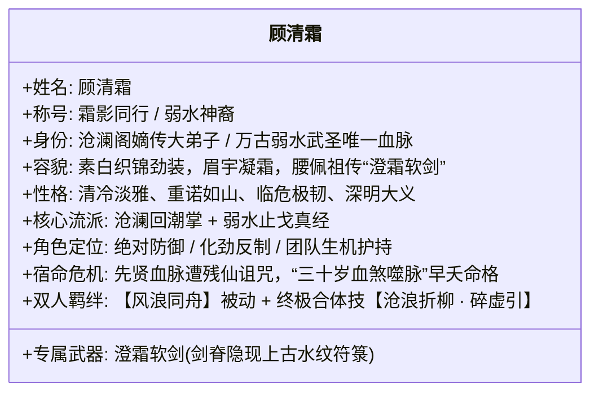
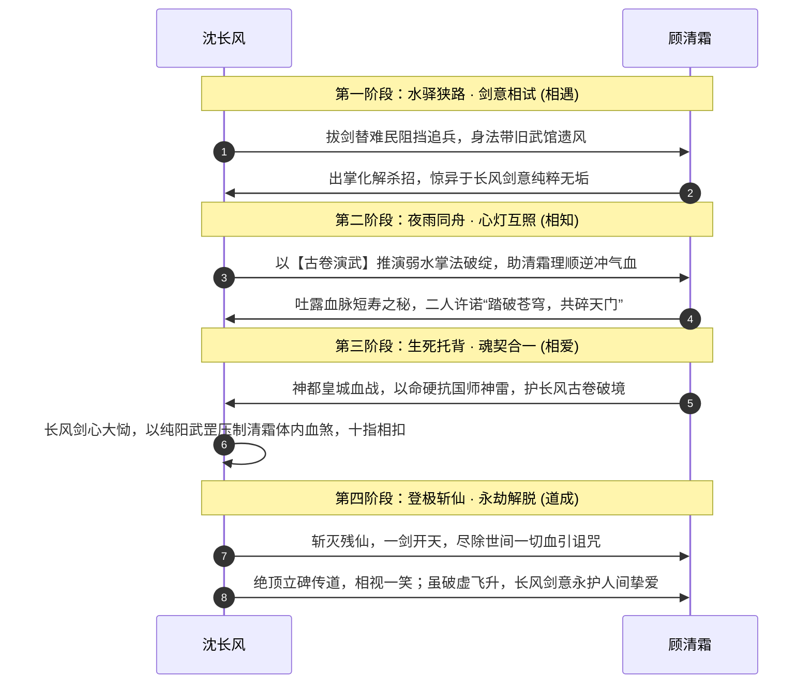

# 06 · 人物群像与女主设定：顾清霜与核心人物档案

> **关联索引**：[企划总库](README.md) · [势力矩阵](05-factions-and-sects.md) · [精品支线](07-sidequests-system.md)

---

## 一、女主深度设定：顾清霜（霜影同行 · 沧澜水圣传人）

顾清霜绝非依附主角的花瓶女伴，而是**拥有独立理想、背负万古先贤血脉、与主角在道心和战术上深度互补的第一女主与生死道侣**。

### 1.1 角色背景与宿命纠葛
* **名门骄子与早夭诅咒**：
  顾清霜为万年前斩天先贤之一“弱水武圣”的嫡系末裔。弱水先贤当年在绝天大阵前拼死重创残仙右臂，残仙因而对其后人降下恶毒的**“血煞天绝引”**——凡具有弱水血脉者，武道进展极快，但体内会随真气增长积蓄阴煞，**寿不过三十，筋脉尽冻而亡**。清霜之母便是年满三十时在清霜眼前化作冰屑散去。
* **追寻正道的执念**：
  师门长辈曾试图寻找延寿灵药救她，清霜见识过延寿药背后的血腥后决然拒绝：“若我的命需要踩着凡人生魂苟延，我宁在三十岁持剑战死！”她下山游历，一是探查血丹祸乱，二是寻找祖上先贤遗留的真正破劫之法。

### 1.2 形象与性格细节
* **容貌风姿**：
  身材高挑修长，墨发以素银簪束起，一袭素白暗纹长袍内衬青蓝软鳞劲装。眉眼清丽如霜雪初霁，平日清冷如秋水初冻，唯在与长风默契破敌或谈及剑道时，才会展露出如雪融化般极具感染力的微暖笑意。
* **以守为攻的仁慈**：
  剑术与掌法专精“卸力、点穴、止戈”，哪怕面对敌手，若非穷凶极恶之徒，往往点到为止、击碎兵刃而不取性命。

### 1.3 与沈长风的关系演进轨迹

### 1.4 战术协同机制与双人合体奥义
* **专属羁绊技能【风浪同舟】（被动）**：
  当沈长风与顾清霜在战场上处于相邻 1 格（GRID）或 3 米半径（FREE）内时，两人架势恢复速度翻倍，沈长风每次攻击命中，为顾清霜回复 1 点真气；顾清霜每次成功化劲，为沈长风的手牌提供【追风】连携标记。
* **双人共鸣绝技【沧浪折柳 · 碎虚引】（终极合招）**：
  需两人皆满真气时施展。顾清霜身化万重柔水天幕定住全场敌方 CTB 推动，沈长风踏水纵剑斩出九重风雷，无视一切防御直接造成毁灭性破势。

---

## 二、关键 NPC 全景档案表

| 姓名 | 阵营归属 | 身份与性格 | 命运与剧情结局 | 战斗定位与武学标签 |
| :--- | :--- | :--- | :--- | :--- |
| **沈长风** | 主角 | 坚韧赤子，胸怀天下，微末求道 | 斩灭残仙，破天立道，破碎虚空飞升 | 全能近战，疾风折柳剑，古卷推演破防 |
| **顾清霜** | 沧澜阁 / 主角阵营 | 清冷孤高，心细如发，大义凛然 | 破除早夭血煞诅咒，承继天下武学大统 | 极强护盾/化劲反制，沧澜回潮掌法 |
| **岚尘** | 烟岚剑谷 | 洒脱机灵，重信诺，对草木极具痴性 | 重振烟岚谷，被天下推举为新一代药王盟主 | 高机动刺客，迷踪步，毒草致盲推条 |
| **苏灵素** | 百草药王谷 | 天真纯善，医术通玄，视治病为天职 | 继承药王衣钵，在人间巡回义诊，功德无量 | 强力辅助回血，金针度穴，驱散一切减益 |
| **严烈** | 镇抚司（后反戈） | 铁血沉毅，重情重义，深明大义 | 辞去官职，隐居江南抚养胞妹，开宗传授破阵重刀 | 重铠狂战，沉锋斩马刀，强压敌人架势条 |
| **沧溟真人** | 沧澜阁老阁主 | 豁达从容，一代宗师，宁折不弯 | 拒绝吸凡人血药，从容坐化前将功力散入灵泉 | 纯阳化劲极境，剧情杀灵魂指引者 |
| **枯木剑圣** | 昆仑凌云宗老祖 | 威严古板，视宗门存亡高于一切 | 昆仑药劫中为保护后辈弟子力战魔头而亡 | 凌云御剑决，全场范围剑气轰炸 |
| **陈玄道** | 大乾国师 / 隐仙司 | 阴险狠辣，崇仙抑人，自诩上天选民 | 神都败亡后逃至北荒，被残仙当作弃子随手捏碎神魂 | 仙术道符雷法，召唤血阵傀儡 |
| **渊冥残仙** | 极北绝天之渊 | 视凡如蚁，暴虐病态，上界逃亡重伤者 | 被沈长风以武入道之剑彻底斩灭本源神魂 | 三阶段终极Boss，仙界法则黑洞，全屏压制 |

