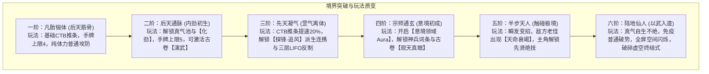

# 08 · 武道境界与战斗系统落地规约

> **关联索引**：[企划总库](README.md) · [主角与金手指](02-protagonist-and-cheat.md) · [工程落地映射](09-godot-engineering.md)

---

## 一、六大修为境界与战斗机制映射

---

## 二、修为境界详细数值与系统权限表

| 境界等级 | 称号与世界表现 | 战力特征与机制质变 | CTB / 真气 / 卡牌系统映射 | 寿元限制与法则表现 |
| :---: | :--- | :--- | :--- | :---: |
| **一阶：凡胎锻体** | 初学乍练、武馆学徒 | 纯外家筋骨力量，无真气护体，招式受体力限制 | 基础 CTB 速率，手牌上限 4，仅可用白阶基础招 | 60–80 岁正常老死 |
| **二阶：后天通脉** | 江湖好手、老练镖师 | 经络贯通，内力护体，可施展“内劲化劲”，招式带额外效果 | 真气池 10–30，手牌上限 5，解锁两门武学切换与变招 | 80–100 岁 |
| **三阶：先天凝气** | 一方豪杰、门派精锐 | 真气外放成罡，飞叶伤人，解锁“探锋·追风”类即时派生连携 | 真气池 30–60，CTB 速度+20%，解锁 LIFO 迎锋截势三层连锁 | 100–120 岁 |
| **四阶：宗师通玄** | 名宿长老、一方掌门 | **手段通玄**：引动风雷、隔空控物，拥有专属“意境光环（Aura）” | 真气池 60–120，解锁架势威压、强霸体机制与派生奥义卡 | 150 岁天堑 |
| **五阶：半步天人** | 绝世高手、开山老祖 | 移山填海、剑气纵横百丈；**受寿元衰竭限制**，低寿时触发燃血 | 真气池 120–200，神识观势（破除迷雾），药尽衰竭破绽 | 200 岁死线危机 |
| **六阶：陆地仙人** | 破虚真神、人间神话 | **以武入道**：身化天地法则，免疫凡俗破势，招式蕴含大道真意 | 无限/自生真气，虚空闪跃，破碎虚空专属终结神通 | 超脱寿元限制 |

---

## 三、绝世高手的“天命衰竭”与“燃寿机制”

* **天命死线（Lifespan Constraint）**：
  * 五阶半步天人的高阶 NPC，在战斗中带有“残存生机”计量。
  * **延寿灵药消耗**：敌方宗师携带百年灵药时，若血量低于 30%，可消耗灵药触发“回光返照”，瞬间回复满气血并进入攻击暴走状态。
  * **枯竭破绽**：老怪若未有灵药支撑，持续战斗超过一定回合（CTB Tick），将进入“天人五衰”虚弱期，架势（Posture）上限减半，受到的暴击与露隙几率大幅上升。这一设计为主角以弱胜强、以快打慢提供了深度的策略切入点。

---

## 四、核心战斗系统与技术映射

### 1. CTB 时序与空间双模（GRID / FREE）
* 继承当前 `BattleSpatialFacade`：
  * **GRID**：15×10 正交格子，严谨的 Manhattan 距离与卡位走位。
  * **FREE**：平滑连续坐标、圆形碰撞半径、自动接近攻击与自由轻功落点。

### 2. 武学卡牌分支与阶段变招
* **基础招式卡**：探锋（试探）、断岳（重斩）、游身（位移）、化劲（格挡/卸力）。
* **多用法分支（Usage Branching）**：单张手牌可根据战局自由选择：
  * **进攻式**：追加架势削减与伤害。
  * **变招式**：生成即时派生连携卡（如“追风”）。
  * **守势式**：提升自身护体，恢复自身架势压力。

### 3. 有限 LIFO 逆序交锋响应（Clash Reaction）
* 一方打出攻击时，守方可入栈响应（迎锋、截势、化劲、反制）。
* **最新入栈的招式优先结算**：见招拆招的武侠博弈感——“你欲断岳重斩，我以化劲卸力；你若追加变锋，我以惊鸿避其锋芒”。

### 4. 古卷“演武推演”即时系统
* 玩家在面对未知强敌首次成功化劲或防御时，手牌现有卡牌即时升级为**【克制分支】**，在接下来的交锋中强制获得 LIFO 栈顶优先权。

### 5. 意境领域（Martial Domain）
* 达到宗师境后，战斗中消耗真气展开领域（如沈长风的“风卷残云界”、顾清霜的“瀚海狂澜界”），在 15×10 棋盘或 FREE 连续半径内对敌方施加集气减速或架势易伤。

