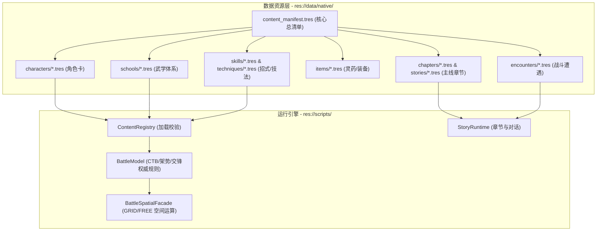

# 09 · Godot 原生工程落地映射与开发路线

> **关联索引**：[企划总库](README.md) · [武道与战斗系统](08-cultivation-and-combat.md) · [序幕详案](chapters/act-0-prologue.md) · [第一幕详案](chapters/act-1-jiangnan.md)

---

## 一、架构原则与规范

本工程所有新增设定严格遵循 Godot 4.x 原生强类型 Resource 架构，**杜绝任何外部未注册 JSON 或硬编码分支**。所有内容必须由 `res://data/content_manifest.tres` 显式索引。



---

## 二、原生 Resource 详细配置清单

```text
demos/changfeng-battle/data/
├── content_manifest.tres               <-- 唯一正式内容清单
└── native/
    ├── characters/                     <-- WuxiaCharacterDefinition
    │   ├── shen_changfeng.tres         <-- 主角（四维属性、古卷技法、苍风剑）
    │   ├── gu_qingshuang.tres          <-- 顾清霜（沧澜掌、护道属性）
    │   ├── lan_chen.tres               <-- 岚尘（烟岚剑、身法属性）
    │   ├── yan_lie.tres                <-- 严烈（重甲巨刀、破势属性）
    │   └── boss_yuanming_xian.tres     <-- 渊冥残仙（多阶段Boss定义）
    ├── schools/                        <-- WuxiaSchoolDefinition
    │   ├── wind_sword.tres             <-- 苍风折柳剑法
    │   ├── tide_palm.tres              <-- 沧澜回潮掌
    │   └── immortal_curse.tres         <-- 残仙噬灵邪法
    ├── items/                          <-- WuxiaItemDefinition
    │   ├── jiangxue_ginseng.tres       <-- 正道地宝：百年绛雪九叶参
    │   ├── chidragon_fruit.tres        <-- 正道地宝：甲子赤龙果
    │   ├── longevity_blood_pill.tres   <-- 邪法外丹：九转长生血丹
    │   └── ancient_scroll_relic.tres   <-- 核心圣物：逆仙图录兽皮残卷
    ├── stories/                        <-- WuxiaStoryDefinition
    │   ├── rain_escort_prologue.tres   <-- 序章：暮秋荒庙托孤
    │   ├── act1_jiangnan_mist.tres     <-- 第一幕：江南血炉
    │   ├── act2_kunlun_crisis.tres     <-- 第二幕：昆仑药劫
    │   ├── act3_imperial_altar.tres    <-- 第三幕：神都劫云
    │   ├── act4_frozen_gate.tres       <-- 第四幕：绝天秘境
    │   └── act5_shatter_void.tres      <-- 终章：极境入道
    ├── chapters/                       <-- WuxiaChapterDefinition
    └── encounters/                     <-- WuxiaEncounterDefinition
```

---

## 三、核心代码接口扩展规范

1. **古卷推演（TechniqueRuntime）**：
   * 在当前 `technique_definition.gd` 基础上扩展 `deduction_pool`。战斗中通过 `BattleModel.submit` 捕获反制事件，动态向手牌注入带克制属性的派生卡（`grant_card`）。
2. **观天真眼（BattleSpatialFacade & BattleModel）**：
   * 强化 `decision_context` 中的观势（Insight）等级，当激活真眼时，客户端直接穿透战争迷雾，完整渲染敌方待触发的 LIFO 响应卡片。
3. **老怪燃寿机制（CombatResolver & StatModifierSystem）**：
   * 在 `CombatantState` 中追加 `lifespan_energy` 字段。当 Boss 生命低于 30% 时，自动触发 `burn_life_mode`，提升攻速但增加受击时的架势压力伤害。

---

## 四、分阶段实施路线图

* **第一阶段：序章与古卷系统实装**
  * 将序章对白 `rain_escort_prologue.tres` 更新为新的老镖头托卷与师门大恨背景。
  * 在 `TechniqueRuntime` 中接入古卷初始被动技能 `ancient_scroll_insight`，实装看破敌方手牌的观势增益。
* **第二阶段：正道灵药与老怪天命机制**
  * 在 `items/` 中注册真正的百年灵药（绛雪参、赤龙果）与假延寿血丹。
  * 在 `BattleModel` 中实现濒死老怪的“燃寿狂暴”与“天命枯竭虚弱期”权威判定。
* **第三阶段：五幕章节与多势力 Boss 遭遇**
  * 依次配置第一幕至终章的故事、章节与战斗遭遇，引入严烈与国师的战斗阶段转换。
* **第四阶段：以武入道与破碎虚空终章闭环**
  * 制作最终 Boss“渊冥残仙”三阶段战役，实装主角“陆地神仙”形态的破虚神通与大结局通关演出。

