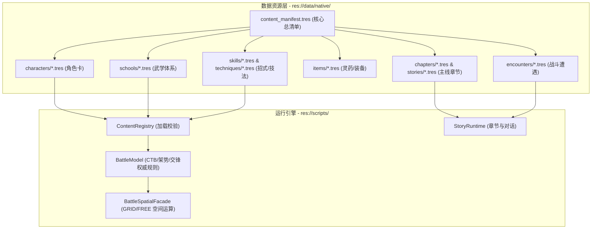

# 09 · Godot 原生工程落地映射与开发路线

> **关联索引**：[企划总库](README.md) · [武道与战斗系统](08-cultivation-and-combat.md) · [序幕 V2](chapters/act-0-prologue-v2.md) · [第一幕详案](chapters/act-1-jiangnan.md)

> 本页后半的未来角色、技能和章节路径是**设计示意，不等于已经存在的 Resource**。正式序幕的真实工程引用见下文；不再安排寿元资源/燃寿机制，也不得让主角开局自带洞察。

---

## 一、架构原则与规范

本工程所有新增设定严格遵循 Godot 4.x 原生强类型 Resource 架构，**杜绝任何外部未注册 JSON 或硬编码分支**。所有内容必须由 `res://data/content_manifest.tres` 显式索引。



---

## 二、原生 Resource 详细配置清单

```text
demos/changfeng-battle/data/
├── content_manifest.tres               <-- 唯一正式内容清单
└── native/
    ├── characters/                     <-- WuxiaCharacterDefinition
    │   ├── shen_changfeng.tres         <-- 主角（江湖散人，开局 insight=0）
    │   ├── gu_qingshuang.tres          <-- 顾清霜（沧澜掌、护道属性）
    │   ├── lan_chen.tres               <-- 岚尘（烟岚剑、身法属性）
    │   ├── yan_lie.tres                <-- 严烈（重甲巨刀、破势属性）
    │   └── boss_yuanming_xian.tres     <-- 渊冥残仙（多阶段Boss定义）
    ├── schools/                        <-- WuxiaSchoolDefinition
    │   ├── wind_sword.tres             <-- 苍风折柳剑法
    │   ├── tide_palm.tres              <-- 沧澜回潮掌
    │   └── immortal_curse.tres         <-- 残仙噬灵邪法
    ├── items/                          <-- WuxiaItemDefinition
    │   ├── jiangxue_ginseng.tres       <-- 正道地宝：百年绛雪九叶参
    │   ├── chidragon_fruit.tres        <-- 正道地宝：甲子赤龙果
    │   ├── longevity_blood_pill.tres   <-- 邪法外丹：九转长生血丹
    │   └── ancient_scroll_relic.tres   <-- 未来候选道具（不在开局显示全名）
    ├── stories/                        <-- WuxiaStoryDefinition
    │   ├── prologue_chase_story.tres   <-- 正式序章 V2：偶遇残镖与逃亡（已存在）
    │   ├── rain_escort_prologue.tres   <-- 旧版历史测试（非正式剧情）
    │   ├── act1_jiangnan_mist.tres     <-- 第一幕：江南血炉
    │   ├── act2_kunlun_crisis.tres     <-- 第二幕：昆仑药劫
    │   ├── act3_imperial_altar.tres    <-- 第三幕：神都劫云
    │   ├── act4_frozen_gate.tres       <-- 第四幕：绝天秘境
    │   └── act5_shatter_void.tres      <-- 终章：极境入道
    ├── chapters/                       <-- WuxiaChapterDefinition
    └── encounters/                     <-- WuxiaEncounterDefinition
        ├── prologue_scout_wave1.tres  <-- 正式序幕 1v2
        ├── prologue_scout_wave2.tres  <-- 正式序幕 1v3
        └── prologue_lookout.tres      <-- 正式序幕 1v1、洞察教学
```

---

## 三、核心代码接口扩展规范

1. **序幕已实现的洞察（现有 BattleModel）**：
   * 不另造被动系统：剧情进入最后落单哨探战时，`GameSession.encounter_options()` 把主角原生 `Insight` 设置为 2；前两波为 0。该能力只揭示敌方当前手牌。
2. **后续残卷进阶（待单独立项）**：
   * 更强的观势、抵御伪装、招式推演或 `grant_card` 必须各有剧情证据、资源字段、测试与平衡验收。切勿以书名预设开局已知能力。
3. **已撤销项目**：
   * 不向 `CombatantState` 加 `lifespan_energy`，不实现 `burn_life_mode`、寿元暗伤或百年倒计时。高阶敌人的邪丹暴走若需要，使用独立状态效果设计。

---

## 四、分阶段实施路线图

* **第一阶段：序章与古卷系统实装**
  * 已以 `prologue_chase_story.tres`、三场正式遭遇和四区 `.tscn` 实现江湖散人偶遇、救治与逃亡。
  * 后续需对护送 NPC 视觉、战斗平衡、平江府承接任务进行人工验收。
* **第二阶段：江南药案与残卷认知递进**
  * 在 `items/` 按需登记治疗药材与邪丹，明确药效与反噬，不采用固定延寿年数。
  * 第一幕先做家书、集市药案与失踪调查；之后再设计残卷进阶和韩啸信息链。
* **第三阶段：五幕章节与多势力 Boss 遭遇**
  * 依次配置第一幕至终章的故事、章节与战斗遭遇，引入严烈与国师的战斗阶段转换。
* **第四阶段：以武入道与破碎虚空终章闭环**
  * 制作最终 Boss“渊冥残仙”三阶段战役，实装主角“陆地神仙”形态的破虚神通与大结局通关演出。

