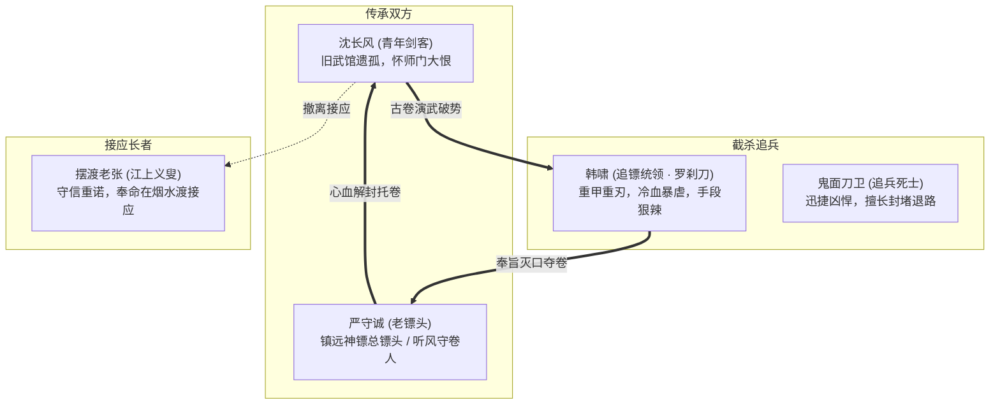
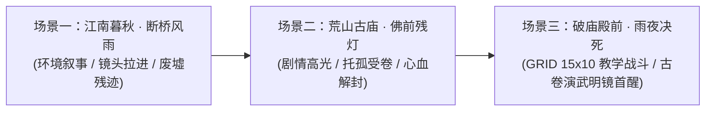

# 附录 · 序幕详细剧本与关卡规范：暮秋荒庙 · 宿命传承

> **关联索引**：[企划总库](../README.md) · [主线全景](../03-main-storyline.md) · [主角与金手指](../02-protagonist-and-cheat.md) · [第一幕详案](act-1-jiangnan.md)

---

## 一、序幕核心定位与叙事目标

序幕作为整部《长风浮生录》的序曲与操作教学关卡，承载着不可替代的四重核心目标：
1. **交代主角至暗身世**：青州长风武馆毁于大火，师尊以身诱敌殉道，沈长风怀揣佩剑仓皇流落江南。
2. **闭环古卷传递因果**：老镖头严守诚并非寻常过客，而是师尊数十年的生死密友兼“听风隐盟”同僚；因师尊殉道掩护，严镖头携残篇突围至此，认出长风剑印与武骨，以心火抹除封印完成托付。
3. **金手指初醒与实战闭环**：古卷【演武明镜】在生死绝境中被首次触发，让玩家直观体验“见招拆招、推演破绽、后发制人”的核心快感。
4. **无缝衔接现有 Demo 资产**：完全复用工程现存的 `rain_escort_prologue.tres`、破庙背景（`ruined_temple`）、断桥网格（`rainy_bridge`）与角色资源。

---

## 二、序幕登场人物详细设定卡



### 1. 沈长风（主角 · 避祸游侠）
* **定位**：初入江湖的落魄剑客 / 玩家操控角色。
* **外貌气度**：身穿洗得发白的青灰布衣，发髻因雨水浸湿微散，腕缠粗麻绑带。面容虽显稚嫩疲惫，但眼神清亮如寒星，背负一柄师传的“断锋青钢剑”。
* **性格特征**：重诺笃行，坚韧内敛。面对强敌心有恐惧却绝不后退，铭记师父“剑者宁折不弯”的古训。
* **战斗初始配置（WuxiaCharacterDefinition）**：
  * `attributes`: `{"STR": 12, "AGI": 12, "CON": 10, "MND": 10}`
  * `school_id`: `"wind_sword"`（苍风折柳剑法基础三式：探锋、断岳、游身）
  * `passives`: `{"insight": 1, "conceal": 0}`

---

### 2. 严守诚（老镖头 · 听风守卷死士）
* **身份与渊源**：镇远镖局总镖头，实为守护万古仙卷残篇的“听风隐盟”执事之一，与沈长风之师是歃血为盟的结拜兄弟。
* **外貌特征**：须发花白斑驳，被雨水与黑血浸透。胸口中透骨铁箭两柄，腰腹缠着厚厚的浸血纱布，背靠破庙断柱，嘴唇干裂发青，但握刀的手至死不松。
* **命运结局**：在临终前认出沈长风佩剑上的暗记，吐出心头最后一口精血烧融兽皮古卷的封印符箓，将《逆仙图录》残页按入沈长风胸怀后含笑闭目。

---

### 3. 韩啸（追兵统领 · 罗刹重刀）
* **身份定位**：序幕关底 Boss / 玄天镇抚司暗雇的江湖亡命徒头领。
* **外貌特征**：身材魁梧如半截黑铁塔，左脸自眼角至下颌有一道狰狞蜈蚣刀疤，手持一柄八十斤重的锯齿鬼头大刀，每走一步甲片铿锵作响。
* **性格台词**：“老不死的，把古卷交出来！神都的老爷们要的东西，人间阎王也保不住！”
* **战斗特色**：
  * **霸体蓄力**：施展【裂岳重斩】，出招前有明显的蓄势红圈预警。
  * **架势压制**：普通命中附加高额 Posture 压力，考验玩家的【化劲】卸力时机。

---

### 4. 鬼面刀卫（追兵侍从 × 2）
* **定位**：战术杂兵 / 引导玩家练习“身法走位”与“探锋快速截杀”。
* **特点**：黑衣蒙面，手持双钩环首刀，移动迅捷（CTB 推条稍快），但生命与架势条极脆。

---

## 三、序幕场景设定与环境交互



### 场景 1：江南道 · 断桥风雨（序曲镜头）
* **视觉呈现**：秋风萧瑟，暴雨倾盆。石桥两侧是滚滚浊浪，远处枯柳在狂风中撕扯。破损的镖车车辕斜插在泥泞浅滩中，血迹顺着泥水被冲刷稀释。
* **镜头运镜**：从苍凉阴郁的天空长镜头俯冲，越过断桥浅滩，定格在不远处半山腰若隐若现的无名古庙飞檐。
* **音效设计**：雷声轰鸣、豆大雨点打在泥石上的急促声、江流怒涛声。

---

### 场景 2：荒山古庙 · 佛前残灯（对话与交互箱庭）
* **视觉呈现**：庙顶瓦片坍塌大半，泥塑的断臂金刚佛像蒙满蛛网。庙殿正中燃着一小堆微弱的篝火，被穿堂风吹得明灭不定。墙角倚靠着浑身是血的老镖头，身旁散落着断裂的镖旗与三口被劈碎的空镖箱。
* **交互点设定**：
  * **【断臂金刚像】**：调查可触发主角独白，感叹仙佛不佑人间、武道唯有自救。
  * **【暗格残箱】**：证明这趟镖车从一开始运送的就不是金银珠宝，而是唯一的一卷兽皮残篇。
  * **【垂死老镖头】**：剧情核心交互入口。

---

### 场景 3：破庙殿前 · 雨夜决死（GRID 15×10 正交战场）
* **战场布局**：
  * **核心地形**：殿门处有两根粗大朱红石柱（阻挡攻击直线 LOS，可作为防守掩体）；中央为青石地砖（正常移动）；两侧为雨水倒灌形成的积水烂泥（泥泞地形：经过消耗额外 1 点移动力）。
* **教学战斗目标**：
  1. 利用【探锋·试探】打断鬼面刀卫的起手。
  2. 在韩啸施展【裂岳重斩】的判定帧，利用【化劲】卸力化解架势破坏。
  3. 触发古卷【演武明镜】推演破绽，施展衍生招式斩碎 Boss 架势（Posture Broken），完成必杀。

---

## 四、序幕完整剧情脚本与互动分镜

> **技术标准说明**：完全遵照 Godot 4.x 原生 `WuxiaStoryDefinition` 数据规范，拆分为镜头节拍（`StoryBeat`）、对话节点（`DialogueNode`）、交互分支（`DialogueChoice`）及事务标记（`StoryEvent`）。

---

### 第一幕：秋雨入庙 · 惊见残镖

```text
[StoryBeat: beat_prologue_intro]
Caption: "暮秋 · 江南道荒道"
Text: "秋雨连夜，雷鸣撼动残山。昔日青州长风武馆的门楣，早在一月前的大火中化为焦土。"
Duration: 3.5

[StoryBeat: beat_prologue_temple]
Caption: "子夜 · 无名破庙"
Text: "一辆插着断裂金镖的残破镖车，倾覆在庙前泥洼中。腥红的血水，混着雨水从石阶一路淌进殿内。"
Duration: 3.5

[DialogueNode: node_temple_enter]
Speaker: "沈长风"
Text: "（推开半掩的破旧庙门，甩落蓑衣上的冰冷雨水，长剑半出鞘，警惕四顾）"
NextNode: "node_groan_sound"

[DialogueNode: node_groan_sound]
Speaker: "旁白"
Text: "阴暗的佛像残碑下，隐隐传来一阵粗重且破碎的喘息声，伴随着鲜血滴落青石的轻响。"
NextNode: "node_elder_warning"

[DialogueNode: node_elder_warning]
Speaker: "老镖头"
Text: "别……别过来！退出去……那些恶鬼……还在追杀老夫……"
NextNode: "node_changfeng_approach"

[DialogueNode: node_changfeng_approach]
Speaker: "沈长风"
Text: "（快步上前借着火光看清老者面容，神色骤变）前辈！你身上中了透骨箭，气脉快断了！我这有金创药，先替你止血！"
NextNode: "choice_help_elder"

[DialogueChoice: choice_help_wound]
Text: "【撕下衣襟按压伤口】先止住后背不断喷涌的血窟窿。"
NextNode: "node_help_action"
Events: [SetFlag: "helped_escort" = true]

[DialogueChoice: choice_inquire_enemy]
Text: "【警惕门外并输送真气】追你的是何方神圣？官府还是魔门？"
NextNode: "node_inquire_action"
Events: [SetFlag: "vigilant_mind" = true]

[DialogueNode: node_help_action]
Speaker: "旁白"
Text: "沈长风撕下袖口粗布，咬牙为老人按住伤口，掌心运起长风武馆纯正的纯阳内力，护住老人心脉。"
NextNode: "node_elder_recognize"

[DialogueNode: node_inquire_action]
Speaker: "沈长风"
Text: "前辈固守心神！追兵若是官兵，绝不会在这荒山野岭赶尽杀绝！"
NextNode: "node_elder_recognize"

[DialogueNode: node_elder_recognize]
Speaker: "老镖头"
Text: "（浑浊的双眼猛地盯住沈长风腰间的佩剑，干枯的手掌死死抓住剑鞘，身躯剧颤）这剑……剑脊上的听风回纹……你、你是青州凌长空那倔老头的徒弟？！"
NextNode: "node_changfeng_shock"

[DialogueNode: node_changfeng_shock]
Speaker: "沈长风"
Text: "（浑身巨震）你认识家师？！武馆遭难那夜，师父拼死为我杀开血路……他老人家究竟怎么了？！"
NextNode: "node_elder_confession"
```

---

### 第二幕：心火解封 · 托付仙篇

```text
[DialogueNode: node_elder_confession]
Speaker: "老镖头"
Text: "（老泪混着血水滚落，惨然咳嗽）长空兄……没有白死……长风！老夫乃是镇远镖局严守诚！我和你师父，是上古‘听风隐盟’留在世上的最后两个守卷人！"
NextNode: "node_scroll_reveal"

[DialogueNode: node_scroll_reveal]
Speaker: "旁白"
Text: "严老镖头颤抖着从怀中贴肉处，掏出一卷边缘焦黑、看似残破古旧的暗金兽皮残片。残卷外层死死贴着两道玄黑咒印符箓。"
NextNode: "node_elder_explain_scroll"

[DialogueNode: node_elder_explain_scroll]
Speaker: "老镖头"
Text: "一个月前，国师的鹰犬嗅到了风声。长空兄为了护住此卷，故意带着假卷引开了朝廷与魔教的主力，力战战死……而真正的《逆仙图录》核心残卷，由老夫押运南下……"
NextNode: "node_changfeng_grief"

[DialogueNode: node_changfeng_grief]
Speaker: "沈长风"
Text: "师父……（手指扣入掌心，指节泛白，泪水无声滑落）"
NextNode: "node_elder_urgency"

[DialogueNode: node_elder_urgency]
Speaker: "老镖头"
Text: "孩子，莫哭！听好！这不是凡俗的绝世神功，这是上古至今千万战死先贤，用命拼出来的逆天机缘！天下老怪求仙贪生，全成了天外残仙的血食药奴……唯有此卷，能破开这天地的万古囚笼！"
NextNode: "node_blood_unseal"

[DialogueNode: node_blood_unseal]
Speaker: "旁白"
Text: "严老镖头运起周身最后一口命元，猛地一掌拍在自己胸口，喷出一口滚烫炽热的心头精血！精血淋在兽皮古卷上，外层邪恶的黑咒符箓瞬间如积雪消融！"
NextNode: "node_scroll_handover"

[DialogueNode: node_scroll_handover]
Speaker: "老镖头"
Text: "（将微热微烫的兽皮古卷狠狠塞进沈长风怀中）老夫死不足惜！带着它，往南走……去姑苏找沧澜阁……活下去！用人间的剑……去斩天上的仙！"
NextNode: "node_elder_dies"

[DialogueNode: node_elder_dies]
Speaker: "旁白"
Text: "老镖头双目圆睁，手掌重重垂落青石，气绝身亡。殿内狂风卷过，微弱的篝火瞬间熄灭。"
NextNode: "node_thunder_strike"
```

---

### 第三幕：恶客临门 · 演武初醒（战斗切入）

```text
[StoryBeat: beat_prologue_thunder]
Caption: "雷霆震殿 · 杀机骤降"
Text: "一道刺目白雷撕裂夜空，照亮了庙门外数道披戴重甲的森冷身影。"
Duration: 3.0

[DialogueNode: node_boss_break_door]
Speaker: "韩啸"
Text: "（八十斤重刀当头劈碎腐朽庙门，碎木飞溅）老狗，果然躲在此地！交出古卷，留你全尸！"
NextNode: "node_boss_see_corpse"

[DialogueNode: node_boss_see_corpse]
Speaker: "韩啸"
Text: "（刀尖挑开严老镖头垂落的手臂，冷眼扫向拔剑而立的沈长风，狞笑）哟？断气了？小崽子，看来严守诚把东西塞给你了。长风武馆的逃命余孽吧？"
NextNode: "node_changfeng_wrath"

[DialogueNode: node_changfeng_wrath]
Speaker: "沈长风"
Text: "（双目赤红，青钢剑平举胸前，周身剑意森寒如冰）你们烧了我的武馆，杀了我师父，逼死了严镖头……今夜，谁也别想走出这座破庙。"
NextNode: "node_boss_mock"

[DialogueNode: node_boss_mock]
Speaker: "韩啸"
Text: "不知天高地厚的蝼蚁！给老子剁了他！"
NextNode: "encounter_prologue_battle"
```

---

### 第四幕：中场高光演出与破势结算（战斗内触发）

**【战斗事件触发点】**：当韩啸生命降至 50% 并开启【霸体蓄力 · 裂岳斩】时，游戏强制触发剧情定格：

```text
[StoryBeat: beat_scroll_resonance]
Caption: "生死刹那 · 古卷通明"
Text: "八十斤重刃撕裂空气呼啸而至，狂暴的刀风压得人经脉欲裂！"
Duration: 2.5

[DialogueNode: node_scroll_miracle]
Speaker: "旁白"
Text: "【逆仙图录 · 首次共鸣】\n沈长风胸口贴肉的兽皮残卷轰然爆发出一道无形清辉！周遭喧嚣的狂风暴雨在沈长风眼中骤然慢了下来！\n韩啸刀招中的每一次关节转动、真气行进的停滞点、以及斩落时下盘右足轻浮的破绽，尽数化作清晰流淌的金色轨迹！"
NextNode: "node_changfeng_insight"

[DialogueNode: node_changfeng_insight]
Speaker: "沈长风"
Text: "（心念通达，剑意无碍）重刀势沉，后劲必空……探其锋，断其根！"
NextNode: "node_execute_counter"

[DialogueNode: node_execute_counter]
Speaker: "系统提示"
Text: "【演武明镜】推演成功！手牌【探锋·试探】升级为绝技【探锋·破岳截脉】！"
NextNode: ""
```
*(战斗恢复：玩家打出升级后的招式，直接扣除韩啸全部架势条，触发【POSTURE_BROKEN】与【露隙 (Opening)】，一击重创韩啸！)*

---

### 第五幕：破庙余烬 · 晨曦烟水

```text
[StoryBeat: beat_prologue_dawn]
Caption: "破晓 · 江南烟水"
Text: "韩啸断臂惨嚎溃逃入雨夜，破庙重归寂静。破败的窗棂透入第一缕淡青色的晨光。"
Duration: 3.5

[DialogueNode: node_post_battle_grave]
Speaker: "旁白"
Text: "沈长风忍着内腑轻伤，在佛殿后山一处老松树下，用佩剑掘出土坑，将严老镖头的遗体妥善安葬，立下一根折断的无名青木为碑。"
NextNode: "node_changfeng_vow"

[DialogueNode: node_changfeng_vow]
Speaker: "沈长风"
Text: "（长跪碑前，将残卷妥帖系于内甲，佩剑归鞘，向墓碑重重磕了三个响头）严前辈，师尊在天之灵作证。沈长风若不能参透先贤道统、踏碎这长生虚妄，誓不还乡。"
NextNode: "node_dock_transition"

[DialogueNode: node_dock_transition]
Speaker: "旁白"
Text: "晨曦破开江雾，沈长风按老镖头生前留下的暗记，沿小径行至江边烟水渡码头。芦苇荡中，一叶乌篷小舟正静静泊在岸边。"
NextNode: "node_ferryman_speak"

[DialogueNode: node_ferryman_speak]
Speaker: "摆渡老张"
Text: "（戴着竹笠，持竹篙驻在船头，打量着长风身上的血迹与清正气象，低声问）客官，清晨风大浪急，要渡江往何处去？"
NextNode: "node_changfeng_final"

[DialogueNode: node_changfeng_final]
Speaker: "沈长风"
Text: "（踏上船板，望向滔滔东流的大江）往东南。去姑苏。"
NextNode: "node_prologue_end"

[DialogueNode: node_prologue_end]
Speaker: "旁白"
Text: "竹篙轻点，小舟划破白雾，顺江而下。江湖风雨，自此拉开大幕！"
NextNode: ""
```

---

## 五、Godot 原生工程落地配置映射

该剧本与关卡规范直接对齐工程底层，可无缝承接于 `demos/changfeng-battle/` 的已有资源：

| 资源类别 | 对应 Godot Resource 类名 | 对应工程落地路径 | 核心挂载属性与逻辑 |
| :--- | :--- | :--- | :--- |
| **故事剧情** | `WuxiaStoryDefinition` | `res://data/native/stories/rain_escort_prologue.tres` | 挂载上述 5 幕完整的镜头（`beats`）、对话节点（`nodes`）与心火解封分支。 |
| **主线章节** | `WuxiaChapterDefinition` | `res://data/native/chapters/rain_escort_prologue.tres` | 绑定新手破庙场景、通关奖励（`healing_powder`、初阶铜钱）、通往第一幕 `act1_jiangnan_mist`。 |
| **场景定义** | `WuxiaChapterSceneDefinition` | `res://data/native/scenes/rain_escort_temple.tres` | 引用破庙背景贴图、佛前烛火与 NPC 站位脚点。 |
| **追兵首领** | `WuxiaCharacterDefinition` | `res://data/native/characters/pursuer_captain.tres` | 绑定韩啸（重刀、劈斩动画、Posture 上限 14）。 |
| **剧情遭遇战**| `WuxiaEncounterDefinition` | `res://data/native/encounters/rainy_temple_duel.tres` | 沈长风 vs 韩啸 + 2名鬼面刀卫，绑定 15×10 正交战场。 |
| **神物初醒** | `WuxiaTechniqueDefinition` | `res://data/native/techniques/scroll_deduce_r1.tres` | 绑定在韩啸蓄力时触发的【演武明镜】手牌推演变招。 |

---

*序幕详细设定与交互剧本已完成编制并归档于 [`docs/game-design/chapters/act-0-prologue.md`](act-0-prologue.md)。*
