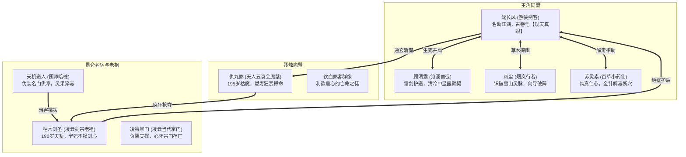

# 附录（V1 分镜待复核）· 第二幕详细剧本与关卡规范：名门暗流 · 昆仑药劫

> **制作阻断提示**：本稿中百年寿限、燃尽命元、古卷自动看破所有药毒等细节尚未按新设定改写，不能直接生成剧情 Resource。大体的昆仑药案与门派冲突可保留，具体因果和能力解锁按[主线 V2 总纲](../03-main-storyline.md)、[跨幕同步清单](../mainline-v2-consistency-audit.md)重新审定。

> **关联索引**：[企划总库](../README.md) · [主线全景](../03-main-storyline.md) · [势力矩阵](../05-factions-and-sects.md) · [第一幕详案](act-1-jiangnan.md) · [第三幕详案](act-3-shendu.md) · [全景人物录](../grand-character-encyclopedia.md)

---

## 一、第二幕核心定位与叙事目标

第二幕将舞台由水乡市井推向天下武学圣地昆仑绝顶，核心叙事承载五大质变：
1. **打破单一善恶脸谱**：展示正道名门宿老在面对两百岁大限时的悲壮风骨（从容护徒）与魔门老怪的疯狂求生（燃寿饮血）。
2. **揭露真地宝与伪仙毒害**：真正的百年天地奇珍“甲子赤龙果”现世，国师暗中下毒挑起正道自相残杀，被沈长风以古卷【观天真眼】当场识破。
3. **主角修为与招式质变**：沈长风见证宗师舍身大义，道心升华，突破至**“宗师通玄境”**，领悟第一重剑意领域。
4. **四人固定小队成型**：小药仙苏灵素正式入队，形成“长风（强攻/破势）+ 清霜（护盾/化劲）+ 岚尘（机动/破雾）+ 灵素（回春/净化）”的经典战术铁三角。
5. **门派政治暗流交锋**：凌云剑宗内部派系纷争、朝廷爪牙借机渗透，多方势力在昆仑飞雪中激烈角逐。

---

## 二、第二幕登场人物详细设定卡



### 1. 苏灵素（百草药王谷 · 纯真小药仙）
* **定位**：核心入队队友 / 强力治疗、驱散、架势压力减免辅助。
* **外貌气度**：鹅黄色碎花对襟短袄，腰悬精致小竹药篓，斜挎十二枚羊脂玉金针囊。眼眸灵动如鹿，笑容纯净无邪。
* **性格特点**：天真烂漫，极富同情心。坚信“医者不仅救肉身，亦当渡人心”，对国师用人命炼药的行径深恶痛绝。
* **战斗属性配置（WuxiaCharacterDefinition）**：
  * `attributes`: `{"STR": 8, "AGI": 11, "CON": 10, "MND": 15}`
  * `school_id`: `"yaowang_needle"`（太素金针术）
  * `passives`: `{"medicine_mastery": 2, "herb_sense": 3}`

### 2. 枯木剑圣（凌云剑宗老祖 · 绝壁风骨）
* **身份与状态**：年届 190 岁，距离两百岁大限仅剩不足数载。独臂，白发如雪，面容如枯槁老树，但脊背笔挺如万年青松。
* **行事准则**：“凌云门下只有站着死的剑客，没有跪着求生的药奴！”面对国师密使奉上的延寿血丹，一剑斩成两段。
* **战斗标签**：极高剑罡攻击力、全场范围剑气轰炸，但自身带有【气血枯竭】的虚弱倒计时判定。

### 3. 仇九煞（天人五衰会长老 · 燃寿狂魔）
* **身份与状态**：195 岁魔道巨擘，肉身已开始散发腐朽死气。为了抢夺赤龙果多活三年，已彻底陷入嗜血癫狂。
* **战斗特色**：
  * **【燃寿血遁】**：每回合主动扣除自身生命上限，换取 CTB 推条提速 50%。
  * **【化血绝骨爪】**：攻击附带吸血，并在命中后降低目标防御。

---

## 三、第二幕核心场景与关卡机制

### 场景 1：昆仑古集 · 飞雪天城（城镇探索与偶遇结盟）
* **视觉呈现**：建在雪线冰瀑旁的巨木石城。漫天暴雪，客栈内牛油大烛跳跃，铜锅翻滚着肥羊烈酒，塞外刀客、道袍剑仙、黑袍散修刀剑横卧。
* **探索交互**：在此救下因拒绝配毒而遭围攻的苏灵素，苏灵素正式加入小队。

### 场景 2：罡风雪栈 · 悬崖天索（FREE 连续身法野外战）
* **视觉呈现**：悬空千仞的铁索木栈道，脚下是万丈云海，狂暴的山道罡风夹杂着冰凌扑面而来。
* **关卡机制**：
  * **【极地狂风】**：周期性罡风判定，身法不足者会被击退甚至震落。
  * **【暗冰滑步】**：移动速度增加，但转向与刹车延迟。

### 场景 3：万剑冢 · 枯木寒庐（叙事与心性交流）
* **视觉呈现**：漫山插遍历代凌云剑客佩剑的剑冢。孤月高悬，枯木老剑圣在石坪上独酌冷泉。

### 场景 4：昆仑绝顶 · 赤龙灵泉（GRID 15×10 核心决战大副本）
* **战场布局**：
  * 中央为终年不冻的“赤龙灵泉”，悬浮着成熟的极阳地宝“甲子赤龙果”。
  * 四周为熔岩裂缝与千年玄冰交织的地貌。
* **关卡机制**：
  * 灵泉周围存在【极阳真罡】：每回合对周边角色恢复真气，但积累【灼痕】。
  * 玩家必须在魔门大军与中毒发狂的宗师夹击下，护送苏灵素净化被国师暗桩投毒的泉眼。

---

## 四、第二幕全景剧情分镜与长对白实录

### 第一场：飞雪古客栈 · 羊汤热酒遇药仙

```text
[StoryBeat: beat_feixue_inn]
Caption: "昆仑雪线 · 飞雪古集"
Text: "鹅毛大雪席卷万仞冰原。简陋的巨木客栈内，炉火通红，酒香混着生铁锈味扑面而来。"
Duration: 3.5

[DialogueNode: node_inn_atmosphere]
Speaker: "旁白"
Text: "沈长风推开沉重的包铁兽皮大门，抖落满身积雪。顾清霜与岚尘随其后迈入，客栈内十多名带刀塞外客与黑袍道人齐刷刷向三人投来刀子般的戒备目光。"
NextNode: "node_waiter_greet"

[DialogueNode: node_waiter_greet]
Speaker: "跑堂小厮"
Text: "客官快请进！热羊肉汤和烫刀子刚出锅！这几天雪大封山，上山寻果子的武林大爷们全挤在集子里，二楼通铺早满了，只有大堂靠火塘的条凳！"
NextNode: "node_corner_shout"

[DialogueNode: node_corner_shout]
Speaker: "塞外恶客"
Text: "臭丫头！装什么冰清玉洁？老子兄弟中了毒蝎毒，你身为药王谷弟子，敢不给配‘百裂散’？今天不把毒药交出来，老子拆了你的药篓！"
NextNode: "node_lingsu_defend"

[DialogueNode: node_lingsu_defend]
Speaker: "苏灵素"
Text: "（怀里死死护着小竹药篓，小脸冻得发白，眼眸中满是清澈与坚决）百裂散是拿断肠草和活蟾酥配的极毒之物！你们哪是解毒，分明是要用它去毒害凌云剑宗守山的灵禽！药王门规：医者活人，绝不助纣为虐！"
NextNode: "node_bully_draw_blade"

[DialogueNode: node_bully_draw_blade]
Speaker: "塞外恶客"
Text: "敬酒不吃吃罚酒！小娘皮，老子先废了你的爪子！"
NextNode: "node_changfeng_chopsticks"

[DialogueNode: node_changfeng_chopsticks]
Speaker: "旁白"
Text: "破空声骤起！一根沉重的黑铁方筷挟着浑厚的纯阳劲风，如离弦快箭般精准钉穿了恶客的刀背，整柄九环鬼头刀轰然插进厚木地板，嗡鸣颤动！"
NextNode: "node_changfeng_step_forward"

[DialogueNode: node_changfeng_step_forward]
Speaker: "沈长风"
Text: "（从容拍去肩头落雪，目光如寒泉注视大汉）欺辱一个悬壶济世的姑娘，阁下也配佩刀？"
NextNode: "node_qingshuang_hand_on_hilt"

[DialogueNode: node_qingshuang_hand_on_hilt]
Speaker: "顾清霜"
Text: "（素手按在软剑玉扣之上，周身水意森寒，大堂茶碗表面瞬间凝结出一层白霜）沧澜门下在此，谁敢动手？"
NextNode: "node_bullies_flee"

[DialogueNode: node_bullies_flee]
Speaker: "塞外恶客"
Text: "沧澜阁……还有这等掌力……好！你们有种，昆仑绝顶见真章！走！"
NextNode: "node_lingsu_gratitude"

[DialogueNode: node_lingsu_gratitude]
Speaker: "苏灵素"
Text: "（快步走上前，眼眸明亮，向长风和清霜规规矩矩行了个医者大礼）小女子百草药王谷苏灵素，多谢几位义士仗义相救！这是灵素自制的‘温经暖玉丸’，各位风雪兼程，快含在舌下驱寒！"
NextNode: "node_lancheng_happy"

[DialogueNode: node_lancheng_happy]
Speaker: "岚尘"
Text: "（嗅了嗅药丸，眼睛瞪圆）好纯的草木醇香！原来你就是天下闻名的药王小弟子！有小药仙与我们同行，这趟昆仑探果，稳了！"
NextNode: ""
```

---

### 第二场：罡风雪栈 · 悬崖天索

```text
[StoryBeat: beat_cliff_crossing]
Caption: "昆仑中段 · 飞雪天栈"
Text: "铁索桥横跨在万丈深渊之上，寒风呼啸如雷，桥面铺满滑腻玄冰。暗处，十余名黑袍血煞刺客早已张弓搭箭。"
Duration: 3.5

[DialogueNode: node_cliff_wind]
Speaker: "岚尘"
Text: "（猫腰趴在栈道木板上，压低嗓子）长风小心！这前面的山坳是‘回马风口’，风力大得能把整头牦牛卷下去！而且……闻这空气里的死尸味，魔门的人在前面下了阴招！"
NextNode: "node_qingshuang_ice_path"

[DialogueNode: node_qingshuang_ice_path]
Speaker: "顾清霜"
Text: "（手中青霜软剑挽出三朵霜花，凌空铺展）弱水凝冰 · 踏雪无痕！我来铺设稳足冰桥，长风，斩碎对岸的暗哨！"
NextNode: "node_changfeng_wind_slash"

[DialogueNode: node_changfeng_wind_slash]
Speaker: "沈长风"
Text: "（足踏薄冰飞掠而出，青钢剑顺着风势递出一记【苍风拂柳】）乘风破浪会有时！宵小之辈，滚出来！"
NextNode: "node_ambush_routed"

[DialogueNode: node_ambush_routed]
Speaker: "旁白"
Text: "沈长风的身形如一片青叶穿梭于箭雨之间，剑光掠过，埋伏在栈道岩穴中的魔门刺客尽数被挑飞落崖！铁索栈道轰然平复，四人顺利踏上通往剑宗的石阶。"
NextNode: ""
```

---

### 第三场：万剑冢旁 · 寒庐论道

```text
[StoryBeat: beat_sword_tomb_night]
Caption: "子夜 · 凌云剑冢寒庐"
Text: "千柄断剑斜插在风雪之中，孤月皎洁。白发苍苍、独臂负手的枯木剑圣坐在石阶上，独饮冷泉。"
Duration: 3.5

[DialogueNode: node_kumu_look_up]
Speaker: "枯木剑圣"
Text: "（抬起苍老浑浊却如利剑般锋芒内敛的双眸）沧澜的小丫头……还有这位使长风剑意的小友。深夜擅闯剑冢，你们也是为了明天成熟的赤龙果而来？"
NextNode: "node_changfeng_bow"

[DialogueNode: node_changfeng_bow]
Speaker: "沈长风"
Text: "（抱剑深深作揖）晚辈沈长风，见过剑圣前辈。晚辈此来，非为夺宝，而是为查清神都血灵芝与江北人口失踪的真相。那赤龙果乃天地极阳灵宝，晚辈担忧有奸人欲借灵果行恶。"
NextNode: "node_kumu_sigh"

[DialogueNode: node_kumu_sigh]
Speaker: "枯木剑圣"
Text: "（抚摸身旁一柄锈迹斑斑的长剑，叹息一声）老夫今年一百九十岁了。两百岁……真是一道让人发疯的坎啊。山下那些魔崽子，为了多活三年五年，把活人生生熬成血羹……可他们忘了，剑客的脊梁若是弯了，多活一万年，也不过是一头披着人皮的蛆虫！"
NextNode: "node_qingshuang_respect"

[DialogueNode: node_qingshuang_respect]
Speaker: "顾清霜"
Text: "（动容道）前辈风骨，令晚辈敬佩。沧澜阁上下，亦绝不苟同饮血苟活之流！"
NextNode: "node_kumu_warn"

[DialogueNode: node_kumu_warn]
Speaker: "枯木剑圣"
Text: "明日常规之战不足为惧，但老夫总觉得……凌云门内，有一股阴冷的气息在涌动。小友，若明日老夫剑心蒙尘，请拔你的剑，替老夫斩个干净！"
NextNode: ""
```

---

### 第四场：绝壁天坪 · 识破血煞毒计

```text
[StoryBeat: beat_kunlun_summit_battle]
Caption: "昆仑之巅 · 赤龙灵泉"
Text: "万仞悬崖，云海滔滔。一株如盘龙盘踞的灵树舒展在熔岩泉眼旁，一枚拳头大小通体如红玉的灵果悬于半空，香飘百里。"
Duration: 3.5

[DialogueNode: node_tianji_hypocrisy]
Speaker: "天机道人"
Text: "（一身雪白道袍，手持拂尘，满脸慈悲长者之态）枯木老祖！魔门仇九煞就在山道下！您乃人间擎天白玉柱，大限只剩数年，这甲子赤龙果延寿六十载，正该由您服下，以安天下苍生之心！贫道愿舍命替老祖采果！"
NextNode: "node_scroll_warning_moment"

[DialogueNode: node_scroll_warning_moment]
Speaker: "旁白"
Text: "【观天真眼 · 洞察气机】\n沈长风怀中古卷金芒暴涨，眼中世界化为脉络气流。\n他清晰地看见天机道人拂尘白丝之间，缠绕着一缕极其阴损的黑色死煞血丝，正悄然往灵果果蒂中渗透！"
NextNode: "node_changfeng_shout_stop"

[DialogueNode: node_changfeng_shout_stop]
Speaker: "沈长风"
Text: "老祖切莫沾果！果子里有毒！天机道人手中拂尘藏着神都国师的‘万灵绝脉煞’！"
NextNode: "node_tianji_turn_face"

[DialogueNode: node_tianji_turn_face]
Speaker: "天机道人"
Text: "（神色剧变，反手抽出短刃刺向灵果）小畜生坏我大事！去死！"
NextNode: "node_lingsu_gold_needle"

[DialogueNode: node_lingsu_gold_needle]
Speaker: "苏灵素"
Text: "（娇叱一声，玉指连弹三枚金针击飞短刃，针尖瞬间化作黑臭浓水）好恶毒的仙门腐血毒！你根本不是道人，是残害苍生的邪徒！"
NextNode: "node_kumu_blade_draw"

[DialogueNode: node_kumu_blade_draw]
Speaker: "枯木剑圣"
Text: "（独臂拔出锈迹斑斑的长剑，剑气如狂龙裂天，一剑将天机道人连同数名魔徒斩翻倒飞）好一个朝廷国师……好一个仙丹大药！老夫活了一百九十岁，竟险些做了饮血的傀儡！"
NextNode: ""
```

---

### 第五场：老祖断刃 · 剑意领域破境

```text
[StoryBeat: beat_kumu_last_stand]
Caption: "绝顶断剑 · 烈士暮年"
Text: "山风凄厉，仇九煞率领百名五衰会魔修杀上绝顶，仇九煞浑身爆发出滔天血雾，双目赤红如厉鬼！"
Duration: 3.5

[DialogueNode: node_qiu_madness]
Speaker: "仇九煞"
Text: "枯木！把赤龙果给老夫！老夫寿数只有三年！老夫不想死！神挡杀神，佛挡杀佛——化血神爪！"
NextNode: "node_kumu_shield_young"

[DialogueNode: node_kumu_shield_young]
Speaker: "枯木剑圣"
Text: "（回头看了一眼沈长风、顾清霜以及身后数十名年轻的凌云弟子，眼中满是无憾与威严）年轻后生们……退后！生而为人，立于天地，不可贪生以毁道！老夫这一剑，给你们开路！"
NextNode: "node_kumu_immolation"

[DialogueNode: node_kumu_immolation]
Speaker: "旁白"
Text: "枯木剑圣周身残存的三年生机在这一瞬间轰然燃烧！整座万剑冢数千柄断剑同时冲天而起，化作一道横贯天地的巍峨剑河，将仇九煞的化血魔阵硬生生轰得稀烂！\n老剑圣七窍溢血，屹立于风雪断崖之巅，肉身坐化为一座永不弯折的白玉冰雕！"
NextNode: "node_changfeng_enlightenment"

[DialogueNode: node_changfeng_enlightenment]
Speaker: "沈长风"
Text: "（看着老祖至死怒目按剑的遗躯，心中关于生与死、武与仙的一切困惑如冰融雪化，轰然开朗）\n生当如是……死亦如是！\n武道之巅，不在偷天苟活，而在顶天立地！"
NextNode: "node_domain_storm_break"

[DialogueNode: node_domain_storm_break]
Speaker: "旁白"
Text: "轰隆隆——！\n沈长风体内经脉气血如狂潮奔涌，苍风折柳剑意在昆仑罡风中淬炼圆满！身后展开百丈方圆的狂风剑罡之界！\n【宗师通玄 · 剑意领域】彻底开辟！"
NextNode: "node_changfeng_slay_qiu"

[DialogueNode: node_changfeng_slay_qiu]
Speaker: "沈长风"
Text: "（青钢剑引动满山风雪，剑芒如雷霆倾泻，一剑直接撕碎仇九煞的护体魔罡）魔头，为老祖陪葬！"
NextNode: "node_act2_closing"

[DialogueNode: node_act2_closing]
Speaker: "旁白"
Text: "仇九煞在不可思议的绝望咆哮中灰飞烟灭。风雪渐歇，沈长风将完好的赤龙果收入苏灵素的玉匣中，四人向枯木老祖冰雕深鞠三躬，翻身上马，剑指帝国暴风眼的巍峨神都！"
NextNode: ""
```
