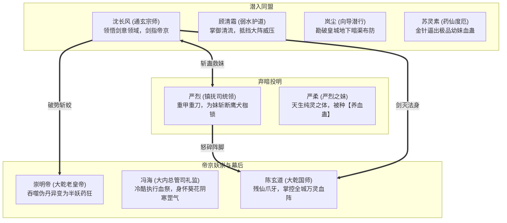

# 附录 · 第三幕详细剧本与关卡规范：神都泣血 · 帝京鼎炉

> **关联索引**：[企划总库](../README.md) · [主线全景](../03-main-storyline.md) · [第二幕详案](act-2-kunlun.md) · [第四幕详案](act-4-frozen-gate.md) · [全景人物录](../grand-character-encyclopedia.md)

---

## 一、第三幕核心定位与叙事目标

第三幕是整部作品剧情冲突与政治阴谋的最高潮，承载五大核心剧变：
1. **揭穿皇权最残忍的遮羞布**：大乾皇室以“甲子寿诞百灵庆典”为诱饵，诱骗十万黎民与数千宗派修士入京，启动全城“万灵血祭大阵”，只为供奉幕后残仙换取一滴真仙命血。
2. **阵营大反转 · 严烈归心**：镇抚司都统严烈发现重病的幼妹严柔竟被国师作为最核心的“天生药引”，在长风与灵素的相助下斩断心魔，毅然倒戈反出朝廷。
3. **宫廷妖异 · 皇者堕落**：直面吞服数百颗伪丹异化为半人半蛟怪物的崇明帝，揭示凡间帝王为求长生丧失人性的可悲与恐怖。
4. **朱雀长街浴血突击**：突破禁军重弩与血煞机关组成的铜墙铁壁，展现团队默契配合与破势绝技。
5. **神都皇城大决战**：捣毁通天观星台血池，粉碎国师陈玄道的法躯，迫使其残魂逃往极北深渊，开启终局远征。

---

## 二、第三幕登场人物详细设定卡



### 1. 严烈（玄天镇抚司统领 · 反戈义士）
* **定位**：可入队重甲破势输出 / 纯爷们硬汉担当。
* **外貌气度**：身高八尺，身披黑铁鱼鳞重甲，面部横贯刀疤，手持一柄重达八十斤的赤金【裂岳斩马刀】。
* **性格闪光**：起初恪守军令、麻木不仁，但在得知幼妹危在旦夕后，血性彻底爆发：“去他娘的军律！若连至亲都护不住，老子当这统领不如当一条狗！”
* **战斗属性配置（WuxiaCharacterDefinition）**：
  * `attributes`: `{"STR": 15, "AGI": 9, "CON": 15, "MND": 8}`
  * `school_id`: `"broken_mountain"`（裂岳沉锋刀法）
  * `passives`: `{"iron_skin": 3, "heavy_impact": 2}`

### 2. 崇明帝（妖化大帝 · 堕落魔君）
* **身份与状态**：在位六十载的老皇帝。为打破两百岁寿元大限，吞服了数百颗活人血丹，肉身异化为长满青黑蛟鳞、双目血红的畸形半妖，力量暴涨十倍却神智全失。
* **战斗特色**：
  * **【蛟龙皇威】**：全屏真实震慑，压制全队行动条。
  * **【血池回生】**：受到致命伤害时自动从地面血池吸取生命复活一次。

### 3. 陈玄道（无极国师 · 伪仙化身）
* **身份定位**：第三幕关底 Boss。渊冥残仙在世间的首席大奴仆。
* **战斗标签**：
  * **高维道法**：擅长施展【五雷轰顶】与【空间遁行】。
  * **真仙符箓**：身披三层免疫凡俗内力打击的太上灵光盾，必须依靠古卷演武破防。

### 4. 冯海（司礼监秉笔太监 · 九千岁）
* **身份特点**：枯槁苍白的老太监，修炼极阴残毒的《化骨玄阴功》，忠于仙丹而非君王。

---

## 三、第三幕核心场景与关卡机制

### 场景 1：神都暗巷 · 镇抚司天牢（潜行与破狱）
* **视觉呈现**：神都倾盆夜雨，青砖暗巷中水雾弥漫。镇抚司黑铁大牢阴森刺骨，守备森严。
* **玩法机制**：利用岚尘的隐匿身法避开禁军火把警戒范围（LOS），配合苏灵素金针无声放倒守卫，潜入天牢底层拯救严烈之妹。

### 场景 2：养心别宫 · 蛟龙魔窟（室内突袭战）
* **视觉呈现**：原本富丽堂皇的皇家寝殿被暗红血水浸透，龙榻四周堆积如山的白骨与药渣，老皇帝在青铜柱前疯狂抽搐。
* **关卡机制**：
  * 破坏寝殿内 3 处【焚香化骨炉】，消除【噬魂尸香】减益。

### 场景 3：朱雀御街 · 破阵冲杀（FREE 连续身法战场）
* **视觉呈现**：宽达五十丈的帝国第一御街。两侧朱红楼阁已被全城血阵映照成暗紫色，成排的机关重弩与发狂的羽林禁军结成铜墙铁壁。
* **关卡机制**：严烈在前顶住强弩箭雨掩护，长风与清霜借轻功在御道两侧屋檐飞跃穿插，斩断阻挡巨弩的车轴。

### 场景 4：太清观星台 · 万灵血池（GRID 15×10 决战大殿）
* **战场布局**：
  * 悬浮于皇城半空的八卦观星台。中央是翻滚着千万人生魂血气的“万灵通天鼎”。
  * 东南西北四个方位矗立着四根“镇魂玉柱”。
* **关卡机制**：
  * 每隔 3 个回合，通天鼎释放一次【摄魂抽血】，必须先集中火力摧毁 4 根镇魂玉柱，切断血池对崇明帝与国师的恢复支持。

---

## 四、第三幕全景剧情分镜与长对白实录

### 第一场：神都烟雨 · 苍生如刍狗

```text
[StoryBeat: beat_shendu_streets]
Caption: "神都 · 永安坊暗渠"
Text: "秋雨连绵，白玉筑就的雄伟神都笼罩在一层诡异的暗紫血雾中。街巷萧条，百姓房门紧锁，成队的铁甲禁军四处抓捕‘待庆生灵’。"
Duration: 3.5

[DialogueNode: node_shendu_entry]
Speaker: "岚尘"
Text: "（从暗渠泥水里探出头，抖落脸上的水珠，面色难看至极）呸！老子在江湖上混了这么多年，从没见过这么阴森的京城！你们看那些禁军佩的刀，刀鞘上全刻着国师府的汲血咒符！整座神都八十一坊，分明是一座已经架在炭火上的大蒸笼！"
NextNode: "node_changfeng_observe"

[DialogueNode: node_changfeng_observe]
Speaker: "沈长风"
Text: "（催动古卷【观天真眼】，眼底金芒流转）不是蒸笼，是‘炼血丹炉’。天上的血雾顺着地下暗渠在流转，整个神都九十九条水道，全都被刻下了血灵噬命之阵。那些被抓走的百姓……气血全在向皇城观星台汇集。"
NextNode: "node_qingshuang_worry"

[DialogueNode: node_qingshuang_worry]
Speaker: "顾清霜"
Text: "（玉手轻按佩剑，眉头深锁）十万黎民，皆以为是进京参拜万寿盛典，朝廷却要把他们化作一炉血水……大乾立国六百年，帝王圣贤书读尽，竟堕落至此！"
NextNode: "node_lingsu_detect_poison"

[DialogueNode: node_lingsu_detect_poison]
Speaker: "苏灵素"
Text: "（鼻尖轻嗅空气中的甜腥气息，眼眶泛红）不止是杀人……这空气里弥漫着‘天心迷魂散’，城里的百姓哪怕被铁链锁着，脸上还在痴痴地笑，以为国师真能赐他们长生金丹！长风大哥，严统领在密信里说的天牢……就在前头永安水闸下！"
NextNode: "node_forward_to_prison"

[DialogueNode: node_forward_to_prison]
Speaker: "沈长风"
Text: "走！救出严柔，斩断国师的药引，逼严烈倒戈！"
NextNode: ""
```

---

### 第二场：天牢拔蛊 · 铁汉跪恩

```text
[StoryBeat: beat_shendu_prison]
Caption: "子夜 · 镇抚司黑牢"
Text: "阴暗潮湿的水牢深处，严烈抱着面如金纸、浑身滚烫的幼妹，虎目含泪，拔刀抵在沈长风喉前。"
Duration: 3.5

[DialogueNode: node_yanlie_despair]
Speaker: "严烈"
Text: "沈长风！你若能救小柔……老子这条命，任你千刀万剐！但你若救不了……今夜谁也别想活着走出神都！"
NextNode: "node_lingsu_needle"

[DialogueNode: node_lingsu_needle]
Speaker: "苏灵素"
Text: "（快步上前，素手按在女孩眉心）严统领息怒！令妹不是染病，是心脉被国师种下了最为恶毒的‘九阴血蛊’！长风大哥，用你的古卷真眼帮我定住蛊虫方位！"
NextNode: "node_scroll_pinpoint"

[DialogueNode: node_scroll_pinpoint]
Speaker: "旁白"
Text: "沈长风闭目凝神，【观天真眼】骤然洞穿女孩体内灵脉，清晰看到一只长着人面的赤红蛊虫正死死咬住女孩心尖！"
NextNode: "node_changfeng_guide"

[DialogueNode: node_changfeng_guide]
Speaker: "沈长风"
Text: "膻中穴下一寸二分！清霜以柔劲护住心包，灵素下针！"
NextNode: "node_frost_shield"

[DialogueNode: node_frost_shield]
Speaker: "顾清霜"
Text: "（素手轻按女孩背心，纯净沧澜回潮劲化作一层清凉水膜护住经脉）弱水化劲 · 封脉固魂！"
NextNode: "node_needle_strike"

[DialogueNode: node_needle_strike]
Speaker: "旁白"
Text: "苏灵素三枚太素金针如闪电刺落，一缕乌黑恶臭的毒血混着尖叫的蛊虫被生生逼出女孩指尖！女孩咳出一口浊气，呼吸渐稳，沉沉睡去。"
NextNode: "node_yanlie_breakdown"

[DialogueNode: node_yanlie_breakdown]
Speaker: "严烈"
Text: "（手中重刀当啷坠地，铁塔般的身躯轰然单膝跪地，一拳砸碎青石地板，虎目泣血）国师……狗皇帝！老子为你们卖命八年，杀人无数……你们竟拿我唯一的亲人炼丹作药？！"
NextNode: "node_changfeng_pull_up"

[DialogueNode: node_changfeng_pull_up]
Speaker: "沈长风"
Text: "（伸手一把拉起严烈，眼神如铁）严兄，男儿膝下有黄金，拔出你的刀！神都十万百姓正被驱赶上观星台，跟我们一起，掀翻这片吃人的天！"
NextNode: "node_yanlie_roar"

[DialogueNode: node_yanlie_roar]
Speaker: "严烈"
Text: "（双目赤红拔起斩马刀，咆哮震碎牢门）掀！老子今夜不把那座狗屁观星台劈成齑粉，誓不为人！"
NextNode: ""
```

---

### 第三场：寝殿龙塌 · 饮血之君

```text
[StoryBeat: beat_emperor_madness]
Caption: "皇城深处 · 养心别宫"
Text: "沉香木雕龙的大殿内没有一丝暖意，刺鼻的血腥味压过了名贵龙涎香。重帘之后，传来野兽般的喘息与骨骼碎裂声。"
Duration: 3.5

[DialogueNode: node_fenghai_whisper]
Speaker: "冯海"
Text: "（手捧一只九龙金钵，里面盛放着翻滚的百名童男童女精血，阴恻恻道）陛下……时辰到了，该进仙露了。国师说了，只要吸干这一钵，陛下身上的真龙仙鳞，便能化为长生不老之躯。"
NextNode: "node_emperor_reveal"

[DialogueNode: node_emperor_reveal]
Speaker: "崇明帝"
Text: "（从阴影中猛然扑出，枯瘦的双臂竟长满了青黑色的倒刺骨鳞，五指如铁爪般夺过金钵暴饮，喉管咕噜作响，眼中满是血红狂态）长生……朕要长生！朕在位六十载，四海宾服……天道凭什么给朕两百岁大限？！凭什么——！"
NextNode: "node_party_burst_in"

[DialogueNode: node_party_burst_in]
Speaker: "旁白"
Text: "殿门轰然被狂暴的刀罡炸开！严烈持斩马刀立于大殿中央，身后沈长风、顾清霜仗剑而入！"
NextNode: "node_yanlie_fury_emperor"

[DialogueNode: node_yanlie_fury_emperor]
Speaker: "严烈"
Text: "赵崇明！睁开你的狗眼看看你自己！你身上流的哪是真龙天子的血？分明是吸食民间骨髓的怪物！"
NextNode: "node_emperor_roar"

[DialogueNode: node_emperor_roar]
Speaker: "崇明帝"
Text: "（擦去嘴角血沫，发出如雷霆般的蛟龙嘶吼）叛逆！都是叛逆！整座天下都是朕的！他们的命是朕给的，为朕延寿是他们的福分！冯海，给朕撕碎他们！"
NextNode: "node_fenghai_cold_strike"

[DialogueNode: node_fenghai_cold_strike]
Speaker: "冯海"
Text: "（身形快若鬼魅，十道紫黑指风破空刺出）奴才领旨！几个不知天高地厚的乱臣贼子，化作老奴的养料吧！"
NextNode: "node_changfeng_parry_fenghai"

[DialogueNode: node_changfeng_parry_fenghai]
Speaker: "沈长风"
Text: "（古卷【演武明镜】瞬息拆解葵花指路数，青钢剑平递而出，剑气化作浩荡长风卷碎指劲）\n吃人的皇帝，嗜血的阉奴，这腐朽的王朝，今日合该伏诛！"
NextNode: ""
```

---

### 第四场：朱雀喋血 · 逆冲御街

```text
[StoryBeat: beat_zhuque_charge]
Caption: "黎明前夕 · 朱雀御街"
Text: "御街两旁白玉灯柱尽数碎裂，血色大阵笼罩苍穹。八百名被血符操控的羽林铁卫与三具万斤机关神弩战车阻断长街！"
Duration: 3.5

[DialogueNode: node_crossbow_fire]
Speaker: "旁白"
Text: "崩！崩！崩！\n如巨木般的重型破甲弩箭撕裂夜空，带着尖锐的音爆啸叫呼啸而来！"
NextNode: "node_yanlie_shield"

[DialogueNode: node_yanlie_shield]
Speaker: "严烈"
Text: "（八十斤斩马刀横立胸前，重甲爆发赤金狂澜）裂岳千重山！老子在前面顶着，长风，清霜，上房拆车！"
NextNode: "node_crossbow_bounce"

[DialogueNode: node_crossbow_bounce]
Speaker: "旁白"
Text: "当！当！当！巨弩撞在严烈的重刀与罡气上火星四溅，严烈虎口震裂，双脚在青石御街上生生犁出两道三寸深的沟壑，却一步不退！"
NextNode: "node_lancheng_grenade"

[DialogueNode: node_lancheng_grenade]
Speaker: "岚尘"
Text: "（身形在屋檐间如轻烟滑行，甩手抛出数枚特制草木雷）严大哥好气魄！看小爷断他们的车轴！爆——！"
NextNode: "node_engine_burst"

[DialogueNode: node_engine_burst]
Speaker: "旁白"
Text: "两具重弩战车的精钢齿轮被炸成扭曲铁片，火光冲天！"
NextNode: "node_changfrost_cooperation"

[DialogueNode: node_changfrost_cooperation]
Speaker: "沈长风 & 顾清霜"
Text: "（一青一白两道剑光并肩掠过长街半空）\n长风折柳，碧水连天——破！"
NextNode: "node_guards_routed"

[DialogueNode: node_guards_routed]
Speaker: "旁白"
Text: "两道交织的宗师剑意如狂澜席卷，不仅瞬间荡平了最后一架战车，更将阻拦长街的血煞军阵硬生生劈开一条通向观星台的坦途！"
NextNode: ""
```

---

### 第五场：观星台顶 · 剑灭伪仙

```text
[StoryBeat: beat_shendu_climax]
Caption: "通天观星台 · 鼎炉崩解"
Text: "妖化崇明帝庞大的蛟躯被长风与严烈合力斩翻在地，陈玄道悬于半空，周身神雷翻涌，万灵通天鼎中十万百姓的生魂正在疯狂哀嚎。"
Duration: 3.5

[DialogueNode: node_cx_rage]
Speaker: "陈玄道"
Text: "一群蝼蚁！尔等以为阻碍大阵便能逆天而行？实话告诉你们，上界‘渊冥真仙’法驾早已降临极北！尔等越是反抗，降下的天罚越是惨烈！这万灵鼎，本就是为真仙准备的祭品！"
NextNode: "node_changfeng_sky_sword"

[DialogueNode: node_changfeng_sky_sword]
Speaker: "沈长风"
Text: "（踏步凌空，宗师剑意如狂风呼啸，古卷演武推演达至大成）真仙？一个藏在冰渊里苟延残喘、靠吸凡人骨血苟活的下界败寇，也敢妄称天道？！"
NextNode: "node_cx_terror"

[DialogueNode: node_cx_terror]
Speaker: "陈玄道"
Text: "你……你怎会知晓上界仙秘？！这不可能——！"
NextNode: "node_changfeng_slash"

[DialogueNode: node_changfeng_slash]
Speaker: "旁白"
Text: "沈长风一剑斩出，这一剑蕴含了长风破浪的浩荡民愿，剑光直接崩碎了陈玄道的太上灵光盾！\n轰隆隆！中央万灵通天鼎应声爆碎，四溢的生魂化作漫天青光重新归入神都百姓体内！\n陈玄道肉身轰然爆碎，一道尖叫的黑色仙仆残魂从残骸中逃出，化作一道凄厉血光，疯狂逃往北荒极境！"
NextNode: "node_post_shendu_setup"

[DialogueNode: node_post_shendu_setup]
Speaker: "顾清霜"
Text: "（望着北方天穹翻滚的黑雾）残仙真身……就在极北冰封大阵的中心。这一战，终于到了直面源头的时刻了。"
NextNode: "node_yanlie_blood_pledge"

[DialogueNode: node_yanlie_blood_pledge]
Speaker: "严烈"
Text: "（将斩马刀重重顿在地上，向北荒怒啐一口唾沫）好！去北极！老子倒要亲眼看看，这万年来把凡间当猪狗圈养的所谓‘真仙’，到底长着怎样一张丑脸！"
NextNode: ""
```
