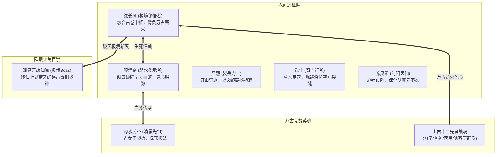

# 附录 · 第四幕详细剧本与关卡规范：叩击绝天 · 先贤共鸣

> **关联索引**：[企划总库](../README.md) · [主线全景](../03-main-storyline.md) · [第三幕详案](act-3-shendu.md) · [终章详案](act-5-finale.md) · [全景人物录](../grand-character-encyclopedia.md)

---

## 一、第四幕核心定位与叙事目标

第四幕跨入整部作品最壮烈苍茫的历史沉淀期，承载五大历史级高光时刻：
1. **踏足凡界万古禁区**：队伍远征北极万丈冰原，亲眼目睹万年前“绝天地通”大战遗留的荒古战场与冻骨之海。
2. **万载断兵 · 追忆英烈**：在诸圣断剑坪见证历代半步天人先辈至死不屈的战痕，打破主角对“长生与死亡”的浅薄认知。
3. **女主血脉大圆满**：顾清霜与万年前战死于此的先祖“弱水武圣”战魂共鸣，彻底荡平体内代代相传的早夭死劫，获得远古大能的完整弱水道统。
4. **《逆仙图录》万古归一**：沈长风手中的兽皮残卷与阵眼中枢的太古阵石完美镶嵌，沉睡在冰原下的上古十二位半步天人先贤英魂相继苏醒，进行万圣问心考验。
5. **修为质变 · 半步天人极境**：长风经受住万古武圣战意的心性拷打，将历代先贤的毕生抗争化作自身纯阳武罡的养料，突破至前所未有的**“半步天人 · 极境巅峰”**，并力斩太古青铜仙傀！

---

## 二、第四幕登场人物详细设定卡



### 1. 弱水武圣战魂（顾清霜先祖 · 万古女圣）
* **形象风姿**：冰封在万丈玄冰之中的虚幻法相。容貌与顾清霜有七分相似，英气勃发，手持一柄早已折断但神意不灭的太古神剑。
* **剧情高光**：以残魂之力为清霜梳理血脉，将万年遗憾尽数托付后辈：“傻孩子……你的命不是诅咒，是我们未曾走完的剑道！”

### 2. 上古十二武圣英魂群像
* **身份构成**：万年间历代试图斩碎绝天地通大阵的“半步天人”绝世强者（持刀狂啸的斩天刀圣、双拳碎岳的覆地拳尊、以身化针的太古药皇）。
* **对主角的考验**：以纯粹战意凝成虚幻剑意幻象，拷问沈长风修武之初衷。见其心境澄澈无私，齐齐躬身纳拜，将战意倾囊相授。

### 3. 渊冥万劫仙傀（第四幕关底 Boss）
* **定位**：残仙从上界带下的太古青铜神傀，高逾十丈，通体布满古老仙家铭文。
* **机制特色**：
  * **法则免疫**：免疫一切凡俗常规五行与招式伤害，唯有激活先贤领域的共鸣招式才能对其造成破势。
  * **虚空裂震**：重击地面撕裂战场空间，产生不可通行的虚空深渊。

---

## 三、第四幕核心场景与关卡机制

### 场景 1：北极冰原 · 冻骨之海（FREE 极限环境生存）
* **视觉呈现**：灰白混沌的世界，狂风卷着如刀锋般的冰雹呼啸横扫。视线不足十米，地面是深不见底的幽蓝冰裂隙与万年古尸巨兽残骸。
* **关卡机制**：
  * **【天绝极寒】**：队伍必须依靠苏灵素的【纯阳温经丹】与严烈的重甲开道，否则移动力与集气速度每 5 秒下降 10%。

### 场景 2：万古天门废墟 · 诸圣断剑坪（探索与剧情高光）
* **视觉呈现**：九根高耸入云但已断裂的通天玉柱。柱下是密密麻麻插在冻土中的古老断兵，每柄兵刃下都冰封着一具栩栩如生、至死不屈的先贤肉身。
* **探索交互**：
  * 触摸断剑触发【先贤追忆】，解锁全队属性上限突破与特殊被动技能。

### 场景 3：锁灵绝天中枢 · 封神绝壁（剧情转折点）
* **视觉呈现**：一面高逾千丈的玄冰镜面绝壁，中央嵌有古老阵盘凹槽，弱水武圣的巨大剑印在此闪烁不休。

### 场景 4：封天锁灵阵眼中枢 · 虚空裂谷（GRID 15×10 大决战）
* **战场布局**：
  * 悬浮于深渊之上的破碎青铜古阵盘。外围是无尽的星界深空黑洞。
* **关卡机制**：
  * 阵盘外圈不断坍缩（每过 4 个回合最外圈格子碎裂跌入虚空），逼迫队伍必须在有限空间内强攻 Boss。

---

## 四、第四幕全景剧情分镜与长对白实录

### 第一场：极北荒原 · 踏足冻骨海

```text
[StoryBeat: beat_frozen_sea]
Caption: "极北禁区 · 冻骨之海"
Text: "天地一片惨白，暴风雪呼啸如巨兽咆哮。极北绝寒如刀割般撕扯着众人的护体真气，脚下的冰层下隐约可见被冰封数千年的上古巨兽与累累白骨。"
Duration: 3.5

[DialogueNode: node_cold_storm]
Speaker: "严烈"
Text: "（将斩马刀狠狠插进坚冰，双手撑着刀柄，呼吸喷出浓重白雾，眉毛挂满冰碴）娘的……老子这辈子没受过这种冻！体内的真气运转起来像灌了铁汁，每走一步骨头都在响！"
NextNode: "node_lingsu_warm_pill"

[DialogueNode: node_lingsu_warm_pill]
Speaker: "苏灵素"
Text: "（从药囊取出散发着赤红暖光的药丸递给众人）严大哥快含住！这是用赤龙果皮炼制的‘九阳回天丹’，能锁住心脉阳气！这风雪不是寻常天象，里面混着仙家死咒的煞气！"
NextNode: "node_lancheng_scout"

[DialogueNode: node_lancheng_scout]
Speaker: "岚尘"
Text: "（在前方冰崖上打下绳结，低头张望）看下面！整座海峡全是一根根朝天的冰刺！那些白骨……身上全穿着不同年代的古老武袍！有些腰牌是三百年前的天下第一刀，有些甚至是一千年前的天山神掌！"
NextNode: "node_changfeng_reverence"

[DialogueNode: node_changfeng_reverence]
Speaker: "沈长风"
Text: "（俯瞰苍茫冰海，眼中满是敬畏与肃穆）万年来，从没有哪一位半步天人是坐以待毙死在榻上的。只要修到此境，发觉了头顶这道天幕的虚妄，他们便都会拔刀北上。这片冰原……是凡人武道的埋骨地，也是万载薪火的不灭炉！"
NextNode: "node_forward_to_sword_ridge"

[DialogueNode: node_forward_to_sword_ridge]
Speaker: "顾清霜"
Text: "（遥望极北深处的冲天蓝光，胸前的沧浪玉佩剧烈发烫）就在前面……我感应到了，先祖的呼唤声，就在天门断剑坪！"
NextNode: ""
```

---

### 第二场：诸圣遗坪 · 触摸万载战痕

```text
[StoryBeat: beat_sword_ridge]
Caption: "万古天门废墟 · 诸圣断剑坪"
Text: "九根巨大的断裂石柱直插苍穹，地面上密密麻麻插着三千柄古老兵刃。虽历经万载风霜侵蚀，兵刃上残留的武道意志依然凝而不散，激荡苍穹！"
Duration: 3.5

[DialogueNode: node_sword_forest]
Speaker: "沈长风"
Text: "（走入剑冢之中，指尖轻抚过一柄布满裂纹的古朴巨剑，耳畔骤然响起太古狂烈的怒吼）"
NextNode: "node_blade_phantom_echo"

[DialogueNode: node_blade_phantom_echo]
Speaker: "太古刀客残响"
Text: "（虚空回荡）‘残仙！凡人命贱，亦不可欺！老夫今日以残躯换你一掌，来世……自有人斩下你项上狗头！’"
NextNode: "node_spear_phantom_echo"

[DialogueNode: node_spear_phantom_echo]
Speaker: "破军枪圣残响"
Text: "（战马嘶鸣与枪鸣交错）‘吾枪刺天三万里，虽死不悔！后来者，莫回头！’"
NextNode: "node_yanlie_moved"

[DialogueNode: node_yanlie_moved]
Speaker: "严烈"
Text: "（铁塔般的大汉眼眶泛红，双手抱拳向满地断兵深深拜伏）都是顶天立地的汉子……天下人都以为宗师老祖们隐世坐化是去求长生，谁能想到他们全死在了这鬼地方，用命替后人撞这道天门！"
NextNode: "node_changfeng_resolve"

[DialogueNode: node_changfeng_resolve]
Speaker: "沈长风"
Text: "（怀中古卷【演武明镜】与满山兵意共鸣，绽放出温润璀璨的金辉）他们没有白死。每一位先贤的死，都将自己的毕生武道烙印在了这方天地里。这份古卷……就是他们千锤百炼留下的天门钥匙！"
NextNode: ""
```

---

### 第三场：玄冰破煞 · 弱水永安

```text
[StoryBeat: beat_frost_sanctuary]
Caption: "极北禁地 · 天门绝壁"
Text: "万仞蓝冰之下，一座清冷英挺的上古女圣残魂在微光中浮现，顾清霜胸前玉佩轰然碎裂，光华万丈！"
Duration: 3.5

[DialogueNode: node_qingshuang_resonate]
Speaker: "顾清霜"
Text: "（身躯剧烈颤抖，体内常年冰寒刺骨的血煞在这一刻化作滚滚温流）先祖……您是当年一剑斩断残仙右臂的……弱水武圣？！"
NextNode: "node_ancestor_caress"

[DialogueNode: node_ancestor_caress]
Speaker: "弱水武圣残魂"
Text: "（虚幻的素手轻轻抚过顾清霜泛红的眼眶，眼中尽是万载沧桑的爱怜）孩子，万年来，让你们这一脉受苦了……那恶毒的残仙怕我们的弱水化劲破其仙道，才在整座血脉中种下这三十岁早夭诅咒……但他想不到，弱水至柔，却能百折不摧！"
NextNode: "node_curse_shatter"

[DialogueNode: node_curse_shatter]
Speaker: "旁白"
Text: "先祖残魂化作一轮澄澈明净的秋水神阳，彻底没入顾清霜眉心！顾清霜体内一切杂驳寒毒尽数瓦解，眉宇间的朱砂痣化为神圣的玄武水印！早夭之劫，万古终灭！"
NextNode: "node_qingshuang_break_shackle"

[DialogueNode: node_qingshuang_break_shackle]
Speaker: "顾清霜"
Text: "（睁开双眸，周身剑气如瀚海波涛，转头望向沈长风，泪如雨下却笑容明媚）长风……我不再是短命之人了！我能陪你……走到天地的尽头！"
NextNode: "node_changfeng_rejoice"

[DialogueNode: node_changfeng_rejoice]
Speaker: "沈长风"
Text: "（紧握清霜的手，剑眉舒展，豪气干云）好！今日之后，这人间的命，我们自己说了算！"
NextNode: ""
```

---

### 第四场：诸圣问心 · 薪火相传

```text
[StoryBeat: beat_sages_awaken]
Caption: "阵眼中枢 · 薪火相传"
Text: "沈长风将染血的暗金兽皮残卷按入中枢石阵凹槽。轰！整座北极冰原骤然爆发出贯穿天地的赤金神芒！"
Duration: 3.5

[DialogueNode: node_sages_phantoms]
Speaker: "旁白"
Text: "天际风雪中，十二道顶天立地的太古虚影相继拔地而起！刀客、剑尊、拳狂、隐士……每一道虚影，皆是一段凡人以武抗仙的悲壮史诗！"
NextNode: "node_blade_sage_speak"

[DialogueNode: node_blade_sage_speak]
Speaker: "斩天刀圣战魂"
Text: "（声如洪钟震动九霄）后世的小子！你持图录而来，可知前路万丈深渊？！你手中长剑，为何而拔？！"
NextNode: "node_fist_sage_speak"

[DialogueNode: node_fist_sage_speak]
Speaker: "覆地拳尊战魂"
Text: "（金刚怒目，气血压垮冰原）若为一人长生，便休要沾染这万千同袍的染血英魂！"
NextNode: "node_changfeng_oath"

[DialogueNode: node_changfeng_oath]
Speaker: "沈长风"
Text: "（面对十二位万古武圣，不卑不亢，收剑抱拳，朗声答道）\n不求长生不死，但求人间公道！\n不求羽化成仙，但叫万世开天！\n凡人之躯，亦能自强！这，便是后辈沈长风的武道！"
NextNode: "node_sages_cheer"

[DialogueNode: node_sages_cheer]
Speaker: "十二先贤战魂"
Text: "（齐齐仰天长笑，笑声震碎苍穹风雪）好！好一个不求仙道求公道！吾道不孤！人间武脉，今日大成！"
NextNode: "node_infusion"

[DialogueNode: node_infusion]
Speaker: "旁白"
Text: "万古先贤战魂化作漫天纯粹道火，尽数灌入沈长风天灵穴！\n沈长风体内经脉发出如天雷般的轰鸣，纯阳气血直接跨越凡人极限，达至【半步天人 · 极境巅峰】！"
NextNode: ""
```

---

### 第五场：万劫仙傀 · 绝天斩关

```text
[StoryBeat: beat_golem_battle]
Caption: "极北深渊裂口 · 仙傀降世"
Text: "大地崩裂，一尊高逾十丈、通体流淌着暗黑仙家符箓的太古青铜神傀自深渊中轰然拔起，一掌拍碎了千丈冰崖！"
Duration: 3.5

[DialogueNode: node_golem_roar]
Speaker: "渊冥万劫仙傀"
Text: "（胸腔传出金属摩挲与冰冷上界道音）凡界蝼蚁，擅叩天门者……死！"
NextNode: "node_allies_strike"

[DialogueNode: node_allies_strike]
Speaker: "严烈 & 顾清霜"
Text: "（刀罡与弱水齐出，轰在仙傀甲胄上火星迸射）好硬的乌龟壳！这是仙家上界的青铜战偶，常规兵刃根本伤不到核心！"
NextNode: "node_changfeng_extreme_step"

[DialogueNode: node_changfeng_extreme_step]
Speaker: "旁白"
Text: "沈长风凌空踏虚而立，整座绝天冰原的风雪在这一刻逆流倒卷！十二先贤的薪火道韵在他身后化为一尊顶天立地的纯阳武圣法相！"
NextNode: "node_changfeng_extreme_slash"

[DialogueNode: node_changfeng_extreme_slash]
Speaker: "沈长风"
Text: "（青钢长剑轻鸣，极境武道神意凝聚于一点，如清晨第一缕破晓曦光）\n薪火借我万载意，凡躯开天第一剑——斩！"
NextNode: "node_golem_split"

[DialogueNode: node_golem_split]
Speaker: "旁白"
Text: "一道贯穿天地的雪白剑芒如裁纸般将庞大的青铜仙傀自眉心一分为二！\n伴随着惊天动地的爆响，仙傀四分五裂坠入深渊，极北地渊深处的万古绝地终于门户大开！\n深渊极底，传来了渊冥残仙惊恐而暴怒的苏醒咆哮！"
NextNode: "node_forward_to_finale"

[DialogueNode: node_forward_to_finale]
Speaker: "沈长风"
Text: "（持剑按立崖顶，目光穿透九幽深渊）渊冥，万年血债，人间来向你讨了！"
NextNode: ""
```
