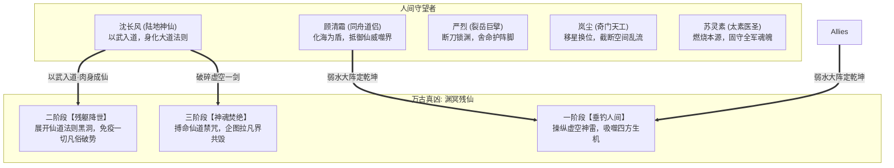

# 附录 · 终章详细剧本与关卡规范：极境入道 · 剑斩残仙 · 破碎虚空

> **关联索引**：[企划总库](../README.md) · [主线全景](../03-main-storyline.md) · [第四幕详案](act-4-frozen-gate.md) · [武道与战斗系统](../08-cultivation-and-combat.md) · [全景人物录](../grand-character-encyclopedia.md)

---

## 一、终章核心定位与叙事目标

终章是整部史诗企划的终极收官之战，全面兑现企划案的基础设定与最高潮：
1. **终极大对决 · 凡人武道叩仙门**：沈长风与人间盟友直面万古幕后真凶——“渊冥残仙”，展开跨越凡仙维度的三阶段决死神战。
2. **凡仙哲辩 · 破除长生虚妄**：直面残仙将凡间生灵视作“血食韭菜”的高高在上，沈长风以人间万年抗争之义予以怒斥，打破对“伪仙”的神圣崇拜。
3. **以武入道 · 登临陆地仙人**：沈长风在凡界生灵大义与万古先贤薪火熔铸下，彻底打破天地法则束缚，肉身成圣，成为人间唯一不依附外药金丹的“陆地真仙”。
4. **一剑开天 · 碎尽锁灵大阵**：不仅诛灭残仙神魂，更以通天伟力逆斩苍穹，一剑劈碎困锁人间万年的锁灵绝天大阵，还世间以清明自在与真正的寿元天地。
5. **传道立统 · 破碎虚空而去**：立长风道碑，公开正法《长风入道真经》九卷，与挚爱知己含笑作别，身化清风长虹破碎虚空，飘摇飞升。

---

## 二、终章登场人物详细设定卡



### 1. 沈长风（人间真圣 · 陆地仙人）
* **定位**：真神级战力 / 超脱凡俗寿元与规则限制。
* **形象变化**：素青长衫无风自扬，满头墨发在脑后轻束，眼眸深邃如无垠星海，周身没有一丝驳杂仙气，唯有如天地初开般纯净浩瀚的浩然武道神罡。
* **战斗终极机制**：
  * **【法体不朽】**：免疫一切凡俗控制、眩晕与强制位移，架势条转化为不坏道躯。
  * **【虚空穿行】**：移动无需消耗移动力，可在战场任意空地瞬间折跃。
  * **【破碎虚空】（终结技）**：蓄满真气斩出，直接抹除高维目标一切法则屏障。

### 2. 渊冥残仙（终极大 Boss · 三阶段神战）
* **身份真相**：万年前上界争霸失败逃遁至此的重伤仙尊，视凡界生灵为续命血食。封天锁地一是防止凡人成仙反噬，二是躲避上界仇敌追查。
* **形象**：
  * **前两阶段**：万丈身躯隐藏在冰渊黑雾中，唯有一只白骨森森、缠绕着暗黑仙纹的万丈巨爪与猩红巨眼探出虚空。
  * **第三阶段**：被逼出残破的仙尊神魂真身，披头散发，面目狰狞扭曲。

---

## 三、终章三大决战场景与关卡机制

### 场景 1：绝天深渊 · 混沌裂台（三阶段终极大决战）
* **视觉呈现**：悬浮在万丈虚空深渊上的太古阵台。四周是破碎的星空光屑、翻滚的九幽黑气与时空裂缝。
* **三大战斗阶段机制（GRID 15×10 与 FREE 连续双模交替）**：
  * **一阶段（集气压制）**：残仙不断召唤天罚雷柱，顾清霜展开【弱水瀚海域】，玩家需引导全队进入护盾安全区。
  * **二阶段（高维黑洞）**：残仙释放【万物归墟】吸收场上角色，严烈插刀定地，岚尘投掷草木神引扰乱吸力，沈长风完成【以武入道】终极突破！
  * **三阶段（生死交锋）**：残仙开启全屏死咒倒计时，沈长风单挑残仙真身，进行极限 LIFO 栈顶逆序见招拆招决死战！

### 场景 2：昆仑绝顶 · 长风道碑（尾声叙事）
* **视觉呈现**：万里晴空，朝阳普照。万丈白玉绝壁上，沈长风以剑气刻满天下人皆可修行的九卷真经。

### 场景 3：九霄苍穹 · 飞升天门（通关大结局演出）
* **视觉呈现**：虚空碎裂，纯净绚烂的星汉与祥云垂落，天乐隐隐，人间万灵膜拜。

---

## 四、终章全景剧情分镜与长对白实录

### 第一场：渊冥深处 · 凡仙质辩

```text
[StoryBeat: beat_abyss_dialogue]
Caption: "极北深渊极底 · 绝天阵眼"
Text: "深不见底的虚空裂隙中，翻滚着粘稠如墨的黑暗死煞。一对遮天蔽日的血色巨眸在虚空中缓缓睁开，恐怖的真仙威压让天地法则都为之哀鸣颤抖！"
Duration: 4.0

[DialogueNode: node_abyss_eye_open]
Speaker: "渊冥残仙"
Text: "（声音跨越万载时空，如九天沉雷轰落，震得众人气血翻江倒海）万年了……竟真有几只凡间蝼蚁，能爬到本尊的卧榻前。沈长风……你身负那些下界死鬼的残卷，莫非真以为凭这凡胎浊骨，能逆改天数？"
NextNode: "node_changfeng_step_forward_calm"

[DialogueNode: node_changfeng_step_forward_calm]
Speaker: "沈长风"
Text: "（素青长衫在狂暴的虚空罡风中猎猎作响，背负长剑，神情平静如深潭）\n逆改天数？不，天数本常，是你贪生畏死，逃落下界，偷换了天命！"
NextNode: "node_immortal_mock"

[DialogueNode: node_immortal_mock]
Speaker: "渊冥残仙"
Text: "（发出一声嗤笑，深渊掀起万丈黑澜）偷换天命？可笑！这天地万物，强者居之！凡人寿不过百，庸碌如蝼蚁草芥，本尊锁灵此界，免尔等沾染上界大祸，取尔等十万残命延本尊仙寿，乃是尔等泼天的造化！草木春秋，本就是为了待割，尔等何敢怨憎？！"
NextNode: "node_changfeng_rebuttal"

[DialogueNode: node_changfeng_rebuttal]
Speaker: "沈长风"
Text: "（仰头直视那双血眸，目光如烈日贯空）\n草木有灵，亦向阳而生；凡人虽微，有死节之烈！\n你自诩九天真仙，在上界战败却如丧家之犬般仓皇逃窜；你惧怕上界仇家寻来，便封锁天地灵机；你惧怕凡人中有人成仙取你狗命，便定下两百岁死劫！\n你不是仙，你只是一个吸食凡人骨血苟延残喘的下界懦夫！"
NextNode: "node_immortal_rage"

[DialogueNode: node_immortal_rage]
Speaker: "渊冥残仙"
Text: "（暴怒咆哮，整座北极冰原瞬间崩塌亿万裂隙）放肆！区区凡尘虫豸，受死——！"
NextNode: ""
```

---

### 第二场：绝地神战 · 舍生叩天

```text
[StoryBeat: beat_finale_battle_stage2]
Caption: "生死搏杀 · 三阶段神战"
Text: "巨大漆黑的仙人巨爪自虚空中抓落，神雷与黑焰遮蔽一切视野！众人各展所长，陷入跨越凡仙维度的极限血战！"
Duration: 3.5

[DialogueNode: node_yanlie_break_blade]
Speaker: "严烈"
Text: "（八十斤斩马刀轰然插进虚空阵台，浑身重甲寸寸崩碎，嘴角狂喷鲜血，死死顶住砸落的虚空巨指）给老子……起！老子这一刀，代大乾死去的十万冤魂还给你！"
NextNode: "node_qingshuang_ocean_shield"

[DialogueNode: node_qingshuang_ocean_shield]
Speaker: "顾清霜"
Text: "（脚踏虚空，弱水武圣神印全面绽放，万顷碧波化作无上灵盾托住整座阵台）弱水三千 · 覆地归海！长风，气脉已被我等锁死，看你的了！"
NextNode: "node_lingsu_vital_spark"

[DialogueNode: node_lingsu_vital_spark]
Speaker: "苏灵素"
Text: "（十二枚金针同时没入自身大穴，纯阳医道真元如火炬般燃烧，照亮长风后心）长风大哥，百草为引，天地同春！这一剑，无憾！"
NextNode: "node_changfeng_breakthrough"

[DialogueNode: node_changfeng_breakthrough]
Speaker: "旁白"
Text: "在战友们拼死守护的刹那，沈长风怀中的古卷终于彻底崩散，化作一万两千道太古符文融入他的四肢百骸！\n万载先贤的执念、神都黎民的呼喊、昆仑老祖的傲骨、身边挚爱的生死相托……\n所有的人间心念，在这一刻彻底熔铸于心！"
NextNode: "node_earthly_immortal_rebirth"

[DialogueNode: node_earthly_immortal_rebirth]
Speaker: "旁白"
Text: "轰——！\n虚空中没有任何外来灵气的灌入，唯有沈长风体内潜藏的凡人体魄与武道神罡，在极限的压迫下自我点燃！\n精气神三宝归一，肉身成圣！\n古往今来第一位不靠仙家法力、纯以武道登峰造极的——【陆地神仙】！"
NextNode: ""
```

---

### 第三场：一剑开天 · 碎尽锁灵

```text
[StoryBeat: beat_finale_battle_climax]
Caption: "绝天之渊 · 终局决战"
Text: "残仙神魂自残躯中被逼出，歇斯底里地催动毁灭禁咒企图玉石俱焚！沈长风长剑出鞘，天地骤然归于死寂！"
Duration: 3.5

[DialogueNode: node_boss_curse]
Speaker: "渊冥残仙"
Text: "（虚幻的仙尊法相扭曲嚎叫）本尊乃不朽真仙！凡人怎么可能肉身成仙？！死！全都给本尊陪葬——！"
NextNode: "node_changfeng_dao_ascend"

[DialogueNode: node_changfeng_dao_ascend]
Speaker: "沈长风"
Text: "（青衫飘飘，单手持剑平平斩出，剑尖划破虚空，没有繁复招式，唯有一股开天辟地的浩荡纯阳）\n天地不仁，我辈自渡。\n万古人间，请——残仙赴死！"
NextNode: "node_boss_obliterated"

[DialogueNode: node_boss_obliterated]
Speaker: "旁白"
Text: "璀璨纯净的剑芒如裁天利刃，精准无误地掠过残仙眉心！\n没有惊天动地的巨响，唯有万年冰封被初阳照化的消融之声。残仙脸上的狰狞定格在不可置信的恐惧中，整具仙魂如风中飞絮，彻底化为虚无飞灰！"
NextNode: "node_strike_the_sky"

[DialogueNode: node_strike_the_sky]
Speaker: "沈长风"
Text: "（借诛仙之余威，踏虚直上九重云霄，反手向天一剑逆劈苍穹黑幕）万载锁灵，今日……给老子碎——！"
NextNode: "node_array_collapse"

[DialogueNode: node_array_collapse]
Speaker: "旁白"
Text: "咔嚓！轰隆隆隆——！\n笼罩在九州头顶整整万年的黑色锁灵绝天大阵，在这一剑之下轰然爆碎！\n天门大开！被封闭万年的九天纯净灵机如浩瀚银河般倾泻而下，普降甘霖！枯木逢春，沧海翻波，天下凡人两百岁的寿元天堑，在这一刻彻底烟消云散！"
NextNode: "node_allies_weep"

[DialogueNode: node_allies_weep]
Speaker: "严烈 & 岚尘 & 苏灵素"
Text: "（相拥仰望澄澈苍穹，热泪长流）天亮了……天终于亮了！先贤们……我们成了！"
NextNode: "node_qingshuang_gaze"

[DialogueNode: node_qingshuang_gaze]
Speaker: "顾清霜"
Text: "（白衣猎猎，青丝飞舞，眼眸中倒映着凌空傲立的青衫青年，嘴角漾开世间最动人的笑容）长风……你做到了。"
NextNode: ""
```

---

### 第四场：昆仑立道 · 传法天下

```text
[StoryBeat: beat_kunlun_legacy]
Caption: "三日之后 · 昆仑绝顶"
Text: "天下浩劫平定，假药尽除，万象更新。昆仑绝顶白雪皑皑，一尊高达万丈的白玉巨碑拔地而起，各派宗师肃穆环立。"
Duration: 3.5

[DialogueNode: node_carve_scriptures]
Speaker: "旁白"
Text: "沈长风并指如剑，在万丈绝壁上龙飞凤舞，刻下《以武入道真经》九卷。\n碑文将万古先贤薪火、天地人三印与肉身成圣之秘悉数公诸于世，不立门阀，不设私藏，天下农夫、樵夫、渔客、布衣，凡有心者皆可修行。"
NextNode: "node_changfeng_inscription"

[DialogueNode: node_changfeng_inscription]
Speaker: "沈长风"
Text: "（收手回袖，面对碑前肃立的天下苍生与各派宿老，清澈的声音回荡在九万里长空）\n长生不在外药，大道行于足下。\n自今日起，世无残仙圈养，人无早夭横祸！\n愿天下习武之人，人人如龙，自强不息，无畏天命！"
NextNode: "node_people_kneel"

[DialogueNode: node_people_kneel]
Speaker: "天下群雄与苍生"
Text: "（数万武林群豪、沧澜弟子、药王门人齐齐跪伏，山呼海啸之声响彻寰宇）拜谢长风道祖！拜谢人道真仙！"
NextNode: ""
```

---

### 第五场：破碎虚空 · 飘摇登仙（终局大圆满）

```text
[StoryBeat: beat_shatter_void_farewell]
Caption: "九霄星汉 · 飘摇登仙"
Text: "万里晴空裂开一道纯净瑰丽的九天星汉，祥云垂落，天乐隐隐，真正的无上天门在昆仑绝顶悄然洞开。"
Duration: 4.0

[DialogueNode: node_friends_farewell]
Speaker: "岚尘"
Text: "（红着眼眶狠狠擦泪，手里攥着长风送他的断剑残片）长风……到了上头，要是再遇到那些不讲理的神仙，替咱们凡间多斩两剑！别丢了咱们下界武者的脸面！"
NextNode: "node_yanlie_farewell"

[DialogueNode: node_yanlie_farewell]
Speaker: "严烈"
Text: "（重重一拳擂在长风肩头，哈哈大笑，眼中却有泪光）好兄弟！严某这辈子当过鹰犬，杀过好人，唯有跟你这一仗，打得痛快，活得像个顶天立地的汉子！一路顺风！"
NextNode: "node_lingsu_farewell"

[DialogueNode: node_lingsu_farewell]
Speaker: "苏灵素"
Text: "（将一枚亲手缝制装满人间灵种的香囊系在长风腰间，笑容清澈甜美）长风大哥，灵素在人间行医，替你看着这风清气正的天下！"
NextNode: "node_qingshuang_close"

[DialogueNode: node_qingshuang_close]
Speaker: "旁白"
Text: "顾清霜一袭胜雪白衣，缓步走到沈长风身前。山风吹拂着两人的衣角，两人默契凝望，千言万语尽在眼中。清霜伸手为长风抚平青衫衣领，眼波盈盈如春水初生。"
NextNode: "node_qingshuang_words"

[DialogueNode: node_qingshuang_words]
Speaker: "顾清霜"
Text: "（柔声细语，字字深情）去吧。弱水不竭，长风不歇。这人间的道统我替你守着。待我踏破虚空之时，自会上苍穹寻你。"
NextNode: "node_changfeng_smile"

[DialogueNode: node_changfeng_smile]
Speaker: "沈长风"
Text: "（伸手握住清霜温热的玉手，低头轻印一吻，转头向天下群友深深抱拳一揖，仰天长笑）\n青山不改，绿水长流！\n诸君，沈某在九霄之上，静候人间诸仙！"
NextNode: "node_ascension_final"

[DialogueNode: node_ascension_final]
Speaker: "旁白"
Text: "长风拔足凌空，身形化作一道纯净璀璨的长风剑芒，在万丈星光与漫天花雨中，破碎虚空，飘摇登仙而去！\n\n【全剧终 · 谨以此篇献给凡人不屈之武道】"
NextNode: ""
```
