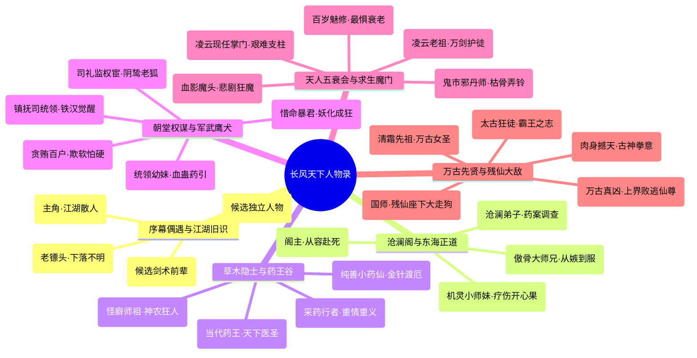

# 《长风浮生录：以武入道》天下群英录 · 全景人物深度档案集

> **关联索引**：[企划总库](README.md) · [女主与群像设定](06-characters-and-heroine.md) · [天下势力矩阵](05-factions-and-sects.md) · [地理大志](world-gazetteer-and-regions.md)

> **剧情资料维护说明**：现行序幕以[序幕 V2](chapters/act-0-prologue-v2.md) 为准。主角不是“灭门遗孤”，凌长空／陆青儿与其师门亲缘线撤回待重写；严守诚在断桥拖延追兵后下落不明。其他未复核的旧人物年龄、血脉宿命和后期结局仍为**候选档案**，不得直接作为玩家已知事实或正式剧情对白。

---

## 编纂导言：有血有肉的人间江湖

本档案集汇聚了《长风浮生录》中活跃于朝堂、宗门、市井、草莽与荒古绝境的 **50 余位关键人物**。每位人物均配备**身世渊源、外貌衣着、性格缺陷与闪光点、独门兵刃武学、经典台词以及专属剧情羁绊**，坚决杜绝符号化的工具人设计。

---

## 第一卷：江湖散人、偶遇镖头与未定旧识

### 1.1 沈长风（字破浪 · 游侠剑客 → 陆地神仙）
* **年龄与生辰**：初登场十九岁，生于江南大雪之夜。
* **外貌风采**：身长七尺二寸，剑眉星目，鼻梁高挺。长发以粗布发带随意束于脑后，碎发常垂于额前。常着一袭洗得发白、下摆微有磨损的青灰游侠短褐，护腕以粗麻紧紧缠绕，腰悬三尺青钢长剑。步履轻盈沉着，双眸清澈如古井，唯有拔剑迎敌时，瞳孔深处会掠过如狂风斩浪般的凌厉神芒。
* **性格深度与习惯**：
  * **克制与谨慎**：长年独行谋生，愿意先看清形势再行动；面对重伤陌生人仍可能出手相助，但不是不畏风险。
  * **嗜茶胜酒**：不喜辛辣烈酒，独好粗瓷大碗的苦茶，自言“茶苦能醒神，剑快需心静”。
  * **剑道执念**：坚信武道是用来“护生”与“求真”的，从不崇拜虚无缥缈的神仙金丹。
* **专属兵刃**：
  * **前期【普通青钢长剑】**：靠护路和送信积攒的钱购得，几次用粗石修整剑锋；不以剑脊铭印作为守卷血统证明。
  * **后期【太虚长风道剑】**：以万古先贤断兵精金熔铸，周身无锋无刃，纯以天地法则剑罡御敌。
* **经典台词**：
  * “师父只教过我几招谋生的剑法，没教我怎么见人要死还装作看不见。”
  * “你们求的长生，是踩着千万人骨血当药引苟活；沈某求的武道，只需手中三尺青锋，替人间斩一个朗朗乾坤！”

### 1.2 凌长空（候选剑术前辈，关系待确认）
* **当前状态**：暂不绑定为沈长风的师父、守卷领袖或预先牺牲的隐盟人物。保留“走方剑客／民间剑师”的人物素材供未来独立支线选用；是否与主角有旧识由后期证据决定。
* **废弃要素**：青州武馆灭门、师尊故意引开追兵、因佩剑暗记而让严守诚认出主角，均不能回填到现行序幕。

### 1.3 陆青儿（候选独立角色）
* **人物保留点**：年轻、擅长轻功与针线，适合用于平江府信件或失踪人口支线。
* **关系未定**：不再默认是武馆小师妹，也不再是沈长风南下的主要动机；如保留她在神都的戏份，需通过独立事件先建立玩家对她的关心。

---

## 第二卷：东海沧澜阁与正道名门群像

### 2.1 顾清霜（第一女主 · 沧澜阁嫡传大弟子）
* **年龄与身世**：二十一岁，沧澜阁嫡传弟子。是否与远古弱水武圣存在血脉联系仍为作者侧候选设定，不是第一幕可知的事实。
* **外貌风采**：容貌绝丽却清冷绝俗。一袭素白暗竹织锦长袍，内衬青蓝软鳞劲装，墨发仅用一根素银簪利落盘起。身形窈窕高挑，眉宇间有一点朱砂冰痣，肌肤胜雪。腰间软剑平时化为银色腰带，迎敌时如灵蛇出岫，剑光若秋水连波。
* **性格软肋与深度**：
  * **外冷内热的坚守**：曾见证母亲在药物误治后去世，故对伪药和被隐瞒的药案格外敏感，也更看重证据与病人的自主选择。
  * **面对情感的矜持**：不善言辞表达，习惯默默做好一切。在与长风风雨同舟中，逐渐被长风温暖坚韧的心性融化冰山。
* **经典台词**：
  * “有人说服下就能救命，便不必再问药是从哪里来的么？”
  * “长风……握紧我的手。弱水所至之处，便是你的退路与铠甲。”

### 2.2 沧溟老真人（沧澜阁当代老阁主）
* **年龄与生平**：一百八十岁，寿数将尽的一代泰斗。鹤发童颜，性格幽默豁达，好与后辈下围棋，输棋爱悔子。
* **风骨境界**：面对国师派人送来的“九转万灵丹”，当场倒进大海喂鱼：“老道活了一百八十岁，看尽人间日出月落，早已活够本了。人道生死如春夏秋冬，强留何益？”从容坐化前将毕生修为散入东海灵泉，为后辈洗髓。

### 2.3 连如玉（沧澜阁大师兄 · 傲骨剑客）
* **身份与性格**：二十四岁，东南世家连家独子，天之骄子。自幼倾慕顾清霜，性格心高气傲，重视门派荣誉胜过性命。
* **角色反转弧光**：起初对毫无门第背景的流民沈长风极尽排斥与敌意；但在鬼市大战中被长风救下后，虽嘴硬不服，却在神都之战中率领师门弟子拼死为长风断后：“姓沈的！我连如玉不是输给你，是输给了清霜师妹的眼光！神都这条命，老子替你扛了！”

### 2.4 阮小汐（沧澜阁机灵小师妹）
* **身份特点**：十六岁，清霜的贴身师妹。圆圆的杏眼，腰挂两个小铃铛，擅长辨识海图与调制跌打药膏。平日里最爱打趣清霜与长风，是沉重江湖氛围中的开心果。

---

## 第三卷：百草药王谷与南岭隐士谱系

### 3.1 岚尘（烟岚谷行者 · 奇门草木向导）
* **年龄与性格**：二十二岁。头戴破斗笠，身着百衲短褐，嘴里永远叼着一根龙须草。玩世不恭、口若悬河，自称“天下第一采药圣手”。
* **内心创伤**：表面嬉皮笑脸，实则亲眼见过整个隐修村落因私藏一株百年灵药被玄天镇抚司屠戮殆尽。对朝廷权贵恨之入骨，对真正的朋友托付生死。
* **独门绝技**：
  * **【烟岚迷踪步】**：可在悬崖峭壁如猿猴腾挪。
  * **【百草毒障囊】**：扔出烟雾弹瞬间致盲全场，打乱敌方 CTB 推动。

### 3.2 苏灵素（百草药王谷当代传人 · 小药仙）
* **外貌与性格**：十七岁。穿一身浅鹅黄绣兰短襦，背着半人高的小竹篓，腕戴药王金铃。心思纯澈若水晶，看见受伤的飞鸟走兽都要悉心包扎。
* **医道真谛**：擅长太素金针渡厄十二法，能肉白骨、活死人。多次在关键时刻以神针封穴，压制顾清霜体内的狂暴血煞。

### 3.3 孙济世（药王谷当代老谷主 · 天下医圣）
* **身份生平**：一百三十岁，天下医修执牛耳者。常年身穿布衣草鞋游历四方义诊。曾冒死潜入神都皇宫检验假长生丹，是天下第一个系统性记录“伪仙血丹噬灵死煞毒性”的先驱。

---

## 第四卷：大乾朝廷、军武巨擘与权谋群像

### 4.1 严烈（玄天镇抚司右统领 · 裂岳铁骨）
* **身份与体貌**：三十岁，边关戍卒出身，凭战功与搏命一路杀至统领高位。身高八尺二寸，膀阔腰圆，面颊一道刀疤贯穿左耳至嘴角。常年身披重达六十斤的黑铁鱼鳞甲，手提精钢裂岳斩马刀。
* **人性内核**：杀伐果断、军令如山，唯一软肋是相依为命的病重幼妹严柔。为换取皇帝赏赐的假延寿丹给妹妹续命，甘愿充当朝廷鹰犬八年。在得知妹妹被国师当作药引血蛊后，信仰彻底崩塌，斩断帅印反出皇朝。

### 4.2 严柔（严烈胞妹 · 纯阴弱质）
* **性格身世**：十四岁，天生纯阴体质，知书达理、蕙质兰心。深知兄长为了救自己背负满身血债与骂名，曾多次暗自绝食试图求死以解脱兄长。

### 4.3 崇明帝（大乾当朝天子 · 暮年药狂）
* **身份性格**：享年七十有八，在位六十年。年轻时平定边患、轻徭薄赋，亦是一代雄主。然而随着年老力衰，对死亡产生极端恐惧，最终彻底被国师精神控制，不惜以全国生灵为代价修筑万灵血池，晚年沦为半人半蛟的嗜血妖物。

### 4.4 冯海公公（司礼监秉笔太监 · 阴鸷权宦）
* **外貌特质**：白面无须，声音尖细微冷，永远弓着身子缩在皇帝龙榻阴影中。精通皇室秘传邪功【葵阴分水刺】，行事狠辣隐秘，专门负责在民间搜捕纯阳童子送入观星台。

### 4.5 铁鹰（玄天镇抚司百户 · 欺软贪婪）
* **身份特点**：严烈手下的贪婪军官。私通地下鬼市，靠截留押送的流民卖给盲骨叟换取黄金与劣质假药，是第一幕剧情的小人型中坚反派。

---

## 第五卷：天人五衰会与江湖求生老怪群像

### 5.1 仇九煞（血影魔头 · 天人五衰会大长老）
* **年龄与状态**：一百九十五岁。距离两百岁大限不足五年，肉身皮肤已如枯木脱皮，眼眶凹陷如恶鬼。身披猩红骷髅袍，浑身时刻散发着尸臭与血煞。
* **悲剧根源**：百年前本是名门正派掌门，因发现师尊暗中吸食童男精血被灭口，逃入魔道，最终在寿命天堑前自己也变成了当年最憎恶的模样。临终前疯癫狂笑：“两百年！凡人为什么只能活两百年！这贼老天不公啊！”

### 5.2 盲骨叟（地下鬼市丹坊主事）
* **外貌打法**：双目在早年试药时被毒瞎，以听风铜铃与嗅觉辨位。骨瘦如柴，指甲黑紫修长，以一根中空的白骨杖喷射毒烟。第一幕关底 Boss。

### 5.3 幻花婆婆（百岁妖姬）
* **性格特点**：实际年龄一百二十岁，依靠秘术维持三十岁艳丽妇人的容貌。最听不得别人提及“老”字，一怒之下动辄剥人面皮制成扇面，战斗风格阴损迅捷。

---

## 第六卷：昆仑凌云剑宗群像

### 6.1 枯木剑圣（凌云剑宗上上代老祖）
* **生平与形象**：一百九十岁，闭关甲子。独臂，着一身单薄麻布道袍，腰悬一柄生锈铁剑。双眸已浑浊如泥塘，但只要握住剑柄，剑气便能冲破万丈云海。
* **悲壮战死**：在昆仑绝顶面对魔门大军与中毒发狂的同辈，孤身立于风雪悬崖，燃尽三年生机出剑，替天下年轻后辈斩碎邪魔包围网，坐化成冰雕仍怒目按剑。

### 6.2 凌霄真人（凌云剑宗现任掌门）
* **性格与困境**：五十岁，面相威严，手握凌云七星大印。在宗门老祖濒死、魔门叩山、朝廷勒索的三重绝境下如履薄冰，展现出名门当家人的沉重与担当。

---

## 第七卷：万古先贤英魂与最终大敌

### 7.1 弱水武圣（顾氏远祖 · 万古女圣战魂）
* **生平神迹**：万年前绝天地通时，第一位杀上天门绝顶的半步天人女圣。手持弱水神剑，以化劲极境硬生生斩碎渊冥残仙右臂，迫使残仙龟缩冰渊万年。

### 7.2 斩天刀圣（太古狂徒战魂）
* **形象特色**：身高九尺，赤裸上身，背负一柄丈二宽刃青铜重刀。狂傲不羁，豪饮万坛烈酒，死前曾一刀在苍穹撕开长达百里的时空裂缝。

### 7.3 陈玄道（大乾国师 · 无极通天观之主）
* **真实面目**：外表看是三十余岁仙风道骨的俊逸青年，身披太极阴阳八卦袍，实则是已活了三百余年的残仙大奴仆。体内仙魂寄生，无肉体七情六欲，唯有一心取悦残仙换取飞升假象。

### 7.4 渊冥残仙（万古幕后真凶 · 上界溃逃仙尊）
* **神魔真相**：上界神战中的败寇，肉身崩碎，仙魂千疮百孔。万年来将整座凡俗下界视作自己苟延残喘的灵血饲养场。
* **战斗威压**：
  * 举手投足引动高维法则，能直接将三维空间压制为二维薄片，视凡界千万人命为草芥微尘。
  * 最终被沈长风以武入道、肉身成圣的一剑彻底斩灭，万古恶梦方休。

