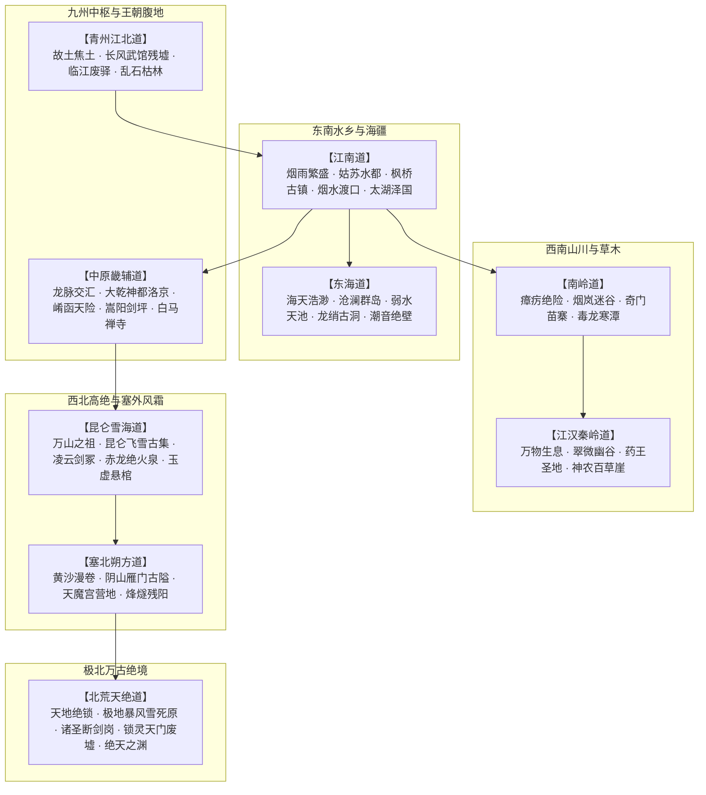

# 《长风浮生录：以武入道》天下九州地理大志 · 场景全景谱系

> **关联索引**：[企划总库](README.md) · [世界地图与副本](04-world-map-and-dungeons.md) · [全景人物录](grand-character-encyclopedia.md)

---

## 宏观大乾九州风貌

本作世界幅员辽阔，不仅有大乾王朝治下的烟雨江南、浩瀚中原与塞上风云，更包含凡俗难渡的绝壁名山、东海烟波与极北万古冰原。每一个大州与地域均具备独特的**人文风土、江湖生态、气候地貌以及战棋空间玩法机制**。

---

## 一、江南道与东海海疆（前中期探索沃土）

> **详细场景尺度、主城拆解与新手村野外规划图详见**：[04 · 世界地图与副本设计](04-world-map-and-dungeons.md)

### 1.1 枫桥古镇与断桥烟水渡（新手起点与序幕衔接）
* **地理风情**：秋雨连绵，枫叶红透。长街由青石板铺就，小桥下乌篷船欸乃而过。镇口为年久失修的汉白玉“断桥”，半截沉于急流中。
* **主要区域点位**：
  * **荒山古庙 · 佛殿残墟**：序幕核心舞台。坍塌的泥塑佛像、被穿堂风吹得明灭的火堆、废弃的镖车残辕，严老镖头受重伤托孤托卷之地。
  * **荒山枯木林**：碎石山径、枯藤老树与悬崖采药点，FREE 身法教学与山贼伏击区。
  * **烟水渡小渔村**：三两间歪斜的茅草窝棚，老船夫石阿公家可借宿避雨，摆渡老张每日在此系缆温酒。
  * **江畔茅檐野酒店【听风肆】**：竹竿撑起发黄草帘酒幌，脚夫客商在此歇脚饮酒解寒，打听城里丢人异讯。
  * **村口草台小集市**：游方行脚郎中摊、杂货老赵货担、倒坐磨刀客条凳，提供新手初阶补给与兵刃磨砺。
  * **断桥烟水渡口**：残桥石阶入水，泊岸乌篷船，老船夫提供直通主城平江府的水路捷径。
  * **芦苇荡荒原古道**：泥泞深草，翻倒镖车，朝廷设卡暗哨，眺望清霜画舫过江。
* **战斗与空间特性**：GRID 15×10 正交战场与 FREE 空间结合。雨夜泥泞地面（消耗双倍移动力）、浅滩流水（水战减速、火系招式威力减半）。

### 1.2 姑苏水都 · 平江府（第一幕主城 · 繁华下的脓疮）
* **地理风情**：大乾东南第一大都会。十里珠帘，粉墙黛瓦，画舫夜夜笙歌。城内水道纵横，陆市与水市交错。
* **核心功能区与探索箱庭**：
  * **平江四街十字路口**：四向通路交汇，汉白玉石牌坊、百晓生说书茶棚、官府悬赏飞签告示牌。
  * **临河水市主大街**：临河白石护栏石埠、乌篷游船，串联武器铺、药房与生活街巷。
  * **平江府衙正街**：威严门楼、鸣冤大鼓、玄天镇抚司暗探哨房，气氛肃杀。
  * **沧澜驻外演武场**：汉白玉比武擂台、练功木人桩、兵刃架，传授进阶招式身法。
  * **主角旧宅（沈家老屋）**：斑驳青砖瓦房、枯柳木桩、供奉师尊残鞘的供案，安全存档与调息点。
  * **苏氏大贾别院**：江南园林门楼、大通钱庄分号、运药镖车，接取商队奇遇。
  * **望江醉仙楼**：临水三层画梁酒楼、太白遗风酒旗，打听地下鬼市与朝廷内幕。
  * **平江瓮城正南门**：重砖城楼、护城河吊桥、水师守城兵丁，通往城外野原。
  * **四大专精独立店铺**：淬锋堂（兵刃铁铺）、百草堂（丹药医馆）、织云绣坊（成衣绸缎）、万象通宝当（杂货当铺）。
  * **城西水道 · 地下鬼市入口**：白天为臭气熏天的干涸泄洪渠，子时三刻水闸开启，露出通往地宫的青石暗道。

### 1.3 地下鬼市 · 活人血炉（第一幕主线大副本）
* **场景氛围**：昔日前朝防洪古水道改建的地下黑城。两侧悬挂幽绿与猩红的纸灯笼，骨董摊、凶刃坊、禁药贩子密布。空气中弥漫着刺鼻的硫磺与浓烈甜腥味。
* **深处核心【太极血火铜窟】**：
  * 高达五丈的青铜炼药巨鼎悬挂在沸腾的血池之上，四周是由铁锁吊挂的囚笼，关押着数百名失踪的年轻武者。
  * **空间交互机制**：地面布满滚烫的蒸汽排气孔（每回合随机喷发造成火伤）、血煞铜阀（玩家靠近可旋转关闭，降低全场毒雾浓度）。

### 1.4 东海沧澜群岛（世外名门仙境）
* **地理风情**：距大陆三十里的大海深处。岛上怪石嶙峋，古松苍劲，白浪拍天。宗门依万丈断崖而建，长桥飞跨海天之间。
* **核心奇景**：
  * **观潮飞阁**：沧澜阁演武大殿，地板全由透明的水晶琉璃铺就，脚下即是万丈惊涛，弟子在此感悟潮汐化劲。
  * **龙绡古洞（支线【弱水长清】秘境）**：深藏于海平面下的万年海蚀溶洞。洞内生满发光的幽蓝珊瑚，深处冰封着上古弱水先贤留下的本源遗刻。
* **空间战术机制**：FREE 连续空间。悬崖海风判定（高风速推移角色）、湿滑苔藓地面。

---

## 二、南岭与江汉秦岭道（草木险境与世外医脉）

### 2.1 南岭烟岚迷谷（奇门自然副本）
* **地理风情**：十万大山深处的无人裂谷。常年被五色毒瘴笼罩，阳光难以透射。谷内怪木横生，巨型发光真菌与奇花异草遍布。
* **核心点位**：
  * **岚尘隐居草堂**：依一株千年古楠树根而筑的树屋，晒满各式草药锦囊与捕捉灵蝶的竹篓。
  * **绝生七煞崖**：悬崖垂直落差百丈，生长着解开血丹剧毒所需的“青龙金线草”，周围盘踞着凶悍异兽。
* **关卡机制（FREE 空间）**：
  * **【迷障毒雾】**：角色置身其中每回合叠加 1 层微毒；观势（Insight）视野强制缩减为身前 3 米；必须依靠岚尘点燃雄黄香驱散。

### 2.2 秦岭翠微峰 · 药王仙谷（天下医者圣地）
* **地理风情**：秦岭绝壁环抱中的一片世外桃源。温泉潺潺，草木长青，药香扑鼻。谷中无兵刃之声，唯有捣药杵与石磨的轻响。
* **关键建筑**：
  * **神农百草回春殿**：药王孙济世与苏灵素诊治天下疑难杂症的正殿，殿内立有一尊刻满周身穴位经络的纯铜针灸人像。
  * **地火灵泉药圃**：天然地热温泉灌溉的药田，栽种着百年绛雪灵芝的幼苗。
  * **洗髓古池**：玩家消耗稀有草药可在此为全队洗髓，提升基础四维属性上限。

---

## 三、中原与大乾京畿道（权力风暴与帝国心脏）

### 3.1 崤函古道与断壁险关
* **地理风情**：黄土高坡之间刀削斧凿般的峡谷古道，两侧危崖高耸蔽日。大乾扼守西京的咽喉重地，关楼巍峨，旌旗如云。
* **关卡机制**：狭长走廊地形（GRID 15×10），极度考验前后排阵型，敌方重盾兵堵截正面，高台弓弩手封锁走道。

### 3.2 大乾神都 · 洛京（第三幕权力中枢大都会）
* **城市规模**：全城由外城商业坊、内城权贵坊以及禁宫皇城三重构成，城垣高达十五丈，引洛水为护城河。
* **深度功能区**：
  * **朱雀天街**：宽达五十丈的帝国大道，两侧楼宇林立，商贾云集。
  * **长生坊与安康病坊**：朝廷官办的“慈善医坊”，实则是将全城无依无靠的老人与流民集中看押、秘密运往地下充当药引的屠宰场。
  * **玄天镇抚司诏狱**：黑铁浇筑的地底堡垒，布满机关铁笼与审讯血刑具。
  * **皇极殿与太清观星通天楼**：高耸入云达百丈的青铜高塔，塔尖直插云霄，即为国师陈玄道布置“万灵归源大阵”的核心枢纽。

---

## 四、西岳昆仑雪海道（剑宗圣地与名宿绝唱）

### 4.1 昆仑飞雪古集（雪线前哨边塞）
* **地理风情**：海拔万仞之上的冰原石城。常年风雪肆虐，房舍皆由巨型原木与花岗岩筑成，厚帘遮风。
* **江湖生态**：正派名宿、魔门探子、塞外蛮族在此犬牙交错。酒肆里大碗烈酒、大块烤肉，是进入雪峰探寻灵果的最后物资补给站。

### 4.2 凌云剑宗 · 万剑冢天坪（第二幕高潮战场）
* **地理风情**：坐落在凌云峰极顶的天然巨型石坪，三面皆是万丈冰崖。石坪上插着千百年来历代凌云剑客战死或坐化前留下的残剑古刃，剑意凛冽。
* **环境机制**：
  * **【寒霜冻裂】**：全场角色真气消耗增加 20%，除非饮用烈酒或携带避寒玉佩。
  * **【高山风暴】**：周期性吹袭强风，顺风方向招式攻击距离 +2，逆风方向移动力 -1。

### 4.3 赤龙火渊灵泉（甲子赤龙果生长地）
* **地理风情**：昆仑极顶玄冰层之下的一处火山熔岩裂谷。外层千年冰封，内层地火奔涌，形成冰火同炉的天地奇观。百年难得一遇的“甲子赤龙果”即悬空生长于熔岩灵泉中央的石髓之上。

---

## 五、极北北荒天绝道（世界终局禁区）

### 5.1 朔风万里死原
* **地理风情**：越过雁门关向北三千里，草木尽绝，生机断绝。只有深达数千丈的万古蓝冰与无休止的时空撕裂风暴。凡人入内片刻即化为冰雕。

### 5.2 万古天门古墟 · 诸圣断剑岗（第四幕悲壮舞台）
* **地理风情**：万年前绝天地通浩劫的核心战场遗址。九根断裂的通天神玉柱斜插在冰原之中，方圆十里散落着太古修士崩碎的甲胄与巨大法宝残骸。
* **震撼奇景**：历代叩击天门的半步天人先贤，肉身被极寒永冻于冰层之下，神态或持刀怒目、或抱剑傲立，栩栩如生，战意万年不散。

### 5.3 绝天之渊 · 锁灵天门中枢（终章决战大殿）
* **场景氛围**：下界天地的最北极点，苍穹被撕裂出一个旋转不息的黑色虚空星洞。大阵中枢是由无数上古仙界锁链与阵石锁死的悬浮祭台。残仙盘踞于星洞黑雾深处，高维法则在此扭曲现实，凡俗物理重力与空间方向尽皆错乱。

